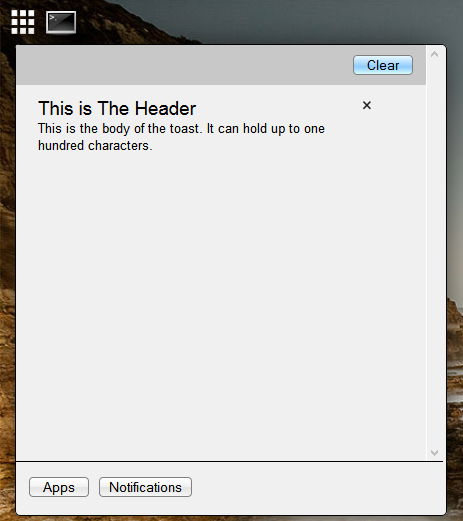

## Notification Tray

The Notification Tray is an area of the app menu that stores all of the [notifications](notification.md) that have been sent in the current section.  You can delete notifications individually, or you can clear all of them at once.

The Notification Tray looks like this:

---

_Source: [Notification Tray](https://sourceforge.net/p/skylightos/wiki/Notification%20Tray/) on the SourceForge wiki · Labels: notification · Last modified 2014-01-21_
