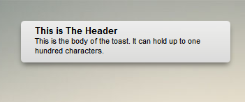

## Notification

A notification is a small bit of information that is passed to the user through a popout box called a toast, and in the [Notification Tray](Notification-Tray.md).  Notifications are unlimited as to their size, but a toast can hold a maximum of thirty header characters and one hundred body characters.  Any more than this will be truncated.  Notifications are simply pieces of text; they cannot be accepted and run scripts.

A toast slides out from the top right hand corner of the screen, and looks like this:

A notification is sent from an app with [App.postNotification()](App.postNotification.md).

---

_Source: [notification](https://sourceforge.net/p/skylightos/wiki/notification/) on the SourceForge wiki · Labels: UI, notification · Last modified 2014-01-21_
