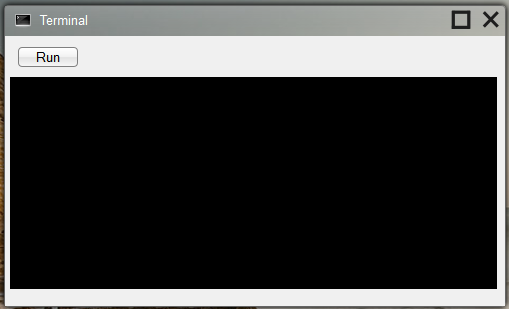

## Window

A window is the main interface an app has with the user.  The app's ui is stored in a window.  A window's attributes are stored an the app's [appData.json](appData.json.md) file.  This is a screenshot of the Terminal app:

---

_Source: [window](https://sourceforge.net/p/skylightos/wiki/window/) on the SourceForge wiki · Labels: window, UI · Last modified 2014-01-21_
