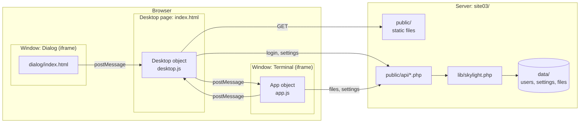
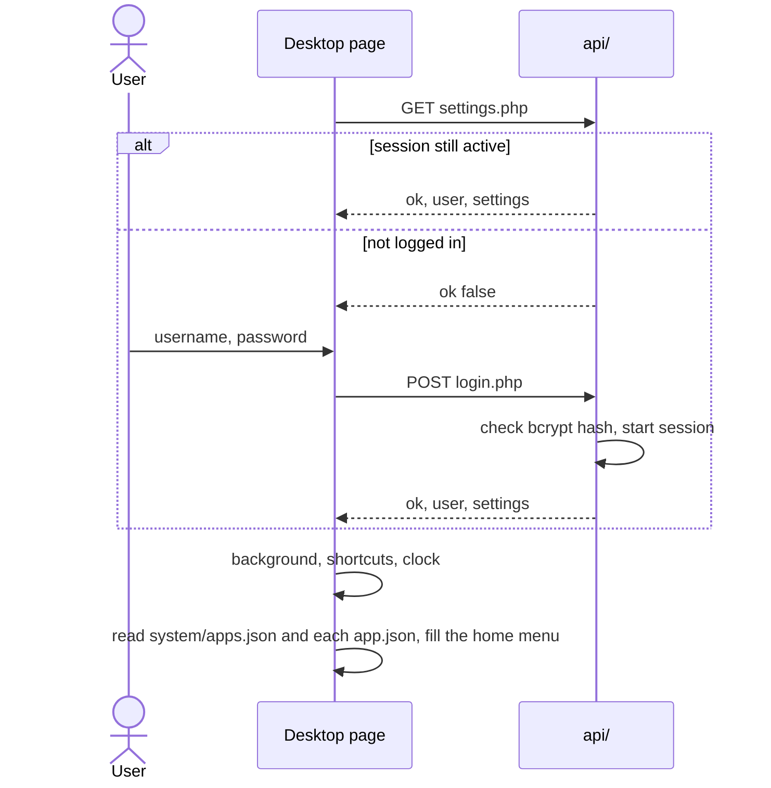
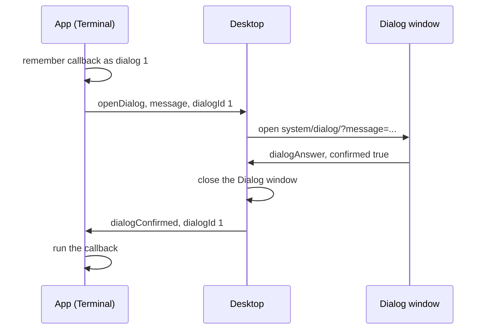

# Architecture

## Overview



| Layer | Files | Job |
| --- | --- | --- |
| Shared browser code | [`system/js/core.js`](../site03/public/system/js/core.js) | The `Skylight` object: HTTP and API calls, query strings, XML. Loaded by every page. |
| Desktop | [`index.html`](../site03/public/index.html), [`system/js/desktop.js`](../site03/public/system/js/desktop.js), [`system/css/desktop.css`](../site03/public/system/css/desktop.css) | The `Desktop` object: login, windows, taskbar, menu, notifications, dialogs, shortcuts. See [Desktop internals](desktop-internals.md). |
| Apps | [`system/js/app.js`](../site03/public/system/js/app.js), [`apps/`](../site03/public/apps/) | The [`App` object](app-api.md), and the built-in apps. |
| Controls | [`system/css/ui.css`](../site03/public/system/css/ui.css) | Buttons, text boxes, button bars. See [UI components](ui-components.md). |
| Server | [`public/api/`](../site03/public/api/), [`lib/skylight.php`](../site03/lib/skylight.php) | Login, settings and user files. See [Server API](server-api.md). |
| Data | [`data/`](../site03/data/) | JSON files. See [Configuration and data](configuration.md). |

All browser code is ES5 (checked with an ES5-only parser) and all PHP avoids features newer than 5.3. There is no build step: each file is served as it is.

## Folder layout

```
site03/
├── public/                  web root
│   ├── index.html           the desktop page (markup only)
│   ├── api/                 login.php, logout.php, settings.php, files.php
│   ├── apps/                one folder per app: app.json, index.html, icons/
│   │   ├── terminal/
│   │   ├── settings/
│   │   └── web-browser/
│   └── system/
│       ├── apps.json        apps in the home menu
│       ├── js/              core.js, desktop.js, app.js
│       ├── css/             desktop.css, ui.css
│       ├── dialog/          the Dialog window (itself a small app)
│       └── images/          home and power buttons, window buttons, backgrounds/
├── lib/skylight.php         shared PHP; outside the web root
├── data/                    users.json and users/<name>/; outside the web root
└── tools/add-user.php       command-line user management
```

Everything outside `public/` is out of reach of the web server, so passwords and user data can't be downloaded.

## Starting up



The login lives in a PHP session cookie (`skylight`, `HttpOnly`). The browser never stores the username or password itself.

## Windows

`Desktop.openWindow(path, args)` reads `path + 'app.json'`, picks a random **AppID**, builds the window (title bar plus `<iframe>`), adds a taskbar button and loads:

```
<site root>/<path>?app-id=<AppID>&username=<user>[&<args>]
```

Paths are relative to the site root and end in `/`, for example `apps/terminal/`. Icon paths in `app.json` are relative to the app's folder.

## Messages between apps and the desktop

Apps can't touch the desktop page directly, so the `App` object sends JSON messages with `postMessage`. The desktop only accepts a message when:

1. it comes from the site's own origin (`event.origin`), **and**
2. it comes from one of the desktop's own window iframes (`event.source`).

A web page shown inside the Web Browser app fails both tests, so it can't control the desktop. Because the desktop knows which window sent each message, an app can close itself without passing its AppID.

| Message (`eventType`) | Fields | Sent by | Desktop action |
| --- | --- | --- | --- |
| `openWindow` | `path` | `App.openWindow` | Open a window |
| `closeWindow` | `appID` (optional) | `App.closeWindow` | Close that window, or the sender |
| `openDialog` | `message`, `dialogId` | `App.openDialog` | Open the Dialog window |
| `dialogAnswer` | `confirmed` | Dialog window | Close the dialog; tell the app if OK was clicked |
| `postNotification` | `header`, `body` | `App.postNotification` | Add a notification and toast |
| `saveSettings` | `changes` | `App.saveSettings`, `App.setBackground` | Save through `api/settings.php`, then apply |
| `addShortcut` | `path` | `App.addShortcut` | Add a desktop shortcut and save it |

The desktop sends one message back to apps: `dialogConfirmed` (`dialogId`), which makes `app.js` run the callback given to `App.openDialog`.

### Dialogs



No code is passed around as text, and the message is shown with `textContent`, so it can't contain HTML.

## Server calls

The browser calls `public/api/<name>.php` through `Skylight.get` and `Skylight.post`, which encode every value, send the header `X-Requested-With: Skylight`, and always return an object with an `ok` field. Requests are synchronous, as in the original. See [Server API](server-api.md).
