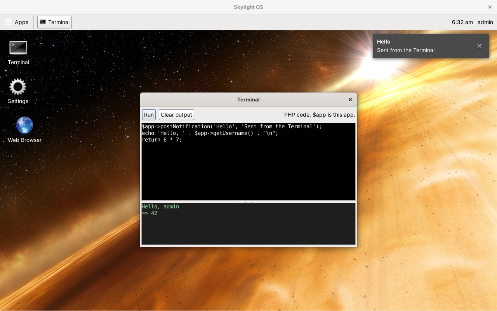

# Skylight OS for PHP-GTK2

This is Skylight OS rebuilt as a desktop program written entirely in PHP, using **PHP-GTK2**, the PHP bindings for **GTK+ 2**, the toolkit GNOME 2 was built on. The code is in [`../site04phpgtk`](../site04phpgtk).

There is no browser, web server, HTML, CSS or JavaScript. One PHP process draws the desktop, and every app is a PHP class with its own real window. It keeps the design of the browser version ([`../site03`](../site03), documented in [`../wiki03`](../wiki03/README.md)): login, a desktop with a background and shortcuts, a home menu, notifications, and the same App API names.

## Contents

**Using Skylight OS**

* [Getting started](getting-started.md): set up on Windows, add a user, run it
* [User guide](user-guide.md): the desktop, windows, notifications and the built-in apps

**Building apps**

* [Building your first app](building-apps.md): a step-by-step tutorial
* [App manifest](app-manifest.md): the `app.json` file
* [App API](app-api.md): the `App` base class
* [PHP-GTK2 primer](gtk-primer.md): GTK widgets, signals and styles, for people who know the web version

**How it works**

* [Architecture](architecture.md): one process, three classes, real windows
* [Desktop internals](desktop-internals.md): the `Desktop` class, and how to extend it
* [Data and configuration](data-and-configuration.md): `apps.json`, users, settings, files and styles

**Background**

* [Compared with the browser version](comparison.md)
* [Security](security.md)
* [Limitations](limitations.md)

## At a glance

| | |
| --- | --- |
| Language | PHP only, written for PHP 5.2 (no closures, namespaces or `__DIR__`) |
| Toolkit | PHP-GTK2 (GTK+ 2) |
| Runs on | Windows with a PHP-GTK2 runtime; also Linux |
| Data | JSON files in `data/` |
| Size | About 1,150 non-blank lines of PHP in 8 files |
| Tested | On Linux with PHP 5.6.40 and PHP-GTK2 built from source (see [Limitations](limitations.md#how-it-was-tested)) |
