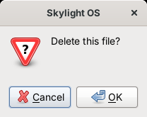

# App API

An app is a class that extends `App` ([`lib/App.php`](../site04phpgtk/lib/App.php)):

```php
<?php
class HelloApp extends App
{
	function build()
	{
		$button = new GtkButton('Say hello');
		$button->connect_simple('clicked', array($this, 'sayHello'));
		$this->window->add($button);
	}

	function sayHello()
	{
		$this->postNotification('Hello', 'Hello, ' . $this->getUsername());
	}
}
```

The method names match the browser version's `App` object (see [Compared with the browser version](comparison.md)).

## Lifecycle

| Method | When | What to do |
| --- | --- | --- |
| `build()` | Once, after the window is created and before it is shown | Add your widgets to `$this->window` |
| `canClose()` | When the user closes the window | Return `true` to allow it, `false` to keep the window open (for example, to ask about unsaved work first) |

Don't override the constructor; use `build()`.

## Properties

| Property | Holds |
| --- | --- |
| `$this->window` | Your `GtkWindow`. Add one widget (usually a box) to it in `build()`. |
| `$this->appID` | This window's ID |
| `$this->path` | Your folder, e.g. `apps/notes/` |
| `$this->manifest` | Your `app.json`, as an array |
| `$this->args` | The array passed as the second argument to `openWindow()`, or an empty array |
| `$this->desktop` | The `Desktop` object. Prefer the methods below. |

## Summary

| Method | Returns |
| --- | --- |
| [`openWindow($path, $args = array())`](#openwindow) | AppID, or `null` |
| [`closeWindow($appID = null)`](#closewindow) | nothing |
| [`openDialog($message, $onOK = null)`](#opendialog) | the `GtkMessageDialog` |
| [`postNotification($header, $body = '')`](#postnotification) | nothing |
| [`getSettings()`](#getsettings) | array |
| [`saveSettings($changes)`](#savesettings) | `true` or `false` |
| [`setBackground($path)`](#setbackground) | `true` or `false` |
| [`addShortcut($path)`](#addshortcut) | nothing |
| [`getAppID()`](#getappid) | string |
| [`getUsername()`](#getusername) | string |
| [`appFile($name)`](#appfile) | full path |
| [`listFiles()`](#listfiles) | array of names |
| [`readFile($name)`](#readfile) | string, or `null` |
| [`writeFile($name, $contents)`](#writefile) | `array('ok' => ..., 'error' => ...)` |

## Windows

### openWindow

```php
$this->openWindow('apps/settings/');
$this->openWindow('apps/notes/', array('file' => 'todo.txt'));   // the app reads $this->args['file']
```

Opens an app in a new window and returns its AppID. If the folder isn't an app, the user gets a notification and `null` is returned.

### closeWindow

```php
$this->closeWindow();         // this window
$this->closeWindow($appID);   // another window
```

Closes without asking: `canClose()` isn't called.

## Dialogs and notifications

### openDialog

```php
$this->openDialog('Delete this note?', array($this, 'deleteNote'));
$this->openDialog('The file was saved.');
```

With a callback: a question with **OK** and **Cancel**, and the callback runs only if the user clicks OK. Without one: an information message with **OK**. The dialog belongs to your window and doesn't block the rest of Skylight. Callbacks are ordinary PHP callbacks; PHP 5.2 has no anonymous functions, so name a method: `array($this, 'methodName')`.



### postNotification

```php
$this->postNotification('Download complete', 'report.pdf was saved.');
```

Shows a toast and adds the notification to the home menu. `$body` is optional. Text is shown as typed, never as markup.

## Settings and the desktop

### getSettings

```php
$settings = $this->getSettings();
// array('background' => 'images/backgrounds/3.jpg', 'notificationTime' => 7000, 'shortcuts' => array(...))
```

### saveSettings

```php
$this->saveSettings(array('notificationTime' => 3000));
```

Checks, saves and applies settings at once. Returns `true`, or `false` after telling the user what was wrong. See [Data and configuration](data-and-configuration.md#settings) for the rules.

### setBackground

```php
$this->setBackground('images/backgrounds/2.jpg');
```

Shorthand for `saveSettings(array('background' => $path))`.

### addShortcut

```php
$this->addShortcut('apps/notes/');
```

Puts a shortcut on the desktop (saved with the user's settings). Adding one that exists does nothing.

## Identity

### getAppID

Returns this window's AppID.

### getUsername

Returns the logged-in user's name.

## Files

### appFile

```php
$image = GtkImage::new_from_file($this->appFile('images/logo.png'));
```

The full path of a file in your app's folder, for loading your own images or data.

### listFiles

```php
$names = $this->listFiles();   // array('notes.txt', 'todo.txt')
```

The user's private files, in `data/users/<name>/files/`.

### readFile

```php
$text = $this->readFile('notes.txt');   // null if there's no such file
```

### writeFile

```php
$result = $this->writeFile('notes.txt', $text);
if (!$result['ok']) {
	$this->openDialog('Could not save: ' . $result['error']);
}
```

Names may use letters, digits, spaces, `-`, `_` and `.` (up to 100 characters, not starting with `.`), so they can't point outside the user's folder. Any text can be saved as it is.
