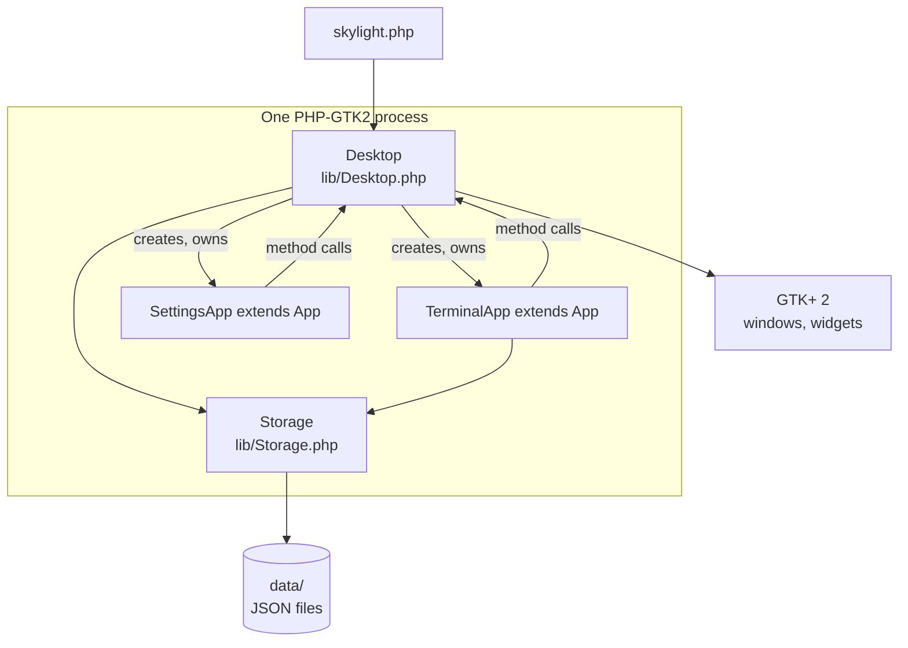

# Architecture

## One process

The browser version needed a browser, a web server and PHP, with the desktop and apps talking through messages and HTTP. Here everything runs in a single PHP process:

| Part | File | Job |
| --- | --- | --- |
| Entry point | [`skylight.php`](../site04phpgtk/skylight.php) | Checks for PHP-GTK2, sets UTF-8 and the time zone, loads the classes, starts the desktop and GTK's main loop |
| `Desktop` | [`lib/Desktop.php`](../site04phpgtk/lib/Desktop.php) | Login, panel, background, shortcuts, home menu, notifications, dialogs, app windows. See [Desktop internals](desktop-internals.md). |
| `App` | [`lib/App.php`](../site04phpgtk/lib/App.php) | Base class for apps; the [App API](app-api.md) |
| `Storage` | [`lib/Storage.php`](../site04phpgtk/lib/Storage.php) | Users, passwords, settings and files in `data/`. Static methods only. |
| Apps | [`apps/`](../site04phpgtk/apps/) | One folder per app: `app.json`, `app.php` (a class extending `App`) and icons |

## How it runs

1. `skylight.php` creates a `Desktop` and calls `start()`, which applies `skylight.gtkrc` and shows the login window.
2. After a successful login, `showDesktop()` builds the desktop window and the home menu, and starts a one-second clock timer.
3. `skylight.php` calls `Gtk::main()`. From here on, everything happens in response to **signals**: GTK calls a PHP method when the user clicks a button, a timer fires or a window is closed.
4. Logging out destroys the desktop and shows the login window again. **Quit** ends `Gtk::main()` and the program exits.

## Apps are classes

Opening an app (`Desktop::openWindow('apps/terminal/')`):

1. reads `apps/terminal/app.json` (see [App manifest](app-manifest.md));
2. loads `apps/terminal/app.php` with `require_once`;
3. creates a `GtkWindow` with the app's title, icon and size, kept in front of the desktop (`set_transient_for`);
4. creates the app object, `new TerminalApp($desktop, $appID, $path, $manifest, $window, $args)`;
5. adds a button to the window list;
6. calls the app's `build()`, which fills the window with widgets, then shows it.

Each window has an **AppID**: a number, as a string, counting up from 1.

Apps call the desktop directly, through the methods `App` inherits (`$this->postNotification(...)`, `$this->openDialog(...)`). There are no messages, no JSON between desktop and apps, and callbacks are ordinary PHP callbacks such as `array($this, 'save')`.

## Real windows

In the browser version, Skylight drew its own windows inside the page and had to handle dragging, maximizing, stacking and minimizing itself. Here every app window is a real top-level window, so the operating system's window manager does all of that, including resizing, which the browser version never had. The desktop only keeps the window list in step.

## Data

There is no server. `Storage` reads and writes JSON files in `data/` directly (see [Data and configuration](data-and-configuration.md)): `users.json` for accounts, and a folder per user for settings and files.
