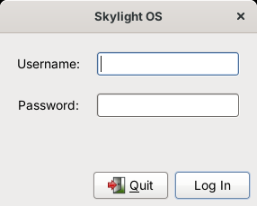

# Getting started

## Requirements

* **PHP 5.2 or later with the PHP-GTK2 extension**, for example the PHP-GTK 2.0.1 Windows package (PHP, `php_gtk2.dll` and the GTK+ 2 runtime in one folder). 32-bit is fine.
* PHP's standard **`json`** and **`hash`** functions, which are built into PHP 5.2 and later.

## Install

1. Copy the `site04phpgtk` folder anywhere, for example `C:\Skylight`.
2. Make sure your PHP-GTK2 `php.ini` loads the extension (`extension=php_gtk2.dll`). Skylight sets the other settings it needs itself (UTF-8 text and the time zone).
3. Create a user from a command prompt in the Skylight folder:

   ```
   php tools\add-user.php admin choose-a-password
   ```

   Run it again to change a password. Usernames may use letters, digits, `-` and `_`.

## Run

Double-click **`run.bat`**, or from a command prompt:

```
php-win skylight.php
```

`php-win.exe` runs without a console window. If `php-win.exe` isn't on your `PATH`, edit `run.bat` or set the `PHP` variable to its full path:

```
set PHP=C:\php-gtk2\php-win.exe
run.bat
```

While you're developing, use `php skylight.php` instead, so PHP's error messages appear in the console.

## Log in



Enter your username and password and press Enter. **Quit** closes Skylight OS.

## The look

GTK+ 2 on Windows draws with whatever theme its runtime is set up to use, often one that imitates Windows. For the classic GNOME 2 look, choose the **Clearlooks** theme: uncomment the `gtk-theme-name` line in `skylight.gtkrc`, if your runtime includes Clearlooks. The screenshots in this documentation use Clearlooks, under GNOME's own window manager on Linux, so on Windows the title bars will look like Windows' own.

## Next steps

* Take the [user guide](user-guide.md) tour.
* Open the **Terminal** and run `$app->postNotification('Hello', 'It works');`.
* [Build your first app](building-apps.md).
