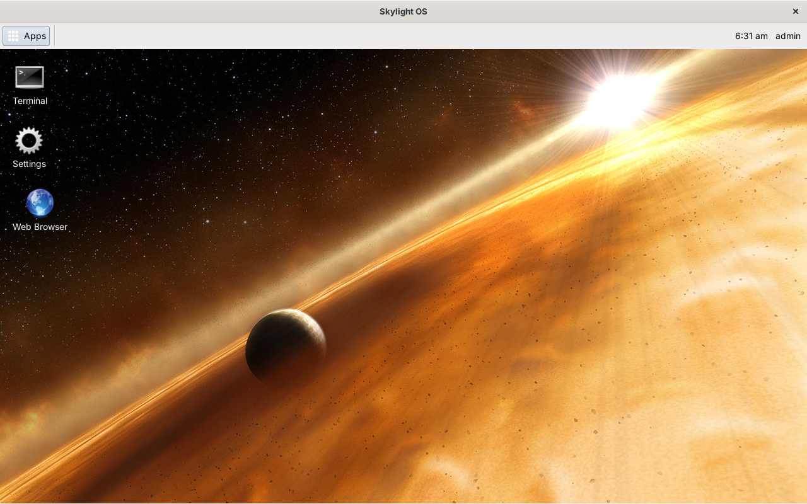
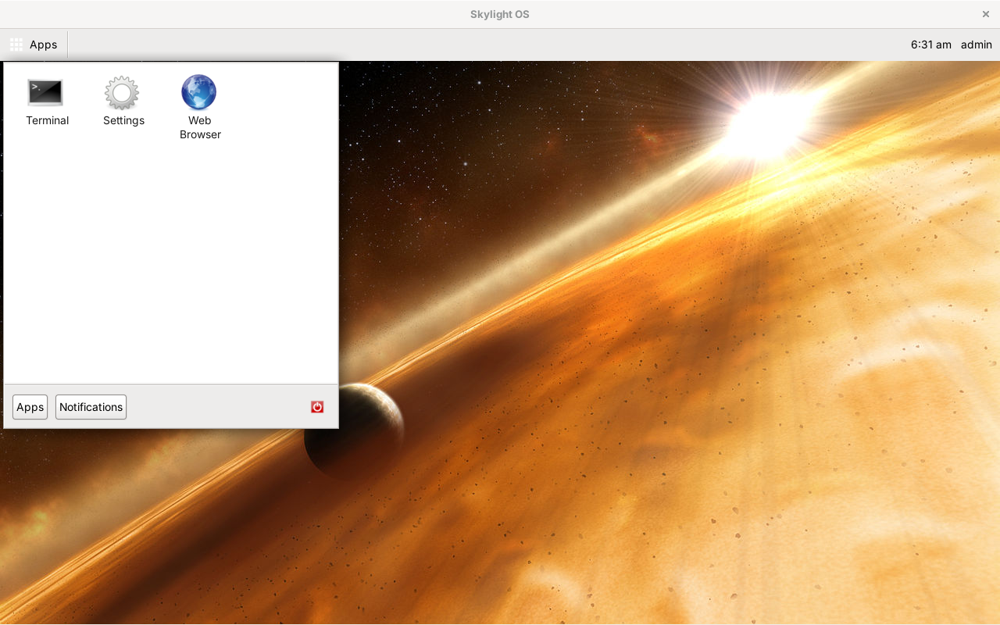
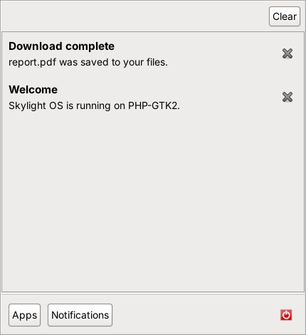
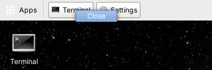
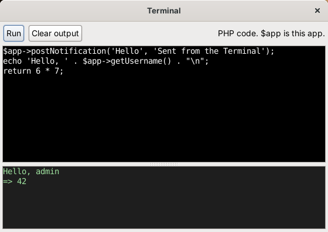
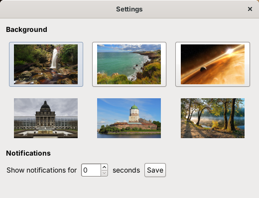
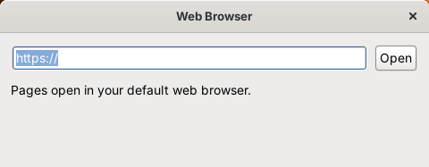

# User guide

## The desktop



The desktop is one large window, maximized when you log in.

| | |
| --- | --- |
| **Apps** (top left) | Opens the home menu |
| **Window list** (next to Apps) | A button for each open app window |
| **Clock** (top right) | The time and your username |
| **Shortcuts** | App icons on the desktop. Double-click to open, drag to move, right-click to remove. They are saved with your settings. |
| **Notifications** (top right, below the panel) | Pop-up messages ("toasts") from apps |

### Home menu



* **Apps**: click an icon to open the app.
* **Notifications**: everything you've been notified about since you logged in, newest first. Click the close icon to remove one, or **Clear** to remove all.

  

* **Power button** (red): log out and return to the login window.

The menu closes when you click elsewhere.

## Windows

Every app opens in its own real window, so moving, resizing, maximizing and minimizing all work as they do for any other program.

* Click an app's button in the **window list** to hide its window; click again to bring it back.
* Right-click a window-list button for **Close**.

  

* App windows stay in front of the desktop.

## Notifications

A notification appears as a toast at the top right for a few seconds (choose how long in Settings), and stays in the home menu's Notifications tab until you remove it or log out. Click a toast's close icon to dismiss it early.

## Built-in apps

### Terminal



Runs **PHP** code. Type in the top box and click **Run**; what the code prints, returns, warns or throws appears in the bottom box. The variable `$app` is the Terminal app itself, so the whole [App API](app-api.md) is available:

```php
$app->postNotification('Hello', 'From the Terminal');
$app->openWindow('apps/settings/');
$app->addShortcut('apps/web-browser/');
return $app->listFiles();
```

> **Careful:** a PHP *fatal* error, such as calling a function that doesn't exist, stops the whole of Skylight OS, as it would any PHP program. Warnings and exceptions are caught and shown in the output.

### Settings



* **Background**: click a picture. The desktop changes at once and remembers it.
* **Notifications**: how many seconds toasts stay on screen (1 to 60). Click **Save**.

### Web Browser



PHP-GTK2 has no widget that can display web pages, so this app opens addresses in your default web browser. Type an address and press Enter or click **Open**; `http://` is added if you leave it out.
