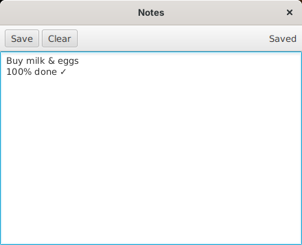

# Building your first app

This tutorial builds **Notes**, an app that keeps one note per user, as a separate app with its own `app.jar`, the way any app that isn't built into Skylight is packaged. It covers the parts of the [App API](app-api.md) most apps need: building a window, reading and saving the user's files, notifications, a confirmation dialog, and stopping the window closing while there are unsaved changes. Every step was tested on Java 8 and JavaFX 8.



You need Skylight OS built and running; see [Getting started](getting-started.md).

## 1. Create the folder

```
site05jfx/apps/notes/
├── app.properties
├── src/notes/NotesApp.java
└── icons/16.png, 32.png, 48.png, 64.png
```

For the icons, copy the four PNGs from `apps/settings/icons/` for now.

## 2. Describe the app

`app.properties` (see [App manifest](app-manifest.md)):

```properties
title=Notes
class=notes.NotesApp
width=440
height=320
icon.16=icons/16.png
icon.32=icons/32.png
icon.48=icons/48.png
icon.64=icons/64.png
```

## 3. Write the class

`src/notes/NotesApp.java`:

```java
package notes;

import javafx.scene.Parent;
import javafx.scene.control.Button;
import javafx.scene.control.Label;
import javafx.scene.control.TextArea;
import javafx.scene.control.ToolBar;
import javafx.scene.layout.BorderPane;
import javafx.scene.layout.HBox;
import javafx.scene.layout.Priority;
import javafx.scene.layout.Region;
import skylight.App;

/** Notes: one note per user, saved in their private files. */
public class NotesApp extends App {

	private final TextArea note = new TextArea();
	private final Label status = new Label();
	private boolean changed = false;

	// 1. Build the window: a toolbar above a text area.
	@Override
	protected Parent build() {
		Button save = new Button("Save");
		save.setOnAction(e -> save());
		Button clear = new Button("Clear");
		clear.setOnAction(e -> askToClear());
		Region spacer = new Region();
		HBox.setHgrow(spacer, Priority.ALWAYS);
		status.setText("Hello, " + getUsername());

		// 2. Load the saved note. readFile() returns null if there isn't one yet.
		String text = readFile("notes.txt");
		note.setText(text == null ? "" : text);
		note.setWrapText(true);
		note.textProperty().addListener((property, oldText, newText) -> changed = true);

		BorderPane root = new BorderPane(note);
		root.setTop(new ToolBar(save, clear, spacer, status));
		return root;
	}

	// 3. Save. writeFile() reports success, or an error to show the user.
	private void save() {
		Result result = writeFile("notes.txt", note.getText());
		if (result.ok) {
			changed = false;
			status.setText("Saved");
			postNotification("Notes", "Your note was saved.");
		} else {
			openDialog("Could not save: " + result.error);
		}
	}

	// 4. Ask before throwing work away. The lambda runs only if the user clicks OK.
	private void askToClear() {
		openDialog("Clear the note? This can't be undone.", () -> {
			note.clear();
			status.setText("Cleared (not saved yet)");
		});
	}

	// 5. Don't lose unsaved work when the window is closed.
	@Override
	protected boolean canClose() {
		if (!changed) {
			return true;
		}
		openDialog("Close without saving your changes?", () -> {
			changed = false;
			closeWindow();
		});
		return false;
	}
}
```

How it works:

1. **`build()`** returns the window's contents: a `BorderPane` with a `ToolBar` on top and a `TextArea` filling the rest.
2. **Events** use lambdas: `save.setOnAction(e -> save())`. The listener on `note.textProperty()` notices every edit.
3. **Files:** `readFile` and `writeFile` use the user's private storage, so each user has their own `notes.txt`.
4. **Dialogs:** the lambda given to `openDialog` runs only if the user clicks OK.
5. **`canClose()`** keeps the window open while there are unsaved changes, and closes it with `closeWindow()` if the user agrees.

## 4. Compile it into app.jar

From `apps/notes/`:

```
mkdir classes
javac -encoding UTF-8 -cp ../../skylight.jar -d classes src/notes/NotesApp.java
jar cf app.jar -C classes .
```

`-cp ../../skylight.jar` lets the compiler see `skylight.App`. Skylight loads `app.jar` when the app opens; you can delete `classes/` afterwards. After changing the code, rebuild `app.jar` and restart Skylight.

## 5. Run it

Open the **Terminal** and run:

```javascript
app.openWindow('apps/notes/');
```

Type something, click **Save**, close the window and open it again: the note is still there. Change it and close the window without saving: you'll be asked first.

## 6. Add it to the home menu

Add the folder to `apps/apps.txt`:

```
apps/terminal/
apps/settings/
apps/web-browser/
apps/notes/
```

Log out and in again: Notes appears in the home menu. `app.addShortcut('apps/notes/')` in the Terminal puts it on the desktop.

## Troubleshooting

| Symptom | Likely cause |
| --- | --- |
| "Cannot open app" with `ClassNotFoundException` | `class` in `app.properties` doesn't match the package and class name, or `app.jar` is missing |
| "Cannot open app" mentioning the manifest | A key is missing from `app.properties` |
| `javac` can't find `skylight.App` | Build Skylight first (`build.bat`), and check the `-cp` path |
| `javac` can't find `javafx...` | Your JDK doesn't include JavaFX; see [Getting started](getting-started.md#requirements) |
| Changes don't show up | Rebuild `app.jar` and restart Skylight; loaded classes stay loaded |
