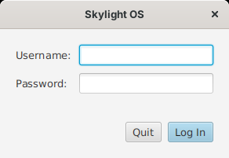

# Getting started

## Requirements

A **Java 8 JDK that includes JavaFX 8**. Not every Java 8 does:

* **Oracle JDK 8** includes JavaFX.
* **OpenJDK 8** usually doesn't. Use a build that adds it, such as Azul **Zulu 8 "FX"** or BellSoft **Liberica 8 "Full"**, or add **OpenJFX 8** to an OpenJDK 8.

Check with `java -version` (it should say 1.8) and by building: the build fails straight away with "package javafx... does not exist" if JavaFX is missing.

## Build

From the `site05jfx` folder:

```
build.bat          (Windows)
./build.sh         (Linux, macOS)
```

This compiles `src/` into `skylight.jar`. It needs `javac` and `jar` from the JDK on your `PATH`.

## Add a user

```
java -cp skylight.jar skylight.AddUser admin choose-a-password
```

Run it again to change a password. Usernames may use letters, digits, `-` and `_`.

## Run

```
run.bat            (Windows: starts with javaw, no console window)
./run.sh           (Linux, macOS)
```

or `java -jar skylight.jar` from the `site05jfx` folder. Skylight looks for `apps/`, `images/` and `data/` in the current folder; to start it from elsewhere, add `-Dskylight.home=C:\path\to\site05jfx`.

## Log in



Enter your username and password and press Enter. **Quit** (or Escape) closes Skylight OS.

## Next steps

* Take the [user guide](user-guide.md) tour.
* Open the **Terminal** and run `app.postNotification('Hello', 'It works');`.
* [Build your first app](building-apps.md).
