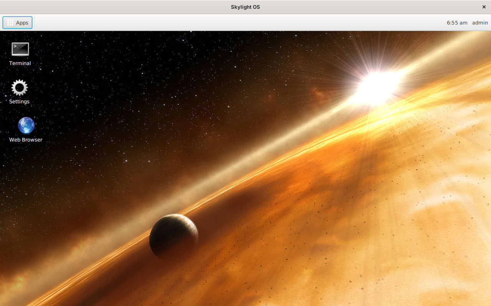
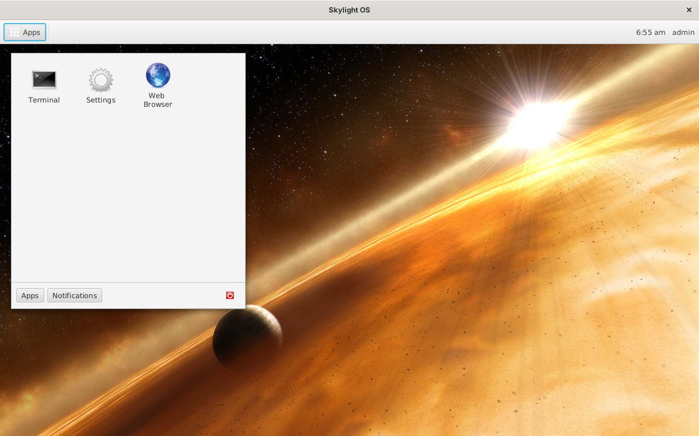
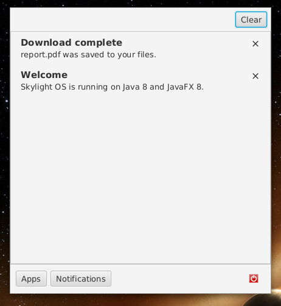
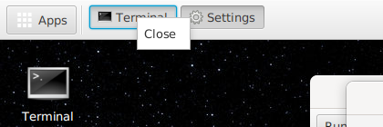
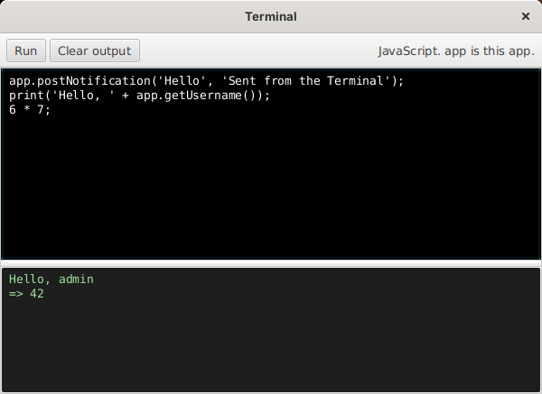
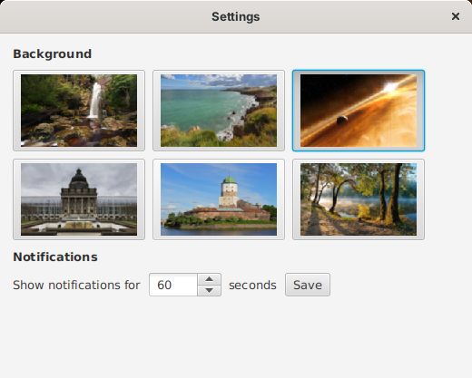
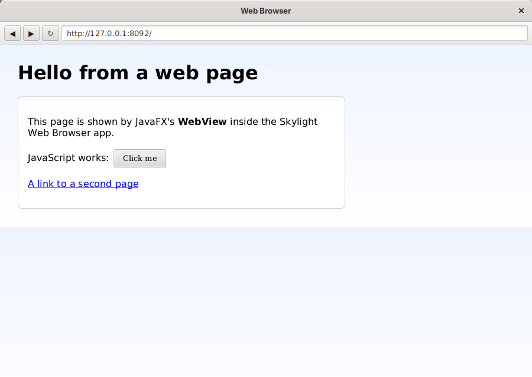

# User guide

## The desktop



| | |
| --- | --- |
| **Apps** (top left) | Opens the home menu |
| **Window list** (next to Apps) | A button for each open app window |
| **Clock** (top right) | The time and your username |
| **Shortcuts** | App icons on the desktop. Double-click to open, drag to move, right-click to remove. They are saved with your settings. |
| **Notifications** (top right, below the panel) | Pop-up messages ("toasts") from apps |

### Home menu



* **Apps**: click an icon to open the app.
* **Notifications**: everything you've been notified about since you logged in, newest first. Click × to remove one, or **Clear** to remove all.

  

* **Power button** (red): log out and return to the login window.

The menu closes when you click anywhere else, or click **Apps** again.

## Windows

Every app opens in its own window, so moving, resizing, maximizing and minimizing work as they do for any program. App windows stay in front of the desktop.

* Click an app's button in the **window list** to hide its window; click again to bring it back.
* Right-click a window-list button for **Close**.

  

## Notifications

A notification appears as a toast at the top right for a few seconds (choose how long in Settings), and stays in the Notifications tab until you remove it or log out. Click a toast's × to dismiss it early.

## Built-in apps

### Terminal



Runs **JavaScript** using Java 8's built-in Nashorn engine. Type in the top box and click **Run**; what the code prints (with `print()`), its result, and any error appear below. The variable `app` is the Terminal itself, so the [App API](app-api.md) is available, and JavaScript functions work as callbacks:

```javascript
app.postNotification('Hello', 'From the Terminal');
app.openWindow('apps/settings/');
app.openDialog('Are you sure?', function () { print('You clicked OK'); });
app.listFiles();
```

Nashorn can also reach any Java class, for example `java.lang.System.getProperty('java.version')`.

### Settings



* **Background**: click a picture. The desktop changes at once and remembers it.
* **Notifications**: how many seconds toasts stay on screen (1 to 60). Click **Save**.

### Web Browser



A real web browser built on JavaFX's WebView. Type an address and press Enter (`http://` is added if you leave it out); use the arrows to go back and forward and ↻ to reload. The address bar follows the links you click.

JavaFX 8's web engine dates from about 2018, so some modern websites may not display correctly.
