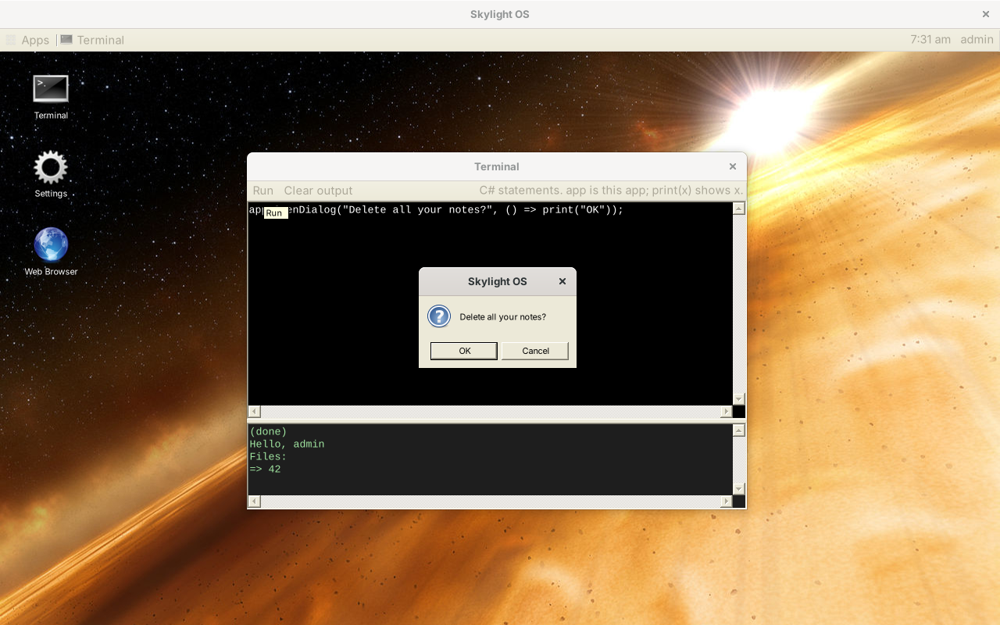

# App API

An app is a class that extends `Skylight.App` ([`App.cs`](../site06cs/src/Skylight/App.cs)) and returns its window's contents from `Build()`:

```csharp
using System.Windows.Forms;
using Skylight;

namespace Hello
{
	public class HelloApp : App
	{
		protected override Control Build()
		{
			Button button = new Button { Text = "Say hello", AutoSize = true };
			button.Click += delegate { PostNotification("Hello", "Hello, " + GetUsername()); };
			FlowLayoutPanel root = new FlowLayoutPanel { Padding = new Padding(20) };
			root.Controls.Add(button);
			return root;
		}
	}
}
```

The method names match the other versions' App APIs, in C#'s PascalCase (see [Compared with the other versions](comparison.md)). Apps need a public constructor with no arguments (the default one is fine).

## Lifecycle

| Method | When | What to do |
| --- | --- | --- |
| `Control Build()` | Once, before the window is shown | Create your controls and return the one that holds them; Skylight docks it to fill the window |
| `bool CanClose()` | When the user closes the window | Return `true` to allow it, `false` to keep the window open (for example, to ask about unsaved work first) |

Built-in apps declare these `protected internal override`; apps in their own DLL use `protected override`.

## Properties

| Property | Holds |
| --- | --- |
| `Window` | Your `Form` |
| `AppID` | This window's ID |
| `AppPath` | Your folder, e.g. `apps/notes/` |
| `Manifest` | Your `app.json`, as a `Dictionary<string, object>` |
| `Args` | The dictionary passed to `OpenWindow(path, args)`, or an empty one |
| `Desktop` | The `Desktop`; prefer the methods below |

## Summary

| Method | Returns |
| --- | --- |
| [`OpenWindow(path)`, `OpenWindow(path, args)`](#openwindow) | AppID, or `null` |
| [`CloseWindow()`, `CloseWindow(appID)`](#closewindow) | — |
| [`OpenDialog(message)`, `OpenDialog(message, onOK)`](#opendialog) | — |
| [`PostNotification(header)`, `PostNotification(header, body)`](#postnotification) | — |
| [`GetSettings()`](#getsettings) | `Settings` (a copy) |
| [`SaveSettings(settings)`](#savesettings) | `bool` |
| [`SetBackground(imagePath)`](#setbackground) | `bool` |
| [`AddShortcut(appPath)`](#addshortcut) | — |
| [`GetAppID()`](#identity) | `string` |
| [`GetUsername()`](#identity) | `string` |
| [`AppFile(name)`](#appfile) | `string` (a full path) |
| [`ListFiles()`](#listfiles-readfile-writefile) | `List<string>` |
| [`ReadFile(name)`](#listfiles-readfile-writefile) | `string`, or `null` |
| [`WriteFile(name, contents)`](#listfiles-readfile-writefile) | `Result` |

## Windows

### OpenWindow

```csharp
OpenWindow("apps/settings/");

Dictionary<string, string> args = new Dictionary<string, string>();
args["file"] = "todo.txt";
OpenWindow("apps/notes/", args);   // NotesApp reads Args["file"]
```

Opens an app in a new window and returns its AppID. If the folder isn't a working app, the user gets a notification and `null` is returned.

### CloseWindow

```csharp
CloseWindow();         // this window
CloseWindow(appID);    // another one
```

Closes without asking: `CanClose()` isn't called.

## Dialogs and notifications

### OpenDialog

```csharp
OpenDialog("The file was saved.");                      // OK only
OpenDialog("Delete this note?", () => DeleteNote());    // OK and Cancel
```

With `onOK`, the user sees a question with **OK** and **Cancel**, and `onOK` runs only on OK. The dialog is a standard Windows message box in front of your window.



Unlike the other versions, the dialog is **modal**: `OpenDialog` doesn't return until the user answers, and `onOK` has already run (or not) by then. Write code that works either way, as the Notes tutorial does, so it reads the same as in the other versions.

### PostNotification

```csharp
PostNotification("Download complete", "report.pdf was saved.");
```

Shows a toast and adds the notification to the home menu. The body is optional.

## Settings and the desktop

### GetSettings

```csharp
Settings settings = GetSettings();
settings.Background;         // "images/backgrounds/3.jpg"
settings.NotificationTime;   // 7000 (milliseconds)
settings.Shortcuts;          // List<Shortcut>: Path, X, Y
```

Returns a **copy**: changing it has no effect until you save it.

### SaveSettings

```csharp
Settings settings = GetSettings();
settings.NotificationTime = 3000;
SaveSettings(settings);
```

Checks, saves and applies the settings. Returns `false`, after telling the user why, if they were refused (see [Data and configuration](data-and-configuration.md#settings)).

### SetBackground

```csharp
SetBackground("images/backgrounds/2.jpg");
```

### AddShortcut

```csharp
AddShortcut("apps/notes/");
```

Adds a desktop shortcut (saved with the user's settings). Adding one that exists does nothing.

## Identity

`GetAppID()` returns this window's ID; `GetUsername()` the logged-in user.

## Files

### AppFile

```csharp
PictureBox logo = new PictureBox { Image = Image.FromFile(AppFile("images/logo.png")) };
```

The full path of a file in your app's own folder.

### ListFiles, ReadFile, WriteFile

```csharp
List<string> names = ListFiles();               // the user's own files
string text = ReadFile("notes.txt");            // null if there's no such file
Result result = WriteFile("notes.txt", text);
if (!result.Ok)
{
	OpenDialog("Could not save: " + result.Error);
}
```

Files are stored as UTF-8 in `data\users\<name>\files\`. Names may use letters, digits, spaces, `-`, `_` and `.` (up to 100 characters, not starting with `.`), so they can't point outside the user's folder.

## Threads

Windows Forms calls your code on its UI thread, and all `App` methods must be called there too. If you start work on another thread (a `Thread`, or `Task.Run`), return to the UI thread with `Window.BeginInvoke(new Action(() => ...))` before calling the App API or touching controls.

## Errors

If your constructor or `Build()` throws, the window isn't opened and the user gets a "Cannot open app" notification. An exception thrown later, in an event handler, reaches Windows Forms' default handler: on Windows that's a dialog offering **Continue** or **Quit**. Catch exceptions you expect, such as `IOException`, where they happen.
