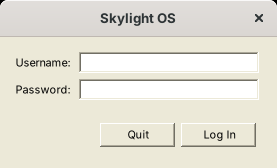

# Getting started

## Requirements

**Windows 11** already has everything: the **.NET Framework 4.8** and its C# compiler, `csc.exe`. Windows 10, 8.1 and 7 with .NET Framework 4.5 or later work too.

`csc.exe` lives in the framework folder and isn't on the `PATH`:

```
%WINDIR%\Microsoft.NET\Framework64\v4.0.30319\csc.exe
```

It's the last compiler shipped with the .NET Framework and understands C# up to version 5; when it starts it says so ("This compiler is provided as part of the Microsoft (R) .NET Framework, but only supports language versions up to C# 5"). That's the language this version is written in.

On Linux or macOS, install **Mono** (the `mono-complete` package on Debian and Ubuntu). Its `mcs` compiler is held to C# 5 by `build.sh`.

## Build

In a Command Prompt, in the `site06cs` folder:

```
build.bat          (Windows)
./build.sh         (Linux, macOS with Mono)
```

This compiles `src\` into `Skylight.exe` (the desktop) and `AddUser.exe` (a console tool). `build.bat` finds `csc.exe` for you; it takes a few seconds.

## Add a user

```
AddUser.exe admin choose-a-password
```

(`mono AddUser.exe ...` on Linux and macOS.) Run it again to change a password. Usernames may use letters, digits, `-` and `_`.

## Run

```
run.bat            (Windows)
./run.sh           (Linux, macOS)
```

or double-click `Skylight.exe`. Skylight finds `apps\`, `images\` and `data\` next to `Skylight.exe`, wherever it's started from. To keep them somewhere else, set the `SKYLIGHT_HOME` environment variable to that folder.

## Log in



Enter your username and password and press Enter. **Quit** (or Escape) closes Skylight OS.

## Next steps

* Take the [user guide](user-guide.md) tour.
* Open the **Terminal** and run `app.PostNotification("Hello", "It works");`.
* [Build your first app](building-apps.md).
