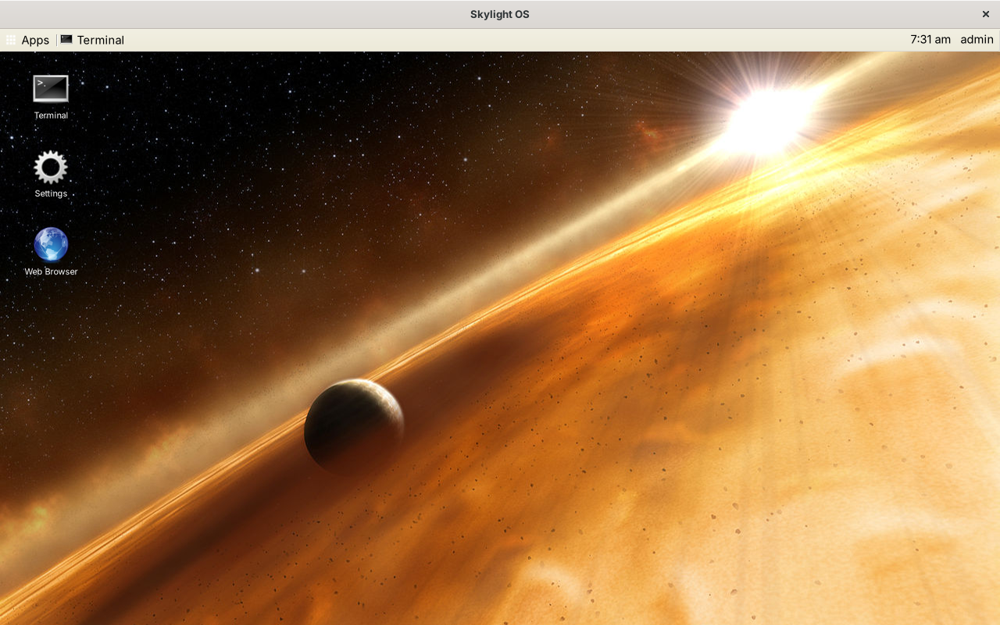
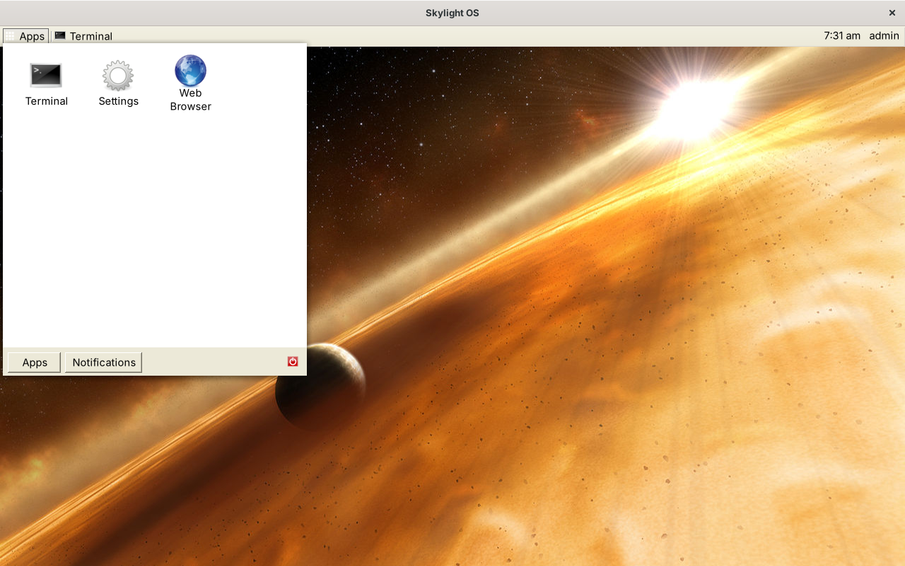
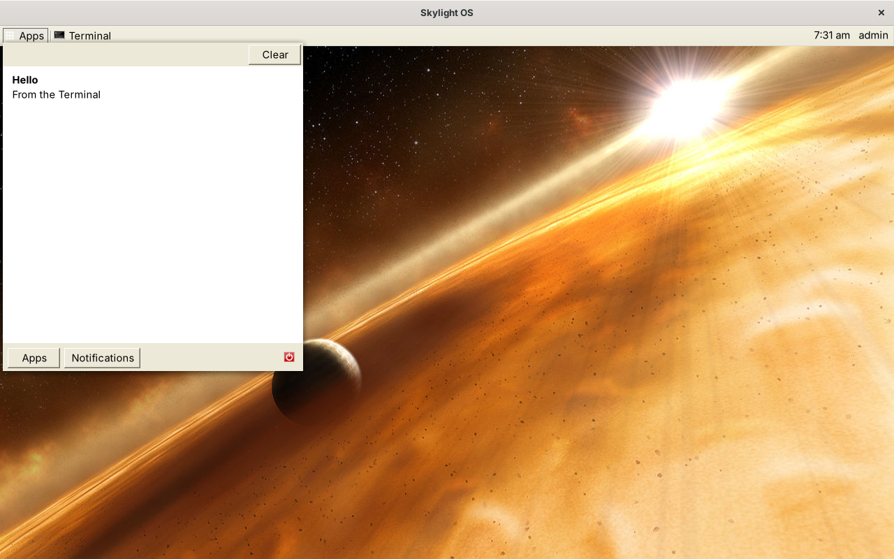
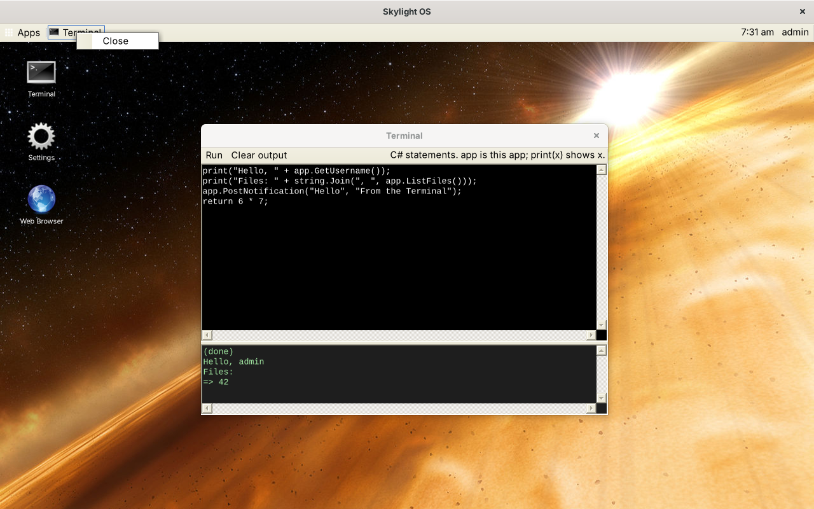
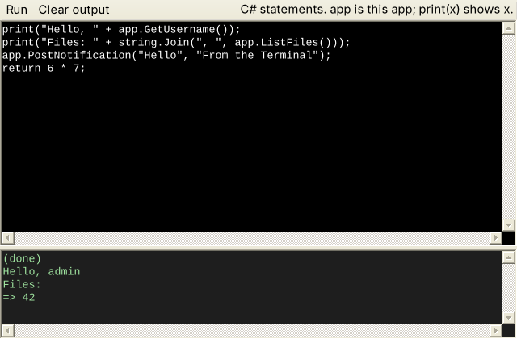
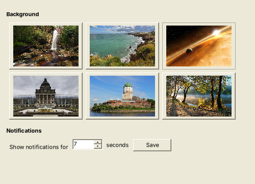
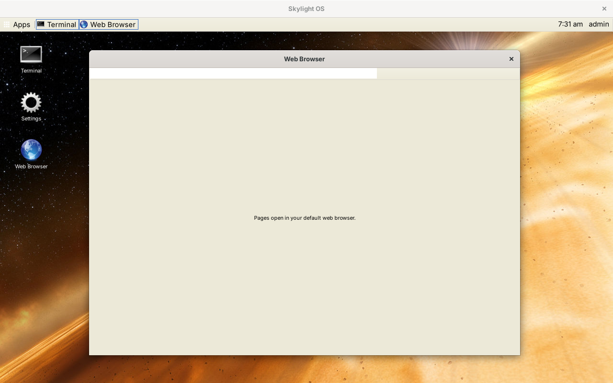

# User guide

## The desktop



| | |
| --- | --- |
| **Apps** (top left) | Opens the home menu |
| **Window list** (next to Apps) | A button for each open app window |
| **Clock** (top right) | The time and your username |
| **Shortcuts** | App icons on the desktop. Double-click to open, drag to move, right-click to remove. They are saved with your settings. |
| **Notifications** (top right, below the panel) | Pop-up messages ("toasts") from apps |

The desktop is a normal window, maximized when you log in. Closing it logs you out.

### Home menu



* **Apps**: click an icon to open the app.
* **Notifications**: everything you've been notified about since you logged in, newest first. Click × to remove one, or **Clear** to remove all.

  

* **Power button** (red, bottom right): log out and return to the login window.

The menu closes when you click anywhere else, or click **Apps** again.

## Windows

Every app opens in its own window, so moving, resizing, maximizing and minimizing work as they do for any program. App windows stay in front of the desktop and don't get their own taskbar buttons; the desktop's window list keeps track of them instead.

* Click an app's button in the **window list** to hide its window; click again to bring it back.
* Right-click a window-list button for **Close**.

  

## Notifications

A notification appears as a toast at the top right for a few seconds (choose how long in Settings), and stays on the Notifications page until you remove it or log out. Click a toast's × to dismiss it early. Toasts don't take the keyboard focus, so you can keep typing.

## Dialogs

When an app asks a question, a standard Windows message box appears in front of its window:


## Built-in apps

### Terminal



Runs **C# statements**. Type in the top box and click **Run**: Skylight wraps the code in a method, compiles it with the system's C# compiler and runs it. What the code prints (with `print(...)`), the value it `return`s, compile errors (with line numbers) and exceptions appear below. The variable `app` is the Terminal itself, so the whole [App API](app-api.md) is available:

```csharp
app.PostNotification("Hello", "From the Terminal");
app.OpenWindow("apps/settings/");
app.OpenDialog("Are you sure?", () => print("You clicked OK"));
print(string.Join(", ", app.ListFiles()));
return 6 * 7;
```

The code can use anything in `System`, `System.Collections.Generic`, `System.IO`, `System.Linq`, `System.Drawing` and `System.Windows.Forms`. Each run takes a second or so, because it starts the compiler.

### Settings



* **Background**: click a picture. The desktop changes at once and remembers it.
* **Notifications**: how many seconds toasts stay on screen (1 to 60). Click **Save**.

### Web Browser

On Windows, a web browser inside the window, using the WinForms `WebBrowser` control (the Internet Explorer 11 engine that Windows 11 still includes for programs like this). Type an address and press Enter (`http://` is added if you leave it out); use ◀ ▶ to go back and forward and ↻ to reload. The address bar follows the links you click.

Where that engine isn't available (on Mono, for example), the window says so and each address you enter opens in your default browser instead:



The Internet Explorer engine is old, so many modern websites won't display correctly in it; see [Limitations](limitations.md).
