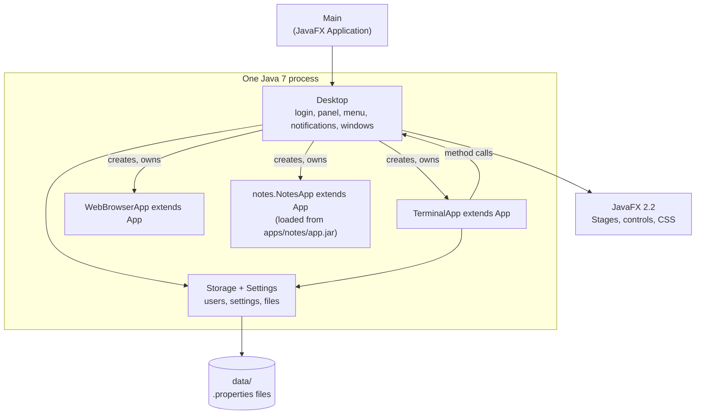

# Architecture

## One Java process

| Class | File | Job |
| --- | --- | --- |
| `Main` | [`Main.java`](../site07java7/src/skylight/Main.java) | The JavaFX `Application`: keeps JavaFX running after windows close, and shows the login window |
| `Desktop` | [`Desktop.java`](../site07java7/src/skylight/Desktop.java) | Login, panel, background, shortcuts, home menu, notifications, dialogs, app windows. See [Desktop internals](desktop-internals.md). |
| `App` | [`App.java`](../site07java7/src/skylight/App.java) | Base class for apps; the [App API](app-api.md) |
| `Settings` | [`Settings.java`](../site07java7/src/skylight/Settings.java) | A user's background, notification time and shortcuts |
| `Storage` | [`Storage.java`](../site07java7/src/skylight/Storage.java) | Users and passwords, settings, app list, user files under `data/` |
| `AddUser` | [`AddUser.java`](../site07java7/src/skylight/AddUser.java) | Command-line tool to add users |
| Built-in apps | [`apps/`](../site07java7/src/skylight/apps/) | `TerminalApp`, `SettingsApp`, `WebBrowserApp` |
| Styles | [`skylight.css`](../site07java7/src/skylight/skylight.css) | The few styles Skylight adds to JavaFX 2.2's default Caspian theme |

Everything is compiled into one `skylight.jar`. The `apps/`, `images/` and `data/` folders sit beside it. JavaFX itself is `jfxrt.jar` from the JDK, added to the class path by the run scripts.

## How it runs

1. `Main.start()` calls `Platform.setImplicitExit(false)`, so logging out (which closes every window) doesn't end the program, then shows the login window.
2. A correct password calls `Desktop.showDesktop()`, which builds a `Stage` (panel and desktop area) and sizes it to fill the screen, builds the home menu (a `Popup`), and starts a one-second clock `Timeline`.
3. From here, JavaFX calls Skylight's code on its application thread when something happens: a click, a timer, a window being closed.
4. Logging out closes everything and shows the login window again. **Quit** calls `Platform.exit()`.

## Apps are classes

`Desktop.openWindow("apps/terminal/", args)`:

1. reads `apps/terminal/app.properties` (see [App manifest](app-manifest.md));
2. loads the class it names: from `skylight.jar` for built-in apps, or from the folder's own `app.jar` for others (using a `URLClassLoader`);
3. creates a `Stage` owned by the desktop (`initOwner`), so it stays in front of it;
4. gives the app its context (`App.init`) and calls `build()`, which returns the window's contents;
5. adds a toggle button to the window list, shows the window and brings it to the front.

AppIDs are numbers, as strings, counting up from 1.

Apps call the desktop through the methods they inherit from `App`. Callbacks are `Runnable`s, written as anonymous classes, and the JavaScript engine passes JavaScript functions as the same `Runnable`.

## Real windows

Each app window is a real top-level window, so the operating system moves, resizes, stacks and minimizes it. The desktop only keeps the window list in step.

## Data

There's no server. `Storage` reads and writes `.properties` files in `data/`, Java's built-in format for settings (see [Data and configuration](data-and-configuration.md)).
