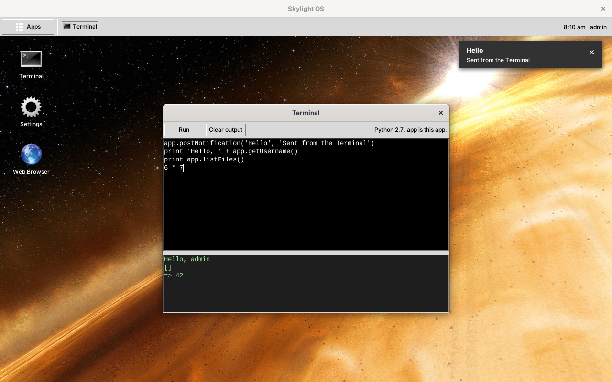

# Skylight OS for Python 2.7 and Tkinter

This is Skylight OS rebuilt as a desktop program in **Python 2.7**, using **Tkinter**, the GUI toolkit that comes with Python (Python's interface to Tcl/Tk). The code is in [`../site08py27tk`](../site08py27tk).

Nothing needs installing beyond Python 2.7 itself: one Python process draws the desktop, and every app is a Python class with its own window. It keeps the design of the other versions (login, a desktop with a background and shortcuts, a home menu, notifications, and the same App API names) and is closest to the [PHP-GTK2 version](../wiki04phpgtk/README.md): apps are source files that run without a build step, settings are dictionaries, and the `data/` folder uses the same JSON formats.

* **The Terminal runs Python**, with `app` as the Terminal itself.
* **The Web Browser** opens pages in your default browser, since Tkinter can't display web pages.
* **Pictures are GIFs**, because the Tk 8.5 that comes with Python 2.7 on Windows can't read PNG or JPEG. If the optional Pillow library is installed, backgrounds are drawn from the original JPEGs.

## Contents

**Using Skylight OS**

* [Getting started](getting-started.md): install Python 2.7, add a user, run it
* [User guide](user-guide.md): the desktop, windows, notifications and the built-in apps

**Building apps**

* [Building your first app](building-apps.md): a step-by-step tutorial
* [App manifest](app-manifest.md): the `app.json` file
* [App API](app-api.md): the `App` base class
* [Tkinter primer](tkinter-primer.md): the Tkinter and Python 2.7 ideas Skylight uses

**How it works**

* [Architecture](architecture.md)
* [Desktop internals](desktop-internals.md)
* [Data and configuration](data-and-configuration.md)

**Background**

* [Compared with the other versions](comparison.md)
* [Security](security.md)
* [Limitations](limitations.md)

## At a glance

| | |
| --- | --- |
| Language | Python 2.7 (2.7.8 or later, for `hashlib.pbkdf2_hmac`) |
| Toolkit | Tkinter with ttk (Tk 8.5 or 8.6) |
| Runs on | Windows, Linux or macOS with Python 2.7 and Tkinter |
| Libraries | None required; Pillow (PIL) optional, for smoother backgrounds |
| Data | JSON files in `data/`, the same formats as the PHP-GTK2 version |
| Size | About 900 non-blank lines of Python in 10 files |
| Tested | On Linux with Python 2.7.18 and Tcl/Tk 8.5.19, the Tk version Windows' Python 2.7 uses (see [Limitations](limitations.md#how-it-was-tested)) |
