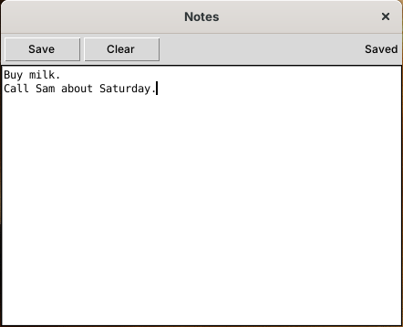

# Building your first app

This tutorial builds **Notes**, an app that keeps one note per user. Like every Skylight app, including the built-in ones, it's a folder with an `app.json` and an `app.py`; there's nothing to compile. It covers the parts of the [App API](app-api.md) most apps need: building a window, reading and saving the user's files, notifications, a confirmation dialog, and stopping the window closing while there are unsaved changes. Every step was tested with Python 2.7.18 and Tk 8.5.



You need Skylight OS running; see [Getting started](getting-started.md).

## 1. Create the folder

```
site08py27tk/apps/notes/
├── app.json
├── app.py
└── icons/16.gif, 32.gif, 48.gif, 64.gif
```

For the icons, copy the four GIFs from `apps/settings/icons/` for now.

## 2. Describe the app

`app.json` (see [App manifest](app-manifest.md)):

```json
{
	"title": "Notes",
	"class": "NotesApp",
	"width": 440,
	"height": 320,
	"icons": { "16": "icons/16.gif", "32": "icons/32.gif", "48": "icons/48.gif", "64": "icons/64.gif" }
}
```

## 3. Write the class

`app.py`:

```python
# -*- coding: utf-8 -*-
"""Notes: one note per user, saved in their private files."""
import Tkinter as tk
import ttk

from skylight.app import App


class NotesApp(App):

    # 1. Build the window: a toolbar above a text box.
    def build(self):
        toolbar = ttk.Frame(self.window, padding=4)
        toolbar.pack(side='top', fill='x')
        ttk.Button(toolbar, text='Save', command=self.save).pack(side='left')
        ttk.Button(toolbar, text='Clear', command=self.askToClear).pack(side='left', padx=4)
        self.status = ttk.Label(toolbar, text='Hello, ' + self.getUsername())
        self.status.pack(side='right')

        self.note = tk.Text(self.window, wrap='word', undo=True)
        self.note.pack(fill='both', expand=True)

        # 2. Load the saved note. readFile() returns None if there isn't one yet.
        self.note.insert('1.0', self.readFile('notes.txt') or '')
        self.note.edit_modified(False)
        self.note.focus_set()

    # 3. Save. writeFile() reports success, or an error to show the user.
    def save(self):
        result = self.writeFile('notes.txt', self.note.get('1.0', 'end-1c'))
        if result['ok']:
            self.note.edit_modified(False)
            self.status.configure(text='Saved')
            self.postNotification('Notes', 'Your note was saved.')
        else:
            self.openDialog('Could not save: ' + result['error'])

    # 4. Ask before throwing work away. The function runs only if the user clicks OK.
    def askToClear(self):
        def clear():
            self.note.delete('1.0', 'end')
            self.status.configure(text='Cleared (not saved yet)')
        self.openDialog("Clear the note? This can't be undone.", clear)

    # 5. Don't lose unsaved work when the window is closed.
    def canClose(self):
        if not self.note.edit_modified():
            return True

        def closeAnyway():
            self.closeWindow()
        self.openDialog('Close without saving your changes?', closeAnyway)
        return False
```

How it works:

1. **`build()`** adds the window's contents to `self.window`, a Tkinter `Toplevel`: a `ttk.Frame` toolbar packed at the top, and a `Text` box filling the rest.
2. **Events:** each button's `command` is a method (`self.save`). The `Text` widget keeps a *modified* flag that it sets on every edit; `edit_modified(False)` clears it after loading and saving.
3. **Files:** `readFile` and `writeFile` use the user's private storage, so each user has their own `notes.txt`. `readFile` returns `None` when there's no note yet, and `or ''` turns that into an empty string.
4. **Dialogs:** the function given to `openDialog` (here `clear`, defined inside the method) runs only if the user clicks OK.
5. **`canClose()`** keeps the window open while there are unsaved changes, and closes it with `closeWindow()` if the user agrees.

The `# -*- coding: utf-8 -*-` line lets the file contain non-English text; Python 2 assumes ASCII otherwise.

## 4. Run it

Open the **Terminal** and run:

```python
app.openWindow('apps/notes/')
```

Type something, click **Save**, close the window and open it again: the note is still there. Change it and close the window without saving: you'll be asked first.

Skylight loads `app.py` the first time the app opens. After changing it, restart Skylight.

## 5. Add it to the home menu

Add the folder to `apps/apps.json`:

```json
[
	"apps/terminal/",
	"apps/settings/",
	"apps/web-browser/",
	"apps/notes/"
]
```

Log out and in again: Notes appears in the home menu. `app.addShortcut('apps/notes/')` in the Terminal puts it on the desktop.

## Troubleshooting

| Symptom | Likely cause |
| --- | --- |
| "Cannot open app" mentioning `app.json` | A key is missing, or the JSON has a mistake (a missing comma or quote) |
| "Cannot open app ... has no class ... extending App" | `class` in `app.json` doesn't match the class name in `app.py`, or the class doesn't extend `App` |
| "Cannot open app" with `SyntaxError`, `ImportError` or another error | A mistake in `app.py`, or an error in `build()`; the notification gives Python's message |
| "Cannot open app" with `TclError: couldn't recognize data in image file`, or the app is missing from the home menu | An icon isn't a GIF (Tk 8.5 can't read PNG) |
| "Error in an app" when clicking something | An exception in one of your event handlers; run Skylight with `python start-skylight.pyw` to see the full traceback |
| Changes don't show up | Restart Skylight; `app.py` is loaded once |
