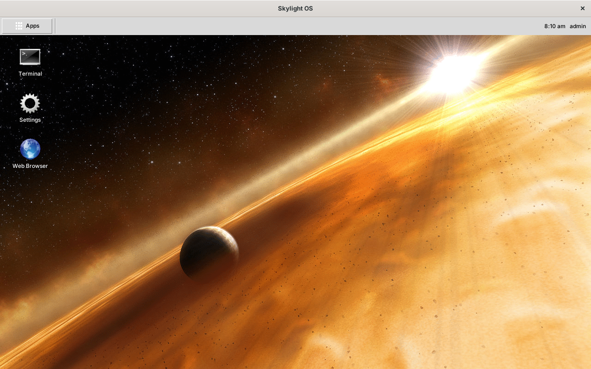
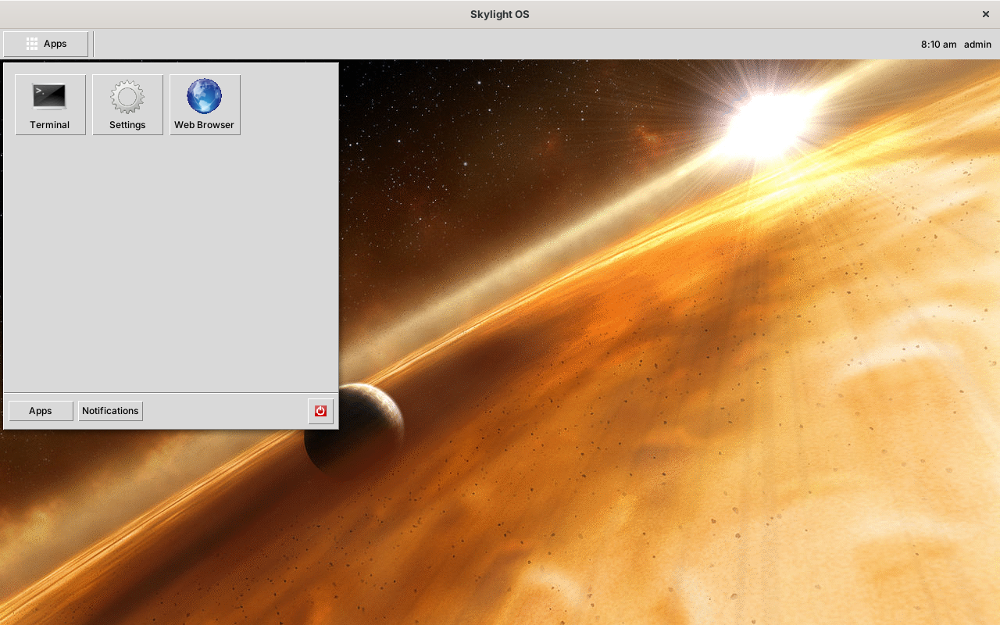
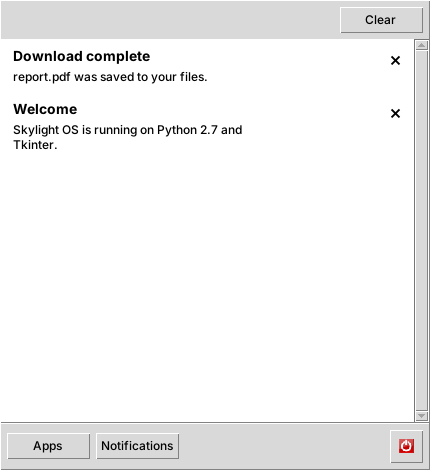
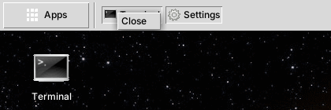
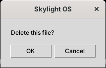
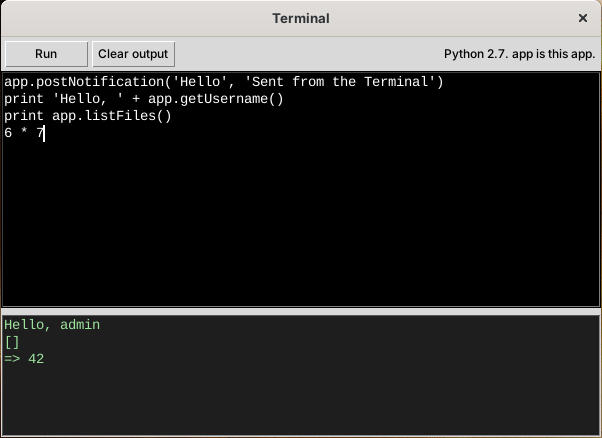
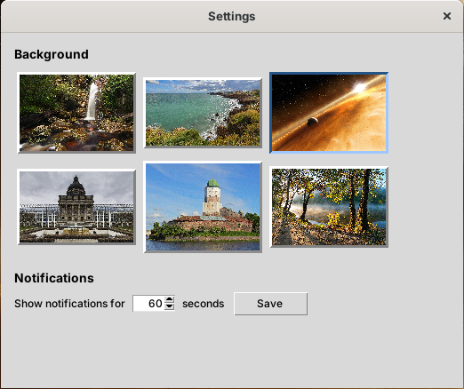
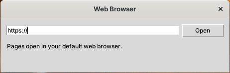

# User guide

## The desktop



The desktop is one large window, maximized when you log in. Closing it logs you out.

| | |
| --- | --- |
| **Apps** (top left) | Opens the home menu |
| **Window list** (next to Apps) | A button for each open app window |
| **Clock** (top right) | The time and your username |
| **Shortcuts** | App icons on the desktop. Double-click to open, drag to move, right-click to remove. They are saved with your settings. |
| **Notifications** (top right, below the panel) | Pop-up messages ("toasts") from apps |

### Home menu



* **Apps**: click an icon to open the app.
* **Notifications**: everything you've been notified about since you logged in, newest first. Click × to remove one, or **Clear** to remove all.

  

* **Power button** (red): log out and return to the login window.

The menu closes when you click anywhere else in Skylight, click **Apps** again, or press Escape.

## Windows

Every app opens in its own window, which stays in front of the desktop. Move and resize windows as usual.

* Click an app's button in the **window list** to hide its window; click again to bring it back.
* Right-click a window-list button for **Close**.

  

App windows belong to the desktop window (Tk calls them *transient*), so on some systems they have no minimize button; use the window list to put one out of the way.

## Notifications

A notification appears as a toast at the top right for a few seconds (choose how long in Settings), and stays on the Notifications page until you remove it or log out. Click a toast's × to dismiss it early.

## Dialogs

When an app asks a question, a small window appears over the app's window. Until you answer, the rest of Skylight waits. Enter answers **OK** and Escape **Cancel**.



## Built-in apps

### Terminal



Runs **Python 2.7** code. Type in the top box and click **Run**; what the code prints, the value of its last line (if that's an expression), and any error appear below. The variable `app` is the Terminal itself, so the whole [App API](app-api.md) is available, and any function works as a callback:

```python
app.postNotification('Hello', 'From the Terminal')
app.openWindow('apps/settings/')
app.openDialog('Are you sure?', lambda: app.postNotification('OK', 'You clicked OK'))
print app.listFiles()
6 * 7
```

Variables and functions you define stay available for later runs, as in Python's interactive prompt. `print` works as a statement (`print 'hi'`) or with brackets (`print('hi')`).

### Settings



* **Background**: click a picture. The desktop changes at once and remembers it.
* **Notifications**: how many seconds toasts stay on screen (1 to 60). Click **Save**.

### Web Browser



Tkinter has no widget that can display web pages, so this app opens addresses in your default web browser, using Python's `webbrowser` module. Type an address and press Enter or click **Open**; `http://` is added if you leave it out.
