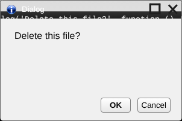
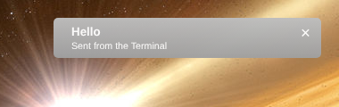

# UI components

## Styles

Load the shared stylesheet in every app page:

```html
<link href="../../system/css/ui.css" rel="stylesheet"/>
```

[`ui.css`](../site09couchdb/attachments/system/css/ui.css) sets the font to Arial and styles:

| Element | Look |
| --- | --- |
| `<button>` and button-type `<input>`s | Light grey gradient, grey border, rounded corners; the gradient flips while pressed |
| `.default` on a button | Bold text: use it for the main action, such as **Save** or **OK** |
| `<input type="text">`, `<input type="password">` | Grey rounded border with a slight inner shadow |
| `.bar` containing `.bar-button`s | Buttons joined into one segmented bar |

```html
<button class="default">Save</button> <button>Cancel</button>

<span class="bar"><button class="bar-button">Day</button><button class="bar-button">Week</button><button class="bar-button">Month</button></span>
```



## Windows

Your page fills the window below the 30px title bar, and is resized when the user maximizes the window. Size things with percentages or `calc()` so they follow the window, as the Terminal does:

```css
#code {
	position: absolute;
	top: 38px;
	width: calc(100% - 12px);
	height: calc(100% - 44px);
}
```

## Dialogs

Use [`App.openDialog`](app-api.md#appopendialog) to confirm something before doing it. Write the message as a question the buttons answer ("Delete this note?"), and put the action in the `onOK` function. The dialog isn't modal: the user can keep using other windows while it is open.

## Notifications

Use [`App.postNotification`](app-api.md#apppostnotification) to report something that happened, especially when your window may be hidden. Keep the header short (it's one line in the toast) and the body to a sentence or two (the toast shows three lines; the Notifications tab shows all of it).


