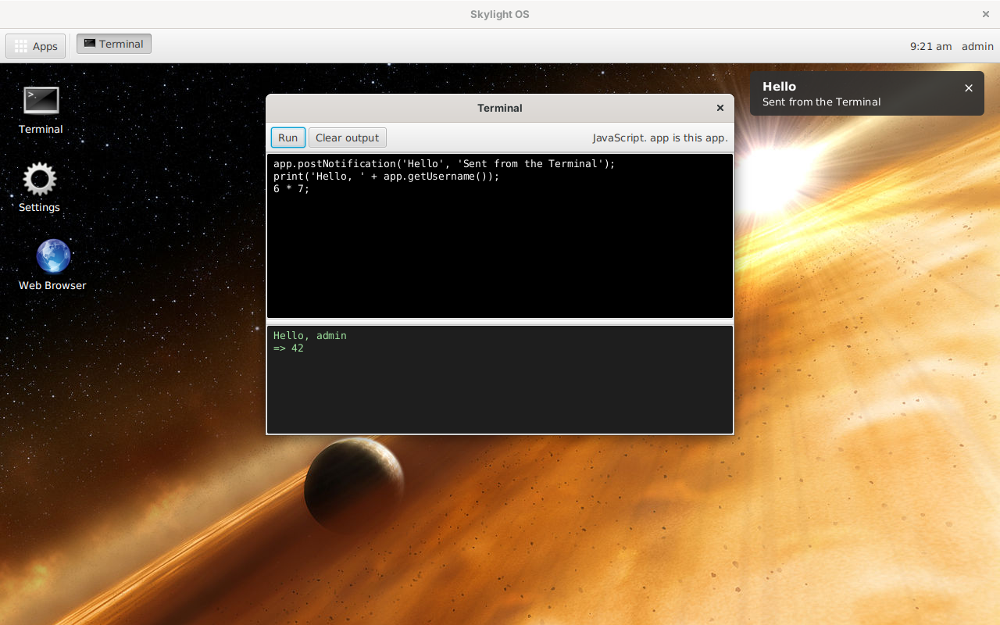

# Skylight OS with JavaFX FXML

This is the [Java 8 and JavaFX 8 version](../wiki05jfx/README.md) of Skylight OS, rebuilt so that windows are described in **FXML**, JavaFX's XML format for user interfaces, instead of being built in Java code. The code is in [`../site11fxml`](../site11fxml).

* **Apps are just files.** An app is an `app.fxml` describing its window, with its behaviour in JavaScript, either inside the FXML or in a `.js` file beside it. There's no Java to write and nothing to compile: edit the file and open the app again. All three built-in apps, and the Notes tutorial, are written this way.
* **The desktop's own windows are FXML too.** The login window, the panel, the home menu and the notifications are files in `ui/`, next to the stylesheet, so they can be rearranged and restyled without rebuilding Skylight.
* **Java apps still work.** An app can still be a Java class, and can load its own FXML with Java methods as its event handlers.

The look, the behaviour, the App API and the data files are the same as the Java 8 version's.

A complete app, the Web Browser, is one 44-line file: [`apps/web-browser/app.fxml`](../site11fxml/apps/web-browser/app.fxml).

## Contents

**Using Skylight OS**

* [Getting started](getting-started.md): build, add a user, run
* [User guide](user-guide.md): the desktop, windows, notifications and the built-in apps

**Building apps**

* [Building your first app](building-apps.md): a step-by-step tutorial, in FXML and JavaScript
* [App manifest](app-manifest.md): the `app.properties` file
* [App API](app-api.md): what apps can call, from scripts or Java
* [FXML primer](fxml-primer.md): FXML, its scripts, and the mistakes to avoid

**How it works**

* [Architecture](architecture.md)
* [Desktop internals](desktop-internals.md)
* [Data and configuration](data-and-configuration.md)

**Background**

* [Compared with the other versions](comparison.md)
* [Security](security.md)
* [Limitations](limitations.md)

## At a glance

| | |
| --- | --- |
| Language | Java 8 for the desktop; FXML and JavaScript (Nashorn) for apps and windows |
| UI | JavaFX 8, default Modena look, plus `ui/skylight.css` |
| Runs on | Windows, Linux or macOS with a Java 8 JDK that includes JavaFX |
| Libraries | None beyond Java 8 and JavaFX 8 |
| Data | `.properties` files in `data/`, as in the Java 8 version |
| Size | About 910 non-blank lines of Java in 7 files (the Java 8 version: 1,070 in 9), 80 lines of FXML for the desktop's windows, and 150 lines of FXML and JavaScript for the three apps |
| Tested | On Linux with OpenJDK 1.8.0 and OpenJFX 8u161 (see [Limitations](limitations.md#how-it-was-tested)) |
