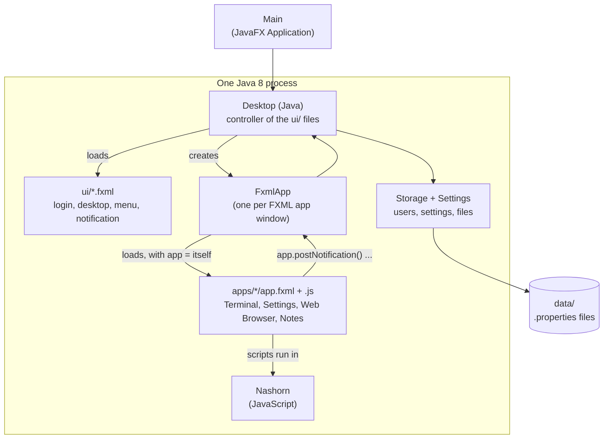

# Architecture

## One Java process, three kinds of file

| Part | Where | Job |
| --- | --- | --- |
| `Main` | [`Main.java`](../site11fxml/src/skylight/Main.java) | The JavaFX `Application`: keeps JavaFX running after windows close, and shows the login window |
| `Desktop` | [`Desktop.java`](../site11fxml/src/skylight/Desktop.java) | Loads the `ui/` files and is their controller; shortcuts, notifications, dialogs, app windows. See [Desktop internals](desktop-internals.md). |
| `App` | [`App.java`](../site11fxml/src/skylight/App.java) | The [App API](app-api.md), and the base class for Java apps |
| `FxmlApp` | [`FxmlApp.java`](../site11fxml/src/skylight/FxmlApp.java) | The `App` behind every FXML app: loads its `app.fxml` with `app` set to itself |
| `Settings`, `Storage`, `AddUser` | `Settings.java`, `Storage.java`, `AddUser.java` | As in the Java 8 version: settings, users, files, the add-user tool |
| The desktop's windows | [`ui/`](../site11fxml/ui/) | `login.fxml`, `desktop.fxml`, `menu.fxml`, `notification.fxml` and `skylight.css` |
| Built-in apps | [`apps/`](../site11fxml/apps/) | `terminal/`, `settings/`, `web-browser/`: each an `app.properties`, an `app.fxml` and icons; the Terminal's script is in `terminal.js` |

The Java code is compiled into `skylight.jar`. Everything that describes what you see, the `ui/` and `apps/` folders, stays as plain files beside it, with `images/` and `data/`.

## How it runs

1. `Main.start()` calls `Platform.setImplicitExit(false)`, so logging out doesn't end the program, then `Desktop.showLogin()`.
2. `showLogin()` loads `ui/login.fxml` with the `Desktop` as its controller: the fields `username` and `password` are filled in from the file's `fx:id`s, and its buttons call the methods `logIn()` and `quit()`.
3. A correct password loads `ui/desktop.fxml` (the panel and the desktop area) into a maximized window, and `ui/menu.fxml` into a `Popup`, then adds the app icons, background and shortcuts in code, and starts the clock.
4. From here, JavaFX calls Skylight's code, or an app's script, when something happens.
5. Logging out closes everything and shows the login window again; **Quit** calls `Platform.exit()`.

## Apps are files

`Desktop.openWindow("apps/terminal/", args)`:

1. reads `apps/terminal/app.properties` (see [App manifest](app-manifest.md));
2. creates the app object: an `FxmlApp` if the manifest says `fxml=`, or the named Java class if it says `class=`;
3. creates a `Stage` owned by the desktop, and gives the app its context;
4. calls `build()`. For an `FxmlApp`, that's an `FXMLLoader` reading `app.fxml` with the variable `app` set to the `FxmlApp`. The file builds the window's contents, and its `<fx:script>` runs, defining the functions its buttons call;
5. adds a toggle button to the window list, shows the window and brings it to the front.

If the FXML has a mistake, `FXMLLoader` reports the file and line, and the user gets that in a "Cannot open app" notification.

Each window gets its own `FXMLLoader`, and so its own JavaScript engine: two Notes windows don't share variables. The files are read each time a window opens, so an edited app shows its changes the next time it's opened, without restarting Skylight.

## Scripts and Java

An app's script calls the App API on `app` like any Java object (`app.writeFile('notes.txt', text)`), and Nashorn passes JavaScript functions to Java as callbacks (`app.openDialog(message, function () { ... })`). `FxmlApp` is only a few lines: everything an FXML app can do is in `App`. See the [FXML primer](fxml-primer.md#javascript-and-java) for where the two languages meet.

## Real windows

Each app window is a real top-level window, so the operating system moves, resizes, stacks and minimizes it. The desktop only keeps the window list in step.

## Data

As in the Java 8 version: `Storage` reads and writes `.properties` files in `data/` (see [Data and configuration](data-and-configuration.md)).
