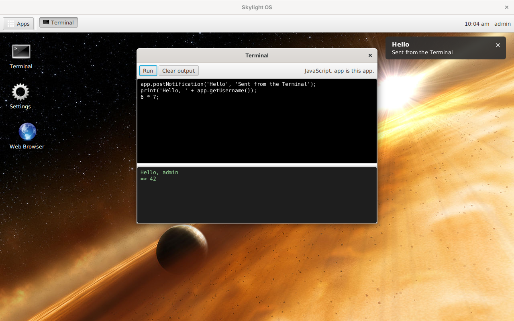

# Skylight OS with FXML apps from CouchDB

This is the [FXML version](../wiki11fxml/README.md) of Skylight OS, with its apps delivered from a **CouchDB app store** instead of a folder on each computer. The code is in [`../site12fxmlcouch`](../site12fxmlcouch).

In the FXML version an app is already just files: an `app.properties`, an `app.fxml` for the window, JavaScript for the behaviour, and icons. Here those files live in CouchDB, one document per app with the files attached, and Skylight reads them over HTTP when the app opens:

* **One store, every desktop.** Each desktop's `skylight.properties` names the store. Pushing an app to the store installs it everywhere.
* **Updates reach users the next time they open the app.** Nothing is compiled, installed or restarted.
* **CouchDB does the rest**: revisions, replication to other servers or a laptop, public reading and administrator-only writing.
* **Almost nothing changed in Skylight.** Java and JavaFX load FXML, scripts, images and even Java classes from URLs as easily as from files, so the store took about 80 lines of Java, and the only app that changed is Settings, which now finds the background pictures, Skylight's own files, with `app.desktopUrl`. Users' settings and files stay on their own computer.

The apps on that screen came from `http://127.0.0.1:5984/skylight-apps/`; the computer had no `apps/` folder.

## Contents

**Using Skylight OS**

* [Getting started](getting-started.md): build, add a user, fill the app store, run
* [User guide](user-guide.md): the desktop, windows, notifications and the built-in apps

**The app store**

* [The app store](app-store.md): how apps are stored, pushed, updated, copied and protected

**Building apps**

* [Building your first app](building-apps.md): a step-by-step tutorial, in FXML and JavaScript, ending with publishing it to the store
* [App manifest](app-manifest.md): the `app.properties` file
* [App API](app-api.md): what apps can call, from scripts or Java
* [FXML primer](fxml-primer.md): FXML, its scripts, and the mistakes to avoid

**How it works**

* [Architecture](architecture.md)
* [Desktop internals](desktop-internals.md)
* [Data and configuration](data-and-configuration.md)

**Background**

* [Compared with the other versions](comparison.md)
* [Security](security.md)
* [Limitations](limitations.md)

## At a glance

| | |
| --- | --- |
| Language | Java 8 for the desktop; FXML and JavaFX (Nashorn) JavaScript for apps and windows |
| UI | JavaFX 8, default Modena look, plus `ui/skylight.css` |
| Apps from | A CouchDB database (1.6 or later), or any web server, or the local `apps/` folder |
| Runs on | Windows, Linux or macOS with a Java 8 JDK that includes JavaFX |
| Libraries | None beyond Java 8 and JavaFX 8; the push tools need `curl` (or PowerShell) |
| Data | `.properties` files in `data/` on each computer, as in the FXML version |
| Size | About 1,000 non-blank lines of Java in 7 files (site11fxml: about 930), plus the push tools (about 100 lines of bash, 60 of PowerShell) |
| Tested | On Linux with OpenJDK 1.8.0, OpenJFX 8u161 and CouchDB 2.3.1 (see [Limitations](limitations.md#how-it-was-tested)) |
