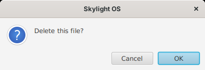

# App API

Apps use the App API to talk to Skylight. In an FXML app, scripts reach it through the variable **`app`**:

```xml
<?xml version="1.0" encoding="UTF-8"?>
<?language javascript?>
<?import javafx.scene.control.*?>
<?import javafx.scene.layout.*?>
<StackPane xmlns:fx="http://javafx.com/fxml">
	<Button text="Say hello" onAction="app.postNotification('Hello', 'Hello, ' + app.getUsername())"/>
</StackPane>
```

A Java app extends `skylight.App` ([`App.java`](../site12fxmlcouch/src/skylight/App.java)) and calls the same methods on itself, as in the [Java 8 version](../wiki5jfx/app-api.md). The method names match the other versions' App APIs (see [Compared with the other versions](comparison.md)).

The examples below are in JavaScript, for FXML apps; in Java, leave out `app.` and use lambdas for the functions.

## Lifecycle

For an FXML app, the window is built from its FXML file, and its `<fx:script>` runs once while that happens. To decide whether the window may close:

### setCanClose

```javascript
app.setCanClose(function () {
	return !changed;   // false keeps the window open
});
```

Skylight calls the function when the user closes the window. Without one, the window always closes.

A Java app overrides `build()` (once, before the window is shown: return the root node) and, if it wants, `canClose()`, as in the Java 8 version.

### loadFxml

```java
@FXML private TextArea note;

@Override
protected Parent build() {
	try {
		return loadFxml("app.fxml");
	} catch (IOException e) {
		throw new IllegalStateException(e);
	}
}
```

For Java apps: loads an FXML file from the app's folder, with the app object as its controller (so `fx:id`s fill `@FXML` fields and `onAction="#save"` calls the method `save()`) and as the script variable `app`.

## Information about the app

| Method | Returns |
| --- | --- |
| `app.getAppID()` | This window's ID |
| `app.getUsername()` | The logged-in user |
| `app.getArgs()` | The values passed to `openWindow(path, args)`, as a map; empty if none |
| `app.getWindow()` | Your `Stage` |

Java apps also have the protected fields `window`, `appID`, `path`, `manifest`, `args` and `desktop`; scripts can only use public methods, hence the getters.

## Summary

| Method | Returns |
| --- | --- |
| [`openWindow(path)`, `openWindow(path, args)`](#openwindow) | AppID, or `null` |
| [`closeWindow()`, `closeWindow(appID)`](#closewindow) | — |
| [`openDialog(message)`, `openDialog(message, onOK)`](#opendialog) | — |
| [`postNotification(header)`, `postNotification(header, body)`](#postnotification) | — |
| [`getSettings()`](#getsettings) | `Settings` (a copy) |
| [`saveSettings(settings)`](#savesettings) | `true` or `false` |
| [`setBackground(imagePath)`](#setbackground) | `true` or `false` |
| [`addShortcut(appPath)`](#addshortcut) | — |
| [`setCanClose(check)`](#setcanclose) | — |
| [`getAppID()`, `getUsername()`, `getArgs()`, `getWindow()`](#information-about-the-app) | see above |
| [`appUrl(name)`, `desktopUrl(name)`, `appFile(name)`](#appurl-desktopurl-appfile) | URL text; `Path` or `null` |
| [`listFiles()`](#listfiles-readfile-writefile) | list of names |
| [`readFile(name)`](#listfiles-readfile-writefile) | text, or `null` |
| [`writeFile(name, contents)`](#listfiles-readfile-writefile) | a result with `ok` and `error` |

## Windows

### openWindow

```javascript
app.openWindow('apps/settings/');
app.openWindow('apps/notes/', { file: 'todo.txt' });   // the Notes window reads app.getArgs().get('file')
```

Opens an app in a new window and returns its AppID. If the folder isn't a working app, the user gets a notification and `null` is returned. A JavaScript object works as the `args` map.

### closeWindow

```javascript
app.closeWindow();         // this window
app.closeWindow(appID);    // another one
```

Closes without asking: the `setCanClose` function isn't called.

## Dialogs and notifications

### openDialog

```javascript
app.openDialog('The file was saved.');                         // OK only
app.openDialog('Delete this note?', function () { remove(); });   // OK and Cancel
```

With a function, the user sees a question with **OK** and **Cancel**, and the function runs only on OK. The dialog is a JavaFX `Alert` belonging to your window; it doesn't block anything else.



### postNotification

```javascript
app.postNotification('Download complete', 'report.pdf was saved.');
```

Shows a toast and adds the notification to the home menu. The body is optional.

## Settings and the desktop

### getSettings

```javascript
var settings = app.getSettings();
settings.background;         // "images/backgrounds/3.jpg"
settings.notificationTime;   // 7000 (milliseconds)
settings.shortcuts;          // a list of shortcuts, each with path, x and y
```

Returns a **copy**: changing it has no effect until you save it.

### saveSettings

```javascript
var settings = app.getSettings();
settings.notificationTime = 3000;
app.saveSettings(settings);
```

Checks, saves and applies the settings. Returns `false`, after telling the user why, if they were refused (see [Data and configuration](data-and-configuration.md#settings)).

### setBackground

```javascript
app.setBackground('images/backgrounds/2.jpg');
```

### addShortcut

```javascript
app.addShortcut('apps/notes/');
```

Adds a desktop shortcut (saved with the user's settings). Adding one that exists does nothing.

## Files

### appUrl, desktopUrl, appFile

```javascript
var logo = new javafx.scene.image.Image(app.appUrl('images/logo.png'));
var picture = new javafx.scene.image.Image(app.desktopUrl('images/backgrounds/2.jpg'));
```

* **`appUrl(name)`**: the address of one of your app's own files. From the [app store](app-store.md), that's `http://.../skylight-apps/notes/images/logo.png`; without one, a `file:` URL in `apps/notes/`. In FXML itself, `@` does the same: `<Image url="@images/logo.png"/>`. Anything that reads URLs can use it: `Image`, `WebView`'s `load`, `new java.net.URL(...)`.
* **`desktopUrl(name)`**: the address of one of Skylight's own files, beside `skylight.jar`, such as the background pictures. These are always on the computer, even when the app comes from a store, so `@../../images/...` doesn't reach them; this does. Settings uses it for its pictures.
* **`appFile(name)`**: the app's file as a `Path` on disk, for code that needs a file rather than a URL. Apps from a store have no folder on disk, so it returns **`null`** then; prefer `appUrl`.

Apps can't write to their own files: the store is read-only to them. Save data with `writeFile`.

### listFiles, readFile, writeFile

```javascript
var names = app.listFiles();                 // the user's own files
var text = app.readFile('notes.txt');        // null if there's no such file
var result = app.writeFile('notes.txt', text);
if (!result.ok) {
	app.openDialog('Could not save: ' + result.error);
}
```

Files are stored as UTF-8 in `data/users/<name>/files/`. Names may use letters, digits, spaces, `-`, `_` and `.` (up to 100 characters, not starting with `.`), so they can't point outside the user's folder.

## Threads

JavaFX runs scripts and event handlers on its application thread, and all `App` methods must be called there too. Scripts can't easily start threads; Java apps that do must return to the JavaFX thread with `Platform.runLater(...)` before calling the App API or touching controls.
