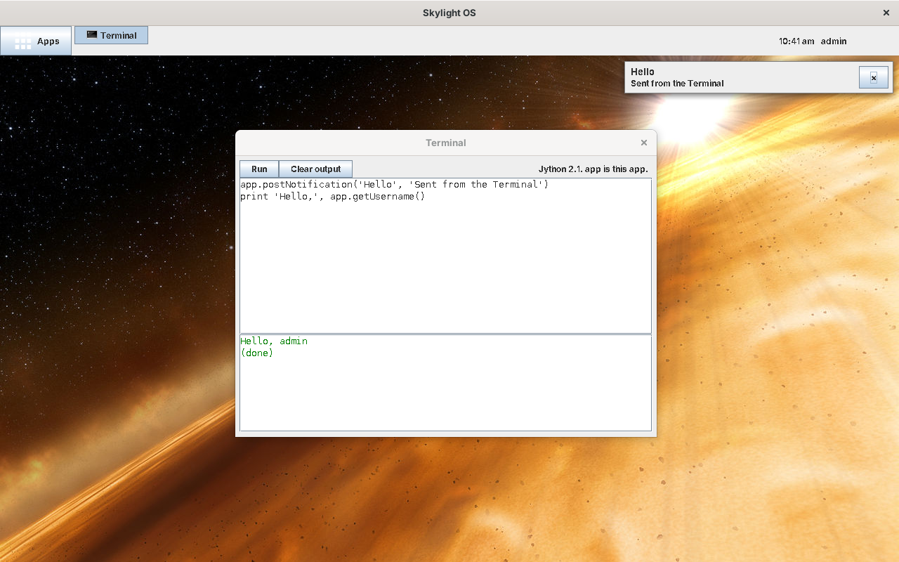

# Skylight OS with Luxor XUL

This is Skylight OS built with **Luxor XUL**, a Java library from 2001 to 2005 that builds Swing windows from **XUL** (Mozilla's XML language for user interfaces), and its companion **Luxilla**, a XUL runner. The code is in [`../site13luxor`](../site13luxor).

It answers one question: *what does an app look like in this technology?* Like the [FXML version](../wiki11fxml/README.md), an app is files and nothing to compile:

* **`app.xul`**: the window, as XML: boxes, buttons, text boxes, labels;
* **`app.py`**: what it does, in **Python** (Jython 2.1, which Luxor uses for scripting). Each `command="save"` in the XUL calls the function `save()`, and each control with an `id` is a variable;
* **`app.properties`**: title, size and icons.

```xml
<vbox id="notes">
	<hbox>
		<button label="Save" command="save"/>
		...
	</hbox>
	<textarea id="note" rows="12" cols="40" flex="1"/>
</vbox>
```

```python
def save():
    result = app.writeFile('notes.txt', note.getText())
    if result.ok:
        app.postNotification('Notes', 'Your note was saved.')
```

The desktop's own windows (the login window, the panel, the home menu, a notification) are `.xul` files in `ui/` too, and Luxilla can show all of them at once without running Skylight. Underneath it's plain **Swing** on **Java 8**: real windows, a maximized desktop window, toasts, a home menu and draggable shortcuts.



## Contents

**Using Skylight OS**

* [Getting started](getting-started.md): download Luxor, build, add a user, run
* [User guide](user-guide.md): the desktop, windows, notifications and the built-in apps

**Building apps**

* [Building your first app](building-apps.md): the Notes tutorial, in XUL and Python
* [App manifest](app-manifest.md): the `app.properties` file
* [App API](app-api.md): what an app's script can call
* [Luxor XUL and Luxilla](luxor-primer.md): what they are, the tags, actions, Luxilla, and what's changed since 2005

**How it works**

* [Architecture](architecture.md)
* [Desktop internals](desktop-internals.md)
* [Data and configuration](data-and-configuration.md)

**Background**

* [Compared with the other versions](comparison.md)
* [Security](security.md)
* [Limitations](limitations.md)

## At a glance

| | |
| --- | --- |
| Language | Java 8 for the desktop; XUL for windows; Python 2.1 (Jython) for apps |
| UI | Swing (Metal look), built by Luxor XUL 1.0 beta 8 |
| Runs on | Windows, Linux or macOS with Java 8 (no JavaFX needed) |
| Libraries | Luxor 1.0 b8 and its libraries, including Jython 2.1, downloaded by `tools/get-libs` (GPL v2 and others; not in the repository) |
| Data | `.properties` files in `data/`, as in the Java 8 versions |
| Size | About 1,320 non-blank lines of Java in 8 files (Swing needs more code than JavaFX for the desktop), 64 lines of XUL for the desktop's windows, and 160 lines of XUL and Python for the three apps |
| Tested | On Linux with OpenJDK 1.8.0 (see [Limitations](limitations.md#how-it-was-tested)) |
