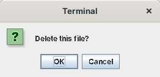

# App API

An app's script reaches Skylight through the variable **`app`**, a Java object ([`App.java`](../site13luxor/src/skylight/App.java)) with one instance per window. The method names match the other versions' App APIs (see [Compared with the other versions](comparison.md)).

```python
app.postNotification('Hello', 'Hello, ' + app.getUsername())
```

Scripts are Python 2.1 (Jython 2.1). Java objects come back as themselves: `app.getSettings()` is a Java `Settings` object whose fields you can read and set, and Java `null` is Python's `None`. Java's `true` and `false` arrive as `1` and `0`.

## Summary

| Method | Returns |
| --- | --- |
| [`openWindow(path)`, `openWindow(path, args)`](#openwindow) | AppID, or `None` |
| [`closeWindow()`, `closeWindow(appID)`](#closewindow) | — |
| [`setCanClose(function)`](#setcanclose) | — |
| [`openDialog(message)`, `openDialog(message, onOK)`](#opendialog) | — |
| [`postNotification(header)`, `postNotification(header, body)`](#postnotification) | — |
| [`getSettings()`](#getsettings) | `Settings` (a copy) |
| [`saveSettings(settings)`](#savesettings) | `1` or `0` |
| [`setBackground(imagePath)`](#setbackground) | `1` or `0` |
| [`addShortcut(appPath)`](#addshortcut) | — |
| [`getAppID()`, `getUsername()`, `getArgs()`, `getWindow()`](#information-about-the-app) | see below |
| [`appFile(name)`](#appfile) | a `java.nio.file.Path` |
| [`listFiles()`](#listfiles-readfile-writefile) | list of names |
| [`readFile(name)`](#listfiles-readfile-writefile) | text, or `None` |
| [`writeFile(name, contents)`](#listfiles-readfile-writefile) | a result with `ok` and `error` |

## The window's controls

Besides `app`, every element with an `id` in the app's `.xul` file is a variable holding its Swing component, so scripts use Swing's own methods:

| XUL | Variable is a | For example |
| --- | --- | --- |
| `<button id="save" .../>` | `JButton` | `save.setEnabled(0)` |
| `<label id="status" .../>` | `JLabel` | `status.setText('Saved')` |
| `<textbox id="address" .../>` | `JTextField` | `address.getText()` |
| `<password id="pin" .../>` | `JPasswordField` | `pin.getPassword()` |
| `<textarea id="note" .../>` | `JTextArea` | `note.append('more')`, `note.setLineWrap(1)` |
| `<checkbox id="bold" .../>` | `JCheckBox` | `bold.isSelected()` |
| `<gadget id="chart"/>` | an empty `JPanel` (with `BorderLayout`) | `chart.add(JScrollPane(JTree()))` |

A Swing event can be handled with Jython's event properties: `note.keyTyped = edited`, `address.actionPerformed = lambda event: go()`.

A **command** (`command="save"` on a button or menu item) calls the script's function of that name with no arguments.

## Windows

### openWindow

```python
app.openWindow('apps/settings/')
app.openWindow('apps/notes/', {'file': 'todo.txt'})   # the Notes window reads app.getArgs().get('file')
```

Opens an app in a new window and returns its AppID. If the folder isn't a working app, the user gets a notification and `None` is returned. `args` is a Python dictionary; its keys and values are passed on as text.

### closeWindow

```python
app.closeWindow()         # this window
app.closeWindow(appID)    # another one
```

Closes without asking: the `setCanClose` function isn't called.

### setCanClose

```python
def canClose():
    return not changed     # 0 keeps the window open
app.setCanClose(canClose)
```

Skylight calls the function when the user closes the window (its close button, Alt+F4, or **Close** in the window list). If it returns a false value, the window stays open. Without one, the window always closes.

## Dialogs and notifications

### openDialog

```python
app.openDialog('The file was saved.')         # OK only
def remove():
    app.writeFile('notes.txt', '')
app.openDialog('Delete this note?', remove)    # OK and Cancel
```

With a function, the user sees a question with **OK** and **Cancel**, and the function runs only on OK. The dialog is a Swing `JOptionPane` belonging to your window, but not modal: the rest of the desktop keeps working. Swing shows a message that starts with `<html>` as HTML, and any other message as plain text.



### postNotification

```python
app.postNotification('Download complete', 'report.pdf was saved.')
```

Shows a toast in the top-right corner and adds the notification to the home menu. The body is optional.

## Settings and the desktop

### getSettings

```python
settings = app.getSettings()
settings.background          # 'images/backgrounds/3.jpg'
settings.notificationTime    # 7000 (milliseconds)
settings.shortcuts           # a Java list of shortcuts, each with path, x and y
```

Returns a **copy**: changing it has no effect until you save it.

### saveSettings

```python
settings = app.getSettings()
settings.notificationTime = 3000
app.saveSettings(settings)
```

Checks, saves and applies the settings. Returns `0`, after telling the user why, if they were refused (see [Data and configuration](data-and-configuration.md#settings)).

### setBackground

```python
app.setBackground('images/backgrounds/2.jpg')
```

### addShortcut

```python
app.addShortcut('apps/notes/')
```

Adds a desktop shortcut (saved with the user's settings). Adding one that exists does nothing; a path that isn't an app gives a notification.

## Information about the app

| Method | Returns |
| --- | --- |
| `app.getAppID()` | This window's ID |
| `app.getUsername()` | The logged-in user |
| `app.getArgs()` | The values passed to `openWindow(path, args)`, as a Java `Map`; empty if none |
| `app.getWindow()` | This app's window, a Swing `JDialog` |

## Files

### appFile

```python
url = app.appFile('start.html').toUri().toString()
```

A file in your app's own folder, as a `java.nio.file.Path`. The Web Browser uses it for its start page.

### listFiles, readFile, writeFile

```python
names = app.listFiles()                  # the user's own files
text = app.readFile('notes.txt')         # None if there's no such file
result = app.writeFile('notes.txt', text)
if not result.ok:
    app.openDialog('Could not save: ' + result.error)
```

Files are stored as UTF-8 in `data/users/<name>/files/`. Names may use letters, digits, spaces, `-`, `_` and `.` (up to 100 characters, not starting with `.`), so they can't point outside the user's folder.

## Threads

Swing runs scripts, commands and event handlers on its event thread, and the App API must be called there too. A long-running function freezes the desktop until it returns.
