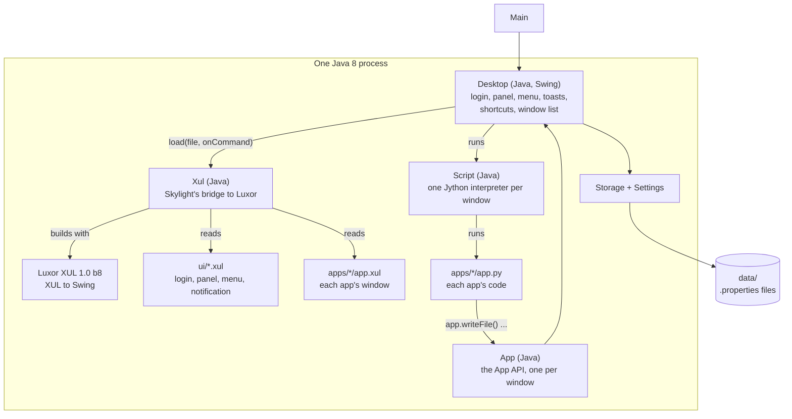

# Architecture

## One Java process: Swing, Luxor and Jython

| Part | Where | Job |
| --- | --- | --- |
| `Main` | [`Main.java`](../site13luxor/src/skylight/Main.java) | Sets up Jython and Luxor, then shows the login window |
| `Desktop` | [`Desktop.java`](../site13luxor/src/skylight/Desktop.java) | The desktop, in Swing: login, panel, home menu, shortcuts, toasts, dialogs, app windows. See [Desktop internals](desktop-internals.md). |
| `Xul` | [`Xul.java`](../site13luxor/src/skylight/Xul.java) | Loads one `.xul` file, registers its commands, builds its first box with Luxor, and finds its controls by id |
| `Script` | [`Script.java`](../site13luxor/src/skylight/Script.java) | One Jython interpreter per app window: runs `app.py`, calls its functions |
| `App` | [`App.java`](../site13luxor/src/skylight/App.java) | The [App API](app-api.md), one object per window, as `app` in the script |
| `Settings`, `Storage`, `AddUser` | `Settings.java`, `Storage.java`, `AddUser.java` | As in the Java 8 versions: settings, users, files, the add-user tool |
| The desktop's windows | [`ui/`](../site13luxor/ui/) | `login.xul`, `panel.xul`, `menu.xul`, `notification.xul` |
| Built-in apps | [`apps/`](../site13luxor/apps/) | `terminal/`, `settings/`, `web-browser/`: each an `app.properties`, an `app.xul`, an `app.py` and icons |
| Luxor and its libraries | `lib/`, from `tools/get-libs` | See [Luxor XUL and Luxilla](luxor-primer.md#the-jars) |

The Java code is compiled into `skylight.jar`. Everything that describes what you see, `ui/` and `apps/`, stays as plain files beside it, with `images/` and `data/`.

## How it runs

1. `Main` sets Jython's options (its cache folder, and no start-up messages), then, on Swing's event thread, points Luxor at the Skylight folder and shows the login window.
2. The login window is `ui/login.xul`, built through `Xul.load`. Its `logIn` and `quit` commands call back into `Desktop`.
3. A correct password opens a maximized `JFrame`: `ui/panel.xul` at the top and the desktop area (a `JPanel` that paints the background and holds the shortcuts) below. The home menu is a `JPopupMenu` holding `ui/menu.xul`, whose `pages` gadget gets the app buttons and the notification list from code.
4. From here, Swing calls Skylight's code, or an app's script, when something happens.
5. Closing the desktop window, or the menu's red button, logs out: every window closes and the login window comes back. **Quit** ends the program.

## Loading a XUL file

`Xul.load("apps/notes/app.xul", onCommand)`:

1. **Reads the file with JDOM** first. Luxor only logs XML mistakes, so this is where a broken file is caught, with its line. It also finds the window's box (the first `<vbox>` or `<hbox>`), every `id` and every `command`.
2. **Registers an action per command** (`new XulAction("save") { ... }`), each calling `onCommand("save")`. Luxor gives each button the action registered under its command at the moment the button is made, so registering just before building gives every window its own.
3. **Loads the file into Luxor** (`XulLoader`) while listening to Luxor's status messages. Any error or warning, such as a style Luxor doesn't understand, stops the load and becomes the "Cannot open app" message.
4. **Builds the box** with `createNContainerFromBox`, giving Luxor a resolver that turns each `<gadget id="..."/>` into an empty `JPanel`.
5. **Finds the controls**: those Luxor named after their id, and text areas through Luxor's input index.

It returns the Swing component and the controls by id.

## Apps are files

`Desktop.openWindow("apps/notes/", args)`:

1. reads `apps/notes/app.properties` (see [App manifest](app-manifest.md));
2. creates the `App` object for the window;
3. loads `app.xul` as above, with each command calling the script's function of the same name;
4. creates a `Script`, a fresh Jython interpreter with `app` and one variable per control, and runs `app.py`. A Python error here closes the window before it's shown, and the user gets the file, line and error;
5. puts the box in a `JDialog` owned by the desktop window, adds a button to the window list, and shows it.

Each window has its own interpreter, so two Notes windows don't share variables. The files are read each time a window opens, so an edited app shows its changes the next time it's opened, without restarting Skylight.

## Real windows

Each app window is a real top-level window, so the operating system moves, resizes and stacks it. Being owned by the desktop window keeps it in front of the desktop and out of the operating system's taskbar.

## Data

As in the Java 8 versions: `Storage` reads and writes `.properties` files in `data/` (see [Data and configuration](data-and-configuration.md)).
