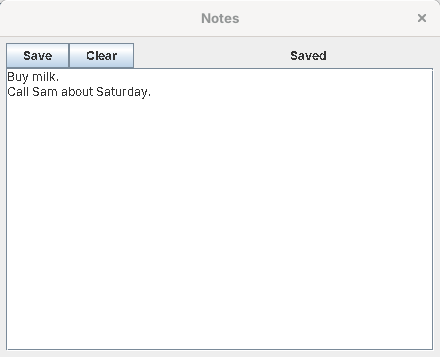
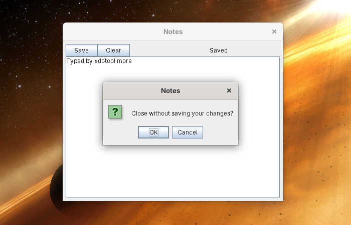

# Building your first app

This tutorial builds **Notes**, an app that keeps one note per user. Like the built-in apps, it's three plain files: XUL for the window, Python for what it does, and a manifest. There's no Java and nothing to compile. It covers the parts of the [App API](app-api.md) most apps need: reading and saving the user's files, notifications, a confirmation dialog, and stopping the window closing while there are unsaved changes. Every step was tested, with the code exactly as it is here.



You need Skylight OS built and running; see [Getting started](getting-started.md).

## 1. Create the folder

```
site13luxor/apps/notes/
├── app.properties
├── app.xul
├── app.py
└── icons/16.png, 32.png, 48.png, 64.png
```

For the icons, copy the four PNGs from `apps/settings/icons/` for now.

## 2. Describe the app

`app.properties` (see [App manifest](app-manifest.md)):

```properties
title=Notes
xul=app.xul
script=app.py
width=440
height=320
icon.16=icons/16.png
icon.32=icons/32.png
icon.48=icons/48.png
icon.64=icons/64.png
```

## 3. Lay out the window

`app.xul`:

```xml
<?xml version="1.0" encoding="UTF-8"?>
<xul>
	<vbox id="notes">
		<hbox>
			<button label="Save" command="save"/>
			<button label="Clear" command="askToClear"/>
			<spacer flex="1"/>
			<label id="status" value="Hello, a-long-user-name"/>
		</hbox>
		<textarea id="note" rows="12" cols="40" flex="1"/>
	</vbox>
</xul>
```

* Everything is inside **`<xul>`**. The first box in it, `<vbox id="notes">`, becomes the window's contents.
* **Boxes** put their contents in a column (`<vbox>`) or a row (`<hbox>`). **`flex="1"`** gives a control the spare room: the spacer pushes the status label to the right, and the text area fills the window.
* **`command="save"`** makes the button call the script's function `save()`.
* **`id="note"`** makes the control a variable, `note`, in the script.
* The label's first `value` is long on purpose: Luxor sizes a label for its first text, and a longer one later would be cut off (see [Luxor XUL and Luxilla](luxor-primer.md#what-its-like-in-2026)).

## 4. Write the script

`app.py`:

```python
# Notes: one note per user, kept in their files.
changed = 0   # Jython 2.1 has no True and False: 1 and 0 instead

# 1. Show the saved note. readFile() returns None if there isn't one yet.
note.setText(app.readFile('notes.txt') or '')
note.setLineWrap(1)
status.setText('Hello, ' + app.getUsername())

def edited(event):
    global changed
    changed = 1
note.keyTyped = edited   # runs whenever a key is typed in the note

# 2. Save. writeFile() reports success, or an error to show the user.
def save():
    global changed
    result = app.writeFile('notes.txt', note.getText())
    if result.ok:
        changed = 0
        status.setText('Saved')
        app.postNotification('Notes', 'Your note was saved.')
    else:
        app.openDialog('Could not save: ' + result.error)

# 3. Ask before throwing work away. clearNote runs only if the user clicks OK.
def clearNote():
    note.setText('')
    status.setText('Cleared (not saved yet)')

def askToClear():
    app.openDialog("Clear the note? This can't be undone.", clearNote)

# 4. Don't lose unsaved work when the window is closed.
def closeAnyway():
    global changed
    changed = 0
    app.closeWindow()

def canClose():
    if changed:
        app.openDialog('Close without saving your changes?', closeAnyway)
        return 0
    return 1

app.setCanClose(canClose)
```

How it works:

1. **The script runs once**, when the window is being built. Every `id` in `app.xul` is a variable (`note` is a Swing `JTextArea`, `status` a `JLabel`), and **`app`** is the [App API](app-api.md). It loads the note and starts listening for typing.
2. **Functions** named in `command="..."` attributes are called when their button is clicked. Variables at the top level (`changed`) keep their values; a function that changes one says `global` first.
3. **Swing, from Python.** `note.setText(...)`, `note.setLineWrap(1)` and `status.setText(...)` are ordinary Swing methods. `note.keyTyped = edited` is Jython's short way to handle a Swing event: `edited` runs for every key typed in the note.
4. **Files:** `app.readFile` and `app.writeFile` use the user's private storage, so each user has their own `notes.txt`. `readFile` returns `None` for a missing file, so `or ''` gives an empty note.
5. **Dialogs:** the function given to `app.openDialog` runs only if the user clicks OK.
6. **Closing:** `app.setCanClose` takes a function that Skylight calls before the window closes. Returning `0` keeps it open; here it asks first, and closes the window itself if the user agrees.

This is **Python 2.1**, the language of Jython 2.1: `1` and `0` instead of `True` and `False`, `print` without brackets, and no `with` (see [Luxor XUL and Luxilla](luxor-primer.md#what-its-like-in-2026)).

## 5. Run it

Open the **Terminal** and run:

```python
app.openWindow('apps/notes/')
```

Type something, click **Save**, close the window and open it again: the note is still there. Type some more and close the window: you're asked first.



To change the app, edit `app.xul` or `app.py` and open the window again: both are read each time an app opens. (`app.properties` is read once per login.)

## 6. Add it to the home menu

Add the folder to `apps/apps.txt`:

```
apps/terminal/
apps/settings/
apps/web-browser/
apps/notes/
```

Log out and in again: Notes appears in the home menu. `app.addShortcut('apps/notes/')` in the Terminal puts it on the desktop.

## Seeing the layout without running it

`tools/preview.sh` (`tools\preview.bat` on Windows) shows every `.xul` file in Skylight in Luxilla, one tab each, including your new `notes` box. The buttons do nothing there, since Luxilla runs no scripts, but it's a quick way to check a layout.

## Going further

* **Any Swing component**: `<gadget id="chart"/>` in the XUL is an empty panel that the script fills, such as `chart.add(JScrollPane(JTree()))`. The Web Browser uses one for its page.
* **Java classes from Python**: `from javax.swing import JTable`, `from java.io import File`. Jython reaches every class on the class path.
* **Several notes**: `app.listFiles()` returns the names of the user's files.
* **Settings**: `app.getSettings()` and `app.saveSettings(settings)`, as in the Settings app (`apps/settings/app.py`).

## Troubleshooting

When an app can't open, the "Cannot open app" notification gives the file and the reason.

| Symptom | Likely cause |
| --- | --- |
| "Error on line 5: The element type ... must be terminated" | The XUL isn't well-formed XML: a tag isn't closed (`<button .../>` needs its `/`) |
| "syntax error: unsupported value ... for css property ..." | A `style` Luxor doesn't understand, such as a `#rrggbb` colour or `monospaced`; use a colour name and `monospace` |
| "expected <xul> with a <vbox> or <hbox> inside it" | The file's root isn't `<xul>`, or the window's box is missing |
| `File "apps/notes/app.py", line 2, in ? NameError: ...` | A mistake in the script: the file and line are given |
| "Error in Notes" notification when a button is clicked | A mistake inside that function; the notification gives the Python error |
| "Error in Notes: The script has no function save()." | A `command` in the XUL has no function of that name in the script |
| A control's variable has become a function | An `id` and a function share a name (`id="save"` and `def save()`): the function replaces the variable. Give ids and commands different names |
| A label's text ends in "..." | Its first `value` was shorter than the new text; make it longer |
| A picture button shows a word next to the picture | It has no `label`, so Luxor shows its `id`; add `label=""` |
