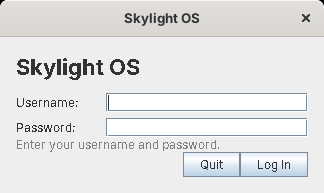

# Getting started

## Requirements

* **A Java 8 JDK** (`javac` and `jar` on your `PATH`). Any Java 8 works: unlike the JavaFX versions, this one needs only Swing, which every Java has. Check with `java -version` (it should say 1.8).
* **An internet connection once**, to download Luxor and its libraries. They aren't in the repository: they're someone else's GPL software, about 2 MB, and SourceForge still hosts them.

## 1. Download Luxor

From the `site13luxor` folder:

```
tools/get-libs.sh                                               (Linux, macOS: needs curl and unzip)
powershell -ExecutionPolicy Bypass -File tools\get-libs.ps1     (Windows)
```

This downloads `luxor-libs-1.0-b8.zip` from SourceForge and puts the jars Skylight uses into `lib/`: Luxor, Jython 2.1, JDOM and the rest (see [Luxor XUL and Luxilla](luxor-primer.md#the-jars)).

## 2. Build

```
build.bat          (Windows)
./build.sh         (Linux, macOS)
```

This compiles `src/` into `skylight.jar`. Its manifest lists the jars in `lib/`, so `java -jar skylight.jar` finds them; keep `lib/` next to it.

## 3. Add a user

```
java -cp skylight.jar skylight.AddUser admin choose-a-password
```

Run it again to change a password. Usernames may use letters, digits, `-` and `_`.

## 4. Run

```
run.bat            (Windows: starts with javaw, no console window)
./run.sh           (Linux, macOS)
```

or `java -jar skylight.jar` from the `site13luxor` folder. Skylight looks for `apps/`, `images/`, `ui/` and `data/` in the current folder; to start it from elsewhere, add `-Dskylight.home=C:\path\to\site13luxor`.

The first start takes a few seconds longer: Jython looks through the Java libraries once and keeps what it found in `data/jython-cache/`.

## Log in



Type your username, press Enter, type your password and press Enter. **Quit** (or Escape) closes Skylight OS.

## Next steps

* Take the [user guide](user-guide.md) tour.
* Open the **Terminal** and run `app.postNotification('Hello', 'It works')`.
* [Build your first app](building-apps.md).
* Run `tools/preview.sh` (or `tools\preview.bat`) to see every window's XUL layout in Luxilla.
