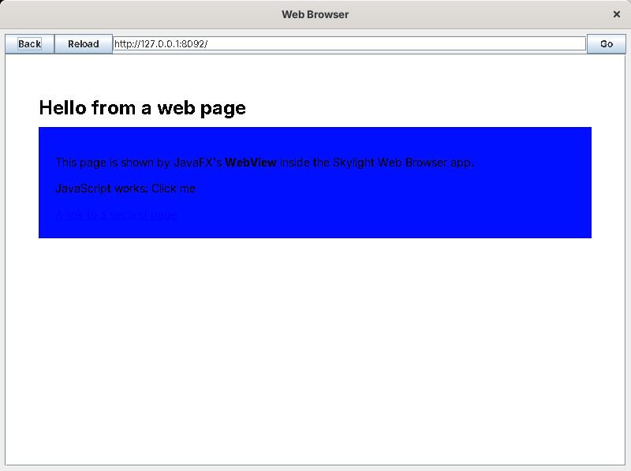

# Limitations

## Behaviour

* **Single user, single computer.** There's no server; each person runs their own copy.
* **Notifications** are kept only while Skylight is running.
* **Long-running code freezes the desktop.** Scripts, commands and events all run on Swing's event thread, so an endless loop in the Terminal freezes Skylight.
* **App windows have no minimize button.** They're dialogs owned by the desktop window, so the operating system doesn't give them taskbar buttons either; hide them with the window list instead.
* **The Web Browser** shows HTML 3.2 with a little CSS and no JavaScript. Modern pages look wrong: the test page's styled box below came out as a solid blue rectangle.

* **XUL files and scripts are read each time an app opens**, so edits show up at once. `app.properties` and `apps/apps.txt` are read at login.
* **Script mistakes appear at run time**: when the window opens (a "Cannot open app" notification) or when a button is clicked ("Error in ...").

## Luxor's limits

Luxor 1.0 b8 has a small layout model (boxes and `flex`, no padding), a small CSS, and a few bugs, all listed in [Luxor XUL and Luxilla](luxor-primer.md#what-its-like-in-2026). It's been unmaintained since 2005, so they won't be fixed, and only the parts Skylight uses were tested.

## Tied to Jython 2.1

Apps are Python 2.1. Python has changed a lot since 2001: no `True`/`False`, no `with`, no generators, `print` as a statement, and only the modules built into Jython's jar: `sys`, `os`, `math` and `time` work, but `string`, `re` and `traceback` don't, because Jython 2.1's Python library isn't part of `jython-2.1.jar` (tested). Java's class library makes up for most of it: `java.util.regex` instead of `re`, string methods instead of `string`.

Moving to a newer Jython (2.7, from 2015 onwards) would give Python 2.7, but Luxor 1.0 b8 was built against Jython 2.1's classes, and Skylight's `Script` would need small changes; that wasn't tried.

## How it was tested

Skylight was built and tested on Linux with:

* **OpenJDK 1.8.0** (Swing, Metal look);
* **Luxor 1.0 beta 8** and its libraries, downloaded by `tools/get-libs.sh` (and again by `tools/get-libs.ps1` under PowerShell 7, which produced identical jars);
* a virtual X display with **metacity** (GNOME's window manager).

The tests:

* **An automated driver** working the real Swing controls: logging in (a wrong password, then the right one); the home menu; the Terminal (output, a single expression's value, errors, variables kept between runs, Java classes, files, a refused file name, a missing file); dialogs with Cancel and OK, and a message-only one; a missing app, a `.xul` file with an XML mistake (reported with its line), a script with an error (reported with its file and line); `openWindow` with arguments; the Notes tutorial (save, the unsaved-changes question, reopening, Clear with OK, closing unchanged); shortcuts, including a duplicate and a non-app; Settings (a background, 3 seconds, a refused 99, a non-number); the Web Browser (its start page, a test page, a second page, Back, Reload, following a link); the window list (hiding and showing); toasts expiring after 3 seconds and closing with ×; logging out.
* **Real mouse and keyboard**, through xdotool, three times: typing the login; the home menu opening and closing with a click outside; opening Notes from the menu, typing, clicking Save; Alt+F4 with unsaved changes (the question, then Enter for OK); typing code into the Terminal and clicking Run; dragging a shortcut (its new position saved) and double-clicking it; **Close** from the window list's right-click menu; closing the desktop window to log out; Escape to quit.
* **A command with no function**, a Python error inside a command, a button with no label (showing its id), and a gadget filled with a Swing `JTree`.
* **The libraries Skylight needs**, by running the driver without each one (see [Luxor XUL and Luxilla](luxor-primer.md#the-jars)).
* **Luxilla**, through `tools/preview.sh`, showing every window's layout.

Testing found these problems in Skylight, all fixed: a font name Luxor refused (`monospaced`, now `monospace`), `#rrggbb` colours and padding that Luxor's CSS doesn't have, a picture button showing its id, a tooltip Luxor ignores, a gadget that couldn't be found by its id, a confusing error when a command named the same as a control has no function, and long file paths in XML error messages. The Notes tutorial was then tested as written in this documentation.

What wasn't tested:

* **Windows and macOS**, and the `.bat` scripts. Swing and Luxor are the same there, but fonts and window decorations differ.
* **Windows PowerShell 5.1** for `get-libs.ps1`.
* **Java versions other than 8.** Luxor and Jython 2.1 are old enough that newer Javas may refuse parts of them.
* **Real websites** in the Web Browser, since the test machine couldn't reach the internet beyond SourceForge.
