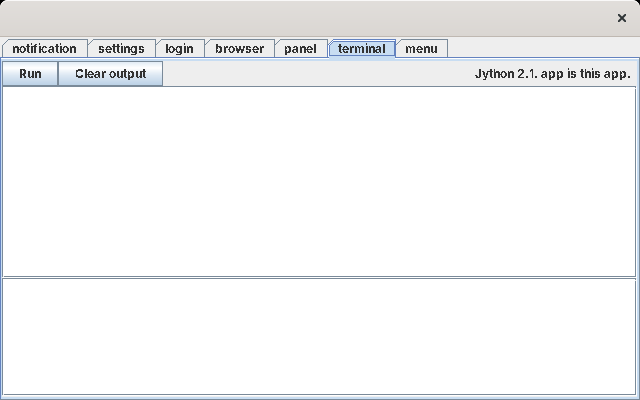

# Luxor XUL and Luxilla

This page is the research behind this version: what Luxor and Luxilla are, what they can do, and what using them in 2026 is like.

## What they are

**Luxor** (<https://luxor-xul.sourceforge.net>) is a Java library, written by Gerald Bauer between 2001 and 2005, that builds Swing user interfaces from **XUL**, the XML user-interface language Mozilla used for its own windows. A `.xul` file describes a window's boxes, buttons, text boxes, menus and toolbars; Luxor turns it into real Swing components, and calls your code when a button is clicked.

**Luxilla** (<https://luxilla.sourceforge.net>) is Luxor's "XUL runner": a 9 KB program that loads every `.xul` file in a folder and shows the first window, or the top-level boxes as tabs. It provides no code behind the buttons. Its job is to show what a XUL file looks like without writing a program.

Together they are close to what Skylight's other versions use: windows described in markup, and code (here Java, or Python through Jython) attached to them.

| | |
| --- | --- |
| Latest release | Luxor 1.0 beta 9 (February 2005), but it ships only a developer jar that needs libraries no longer published; **1.0 beta 8** (January 2003, libraries March 2003) is the last complete release, and the one used here |
| Luxilla | 1.0 beta 8 (March 2003) |
| Licence | GNU GPL version 2 (Luxor and Luxilla); the bundled libraries keep their own licences |
| Runs on | Written for the Java 1.4 of its day; it runs unchanged on Java 8 (tested here) |
| Downloads | SourceForge's file pages for [luxor-xul](https://sourceforge.net/projects/luxor-xul/files/) and [luxilla](https://sourceforge.net/projects/luxilla/files/); `tools/get-libs` fetches what Skylight needs |

## The jars

`luxor-libs-1.0-b8.zip` contains Luxor and everything it uses:

| Jar | What it is | Skylight needs it |
| --- | --- | --- |
| `luxor-1.0-b8.jar` | Luxor itself | yes |
| `houston-1.0-b1.jar` | Gerald Bauer's status messages and logging (`houston.Status`) | yes: Skylight listens to it for Luxor's errors |
| `cypress-1.0-b1.jar` | His CSS parser, for `style="..."` | yes |
| `jdom-1.0-b8`, `jaxen-1.0`, `saxpath-1.0` | XML: JDOM, and XPath for it | yes |
| `jython-2.1.jar` | Jython 2.1: Python 2.1 for Java | yes: the apps' scripts |
| `caramel`, `salsa`, `apollo` (1.0-b1), `rachel-2.0-b2` | His utility, Swing helper, browser-launching and resource libraries | no, but other Luxor features use them, so `get-libs` includes them |
| `velocity-1.3-rc1`, `collections-2.0` | Apache Velocity templates, and Commons Collections | no (Luxor's templates and portal), but included for the same reason |
| `luxilla-1.0-b8.jar` | The Luxilla runner | only for `tools/preview` |
| `hsqldb-1.7.1`, `j2h-1.2` | A database and a code-to-HTML tool, for Luxor's examples | no, and not downloaded |

"Needs" was tested: the automated test passes with only the seven jars marked yes, and fails without `cypress` or `jaxen`.

There's no JavaScript engine: Luxor's scripting language is Python, through Jython.

## A XUL file

```xml
<xul>
	<vbox id="notes">
		<hbox>
			<button label="Save" command="save"/>
			<button label="Clear" command="askToClear"/>
			<spacer flex="1"/>
			<label id="status" value="Hello, a-long-user-name"/>
		</hbox>
		<textarea id="note" rows="12" cols="40" flex="1"/>
	</vbox>
</xul>
```

* The root is always `<xul>`. Everything directly inside it is a **definition** with an `id`: a window, a box, a menu bar, an icon. Luxor keeps them in one big table and builds a definition when asked for its id.
* **Boxes** lay out their children in a row (`<hbox>`) or a column (`<vbox>`), using Swing's `BoxLayout`. **`flex="1"`** lets a child take the spare room; without it, a child keeps its preferred size.
* **`command="save"`** connects a button or menu item to an **action** named `save`.
* **`style="..."`** sets a few CSS-like properties.

The tags Luxor 1.0 b8 understands include `window`, `menubar`, `menu`, `menupopup`, `menuitem`, `toolbar`, `toolbarbutton`, `statusbar`, `box`, `vbox`, `hbox`, `groupbox`, `deck`, `stack`, `grid`, `tabbox`, `button`, `textbox` (also `text`), `password`, `textarea`, `checkbox`, `choice`, `label`, `image`, `icon`, `iframe`, `tree`, `table`, `datagrid`, `list`, `range`, `slider`, `progressmeter`, `spacer`, `separator`, `keyset`, `gadget` (also `componentref`), `portal` and `portlet`. The reference is in `luxor-docs-1.0-b8.zip` (`doc/ref/xul/`).

## Actions

An action is a Swing `Action` with a name, registered with Luxor:

```java
new XulAction("save") {
	public void execute() {
		// what Save does
	}
};
```

The constructor registers it. Luxor looks the action up **when it builds the button**, and attaches it as the button's listener, so actions must exist before the window is built. A command with no action gives a warning (`action 'save' not found`) and a button that does nothing.

Luxor's examples also show actions written in Python, by subclassing `XulAction` in a Jython script.

## Building windows

```java
XulManager xul = XulManager.getXulManager();
xul.setResourceLoader(new ChromeFileResourceLoader(new File("chrome")));
xul.load();                                   // reads chrome/startup/**/*.xul
JFrame frame = xul.lookupWindow("MAIN");      // a new JFrame from <window id="MAIN">
JComponent box = xul.lookupBox("notes");      // a new Swing component from <vbox id="notes">
```

Each `lookup` builds **new** Swing components, so a definition can be used for any number of windows. Controls are named after their `id` (`Component.getName()`), except text areas; `createNContainerFromBox(id, resolver).lookupNInput(id)` finds those. A `<gadget id="x"/>` is a placeholder that the `resolver` fills with any Swing component you like.

## Luxor's other features

Luxor also has features Skylight doesn't use: a **portal** (XHTML pages with `<portlet>` slots filled by Java objects), **Velocity** templates, URL handlers for `chrome://` and `about:` addresses, a small built-in **web server** (Rachel) started from a configuration file, XSLT stylesheets applied to XUL, and data-bound forms (`XulForm`, `XulInput`) with validation.

## Luxilla

```
java -cp "lib/*" luxilla <folder>
```

Luxilla loads every `.xul` file under the folder. If one defines a `<window>`, it opens the first; otherwise it shows each top-level box in a tab, with the first toolbar and menu bar. Skylight includes it as `tools/preview.sh` (`tools\preview.bat`), which shows all of Skylight's windows at once:



The buttons do nothing: Luxilla has no actions, and says so (`xul warning: action 'run' not found`). It's a quick way to check a layout while writing a `.xul` file, without logging in to Skylight.

## How Skylight uses them

Skylight uses **Luxor as a library** and plays the part of Luxilla itself, with more: it loads one `.xul` file at a time, when a window opens; it registers that window's actions just before building it; and it runs a Jython script behind each app, with its controls as variables. See [Architecture](architecture.md).

## What it's like in 2026

Luxor still works: Luxor 1.0 b8, Jython 2.1 and the rest ran on Java 8 without any changes. But it shows its age, and writing Skylight found these limits, all of them in Luxor 1.0 b8 itself:

| Found | What happens | What Skylight does |
| --- | --- | --- |
| Errors are only logged | A mistake in a `.xul` file is printed to the console, and Luxor carries on: a bad style is ignored, and a file that isn't valid XML defines nothing, so asking for its box gives an empty red panel | Skylight reads the file itself first, and collects Luxor's messages while it loads, to show them in a "Cannot open app" notification |
| One table of definitions | Every `id` in every file shares one table; loading a file replaces definitions with the same id | Skylight loads a file just before building its window |
| Actions are global names | Two windows with a `save` command share one action table | Skylight registers each window's actions just before building it; buttons keep the action they were built with |
| A small CSS | `font`, `color`, `background`, `width`, `height`, `min-`/`max-` sizes, `align` and a few borders. Colours must be names (`gray`, `green`); `#555555` and `monospaced` are refused; there's no padding or margin | Named colours; padding added in Java around each window |
| `max-width` on a text box | Ignored: text boxes stretch to fill their row | Accepted as it is (the Settings window's number box is wide) |
| Labels | A label keeps the width of its first text, so a longer text later is cut off with "..." | Give a label a long enough first `value` |
| Buttons | `tooltip` is documented but ignored on `<button>`; a button without a `label` shows its `id` as its text | `label=""` on picture buttons; the one tooltip is set in Java |
| Text areas | Not named after their id; no line wrapping by default | Skylight finds them through Luxor's input index; apps call `setLineWrap(1)` |
| `<iframe>` | Swing's `JEditorPane` (HTML 3.2), with no way to change its page from code | The Web Browser puts its own `JEditorPane` in a `<gadget>` |
| Jython 2.1 | Python 2.1: no `True`/`False` (use `1` and `0`), no `with`, `print` is a statement, `try` can't have both `except` and `finally` | Apps are written in Python 2.1 |
| Luxor 1.0 b9 | Its jar needs newer helper libraries that were never released as files | Uses 1.0 b8 |
