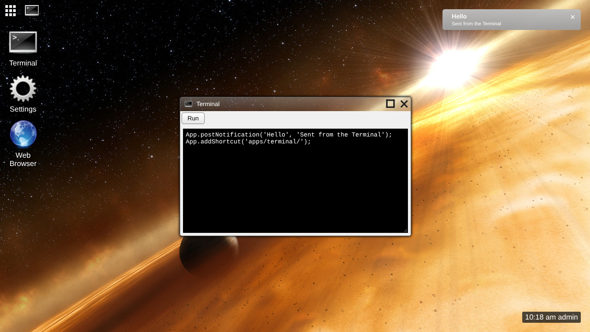

# Skylight OS as a CouchDB app store

This is the [CouchDB 2.3.1 couchapp](../wiki9couchdb/README.md) version of Skylight OS, refactored so that **each app is its own document in CouchDB**. The code is in [`../site14couchsky`](../site14couchsky).

In site9couchdb, the desktop and every app were attachments of one design document, and the home menu was a hand-edited list. Here:

* **The desktop** (the page, `core.js`, `desktop.js`, the styles and the Dialog) is still the design document `_design/skylight`.
* **Each app** is a document named after it (`terminal`, `settings`, `web-browser`, `notes`), with its `app.json` as the `manifest` field and its files as attachments.
* **The home menu** is a CouchDB **view** of the app documents, ordered by a `menu` number in each manifest. Pushing a new app adds it to everyone's menu; nothing else needs editing.
* **`tools/push-app`** installs or updates one app without touching the rest. Users get an updated app the next time they open it, without reloading the page.
* **Rewrite rules** keep every address the same, so the pages and the App API are unchanged: an app is still `apps/notes/`, and its page still loads `../../system/js/core.js`.

Users, logins and each user's private database are exactly as in site9couchdb.

## Contents

**Using Skylight OS**

* [Getting started](getting-started.md): install CouchDB, push Skylight and its apps, add users
* [User guide](user-guide.md): the desktop, windows, notifications and the built-in apps

**The app store**

* [The app store](app-store.md): app documents, the rewrites, the home menu view, pushing and removing apps

**Building apps**

* [Building your first app](building-apps.md): a step-by-step tutorial, ending with `push-app`
* [App manifest](app-manifest.md): the `app.json` file, now with `menu`
* [App API](app-api.md): the `App` object apps use
* [UI components](ui-components.md): the shared styles

**How it works**

* [Architecture](architecture.md): the browser, the design document, the app documents and the databases
* [CouchDB primer](couchdb-primer.md): the CouchDB features Skylight uses, including rewrites and views
* [Desktop internals](desktop-internals.md): what changed from the PHP version, and `core.js`
* [Data and configuration](data-and-configuration.md): documents, databases, tools and settings

**Background**

* [Compared with the other versions](comparison.md)
* [Security](security.md)
* [Limitations](limitations.md)

## At a glance

| | |
| --- | --- |
| Runs on | Apache CouchDB 2.3.1 (2.x in general); any modern browser |
| Languages | ES5 JavaScript, HTML and CSS; JavaScript `validate_doc_update` and view functions in CouchDB |
| Server code | None: three validation functions, one view and five rewrite rules |
| Install tools | `tools/push.sh`, `tools/push-app.sh` and `tools/add-user.sh` (bash and curl), or the `.ps1` versions (PowerShell) |
| Data | CouchDB documents: the desktop and one per app in `skylight`, and one private database per user |
| Changed from site9couchdb | `desktop.js` (about 10 lines), the rewrites, a view, the `skylight` validation function, and the push tools |
| Tested | On a CouchDB 2.3.1 built from Apache's source release, with Chromium (see [Limitations](limitations.md#how-it-was-tested)) |
