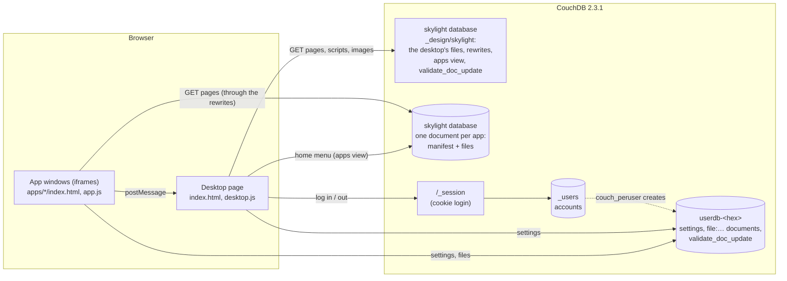
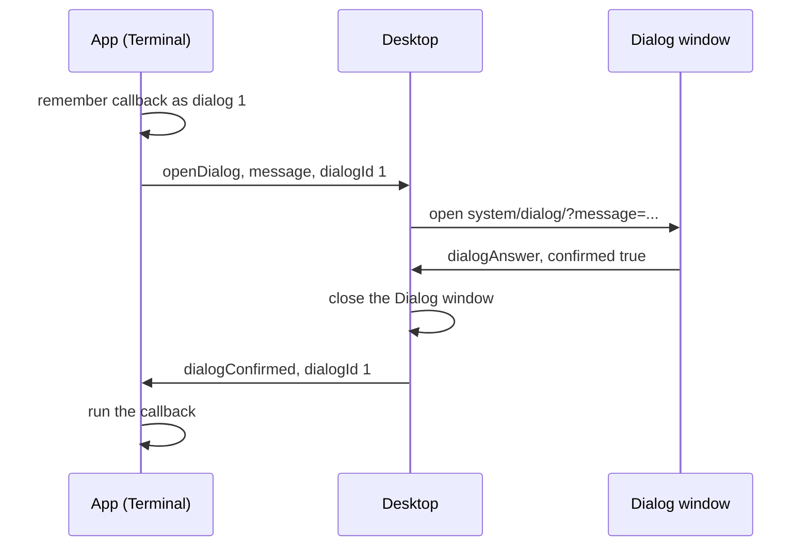

# Architecture

## Overview



Everything is served by CouchDB, from one address, so the pages and CouchDB's own API share an origin: the pages can call `/_session` and `/userdb-…/` directly, and CouchDB's login cookie goes with every request.

| Part | Where | Job |
| --- | --- | --- |
| The desktop's pages, scripts, styles, images | Attachments of `skylight/_design/skylight` (from `attachments/`) | The desktop, the Dialog window and the shared `core.js` and `app.js`, as in the PHP version |
| The apps | One document each in `skylight` (from `apps/`), named after the app | `manifest` (the app's `app.json`) and the app's files as attachments; see [The app store](app-store.md) |
| `rewrites` | The design document (from `design/rewrites.json`) | Makes `.../_rewrite/` show `index.html`, and makes the app documents look like folders under `apps/` |
| `views.apps` | The design document (from `design/views/apps/map.js`) | The home menu: every app with a `menu` number, in order |
| `validate_doc_update` | The design document (from `design/validate_doc_update.js`) | Only CouchDB administrators may change Skylight or its apps, and every app must have a manifest with a title |
| Accounts | `_users` (CouchDB's) | Names and password hashes; logins through `/_session` |
| Sign-up check | `_users/_design/skylight` (from `users/validate_doc_update.js`) | Only administrators may create accounts |
| A user's data | `userdb-<name in hex>`, created by couch_peruser | `settings` and `file:<name>` documents, readable only by that user |
| Checks on that data | `userdb-…/_design/skylight` (from `userdb/validate_doc_update.js`) | Only valid settings and files may be saved |
| `core.js` | An attachment | Turns the App API's server calls into CouchDB requests (see [Desktop internals](desktop-internals.md)) |

## Folder layout

```
site14couchsky/
├── attachments/            uploaded as the design document's attachments
│   ├── index.html          the desktop page
│   └── system/             js/ (core, desktop, app), css/, dialog/, images/
├── apps/                   terminal/, settings/, web-browser/: each pushed as its own document
├── design/                 validate_doc_update.js, rewrites.json and views/apps/map.js for _design/skylight
├── userdb/                 validate_doc_update.js for each user's database
├── users/                  validate_doc_update.js for _users (no sign-ups)
└── tools/                  push, push-app and add-user, for bash (.sh) and PowerShell (.ps1)
```

## Starting up

1. The browser loads `.../_design/skylight/_rewrite/`, which the rewrite rules turn into the `index.html` attachment. Its scripts and styles are loaded by relative address, so they're attachments too.
2. `core.js` works out the site's root from its own address, as in the PHP version.
3. The desktop asks for the settings. `core.js` calls `GET /_session`; if CouchDB knows the user from the cookie, it reads their `settings` document and the desktop appears straight away. Otherwise the login form shows.
4. Logging in posts the name and password to `/_session`. CouchDB checks them against `_users` and sets the `AuthSession` cookie.
5. The desktop builds the home menu from `system/apps.json`, which the rewrites turn into the `apps` view, and reads each listed app's manifest from `apps/<name>/app.json`, which the rewrites turn into the app's document (see [The app store](app-store.md#addresses)).

## Windows

App windows work exactly as in the PHP version: each is an `iframe` showing the app's `index.html`, with its AppID and the username in the address, inside a window the desktop draws. See the [PHP version's architecture](../wiki3/architecture.md#windows) for the details.

## Messages between apps and the desktop

Apps can't touch the desktop page directly, so the `App` object sends JSON messages with `postMessage`. The desktop only accepts a message when:

1. it comes from the site's own origin (`event.origin`), **and**
2. it comes from one of the desktop's own window iframes (`event.source`).

A web page shown inside the Web Browser app fails both tests, so it can't control the desktop. Because the desktop knows which window sent each message, an app can close itself without passing its AppID.

| Message (`eventType`) | Fields | Sent by | Desktop action |
| --- | --- | --- | --- |
| `openWindow` | `path` | `App.openWindow` | Open a window |
| `closeWindow` | `appID` (optional) | `App.closeWindow` | Close that window, or the sender |
| `openDialog` | `message`, `dialogId` | `App.openDialog` | Open the Dialog window |
| `dialogAnswer` | `confirmed` | Dialog window | Close the dialog; tell the app if OK was clicked |
| `postNotification` | `header`, `body` | `App.postNotification` | Add a notification and toast |
| `saveSettings` | `changes` | `App.saveSettings`, `App.setBackground` | Save the `settings` document, then apply |
| `addShortcut` | `path` | `App.addShortcut` | Add a desktop shortcut and save it |

The desktop sends one message back to apps: `dialogConfirmed` (`dialogId`), which makes `app.js` run the callback given to `App.openDialog`.

### Dialogs



No code is passed around as text, and the message is shown with `textContent`, so it can't contain HTML.

## Requests to CouchDB

All requests are synchronous `XMLHttpRequest`s with JSON bodies, made by `core.js`. Each answers one of the PHP version's API calls:

| App API / desktop | PHP version | CouchDB request |
| --- | --- | --- |
| Log in | `POST api/login.php` | `POST /_session` `{"name", "password"}`, then read the settings |
| Log out | `POST api/logout.php` | `DELETE /_session` |
| `App.getSettings()`, start-up | `GET api/settings.php` | `GET /_session`, then `GET /userdb-…/settings` |
| `App.saveSettings()` | `POST api/settings.php` | `GET` then `PUT /userdb-…/settings` with its `_rev` |
| `App.listFiles()` | `GET api/files.php` | `GET /userdb-…/_all_docs?startkey="file:"&endkey="file:￰"` |
| `App.readFile(name)` | `GET api/files.php?name=` | `GET /userdb-…/file:<name>` |
| `App.writeFile(name, text)` | `POST api/files.php` | `GET` then `PUT /userdb-…/file:<name>` with its `_rev` |

Saving reads the document first to get its current revision (`_rev`), which CouchDB requires to replace it. If someone else saved in between, CouchDB answers 409 Conflict, and `core.js` tries again, up to three times.
