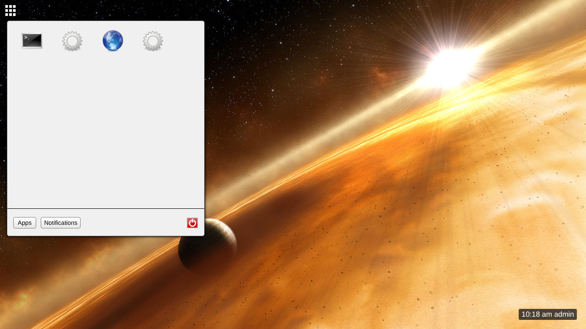
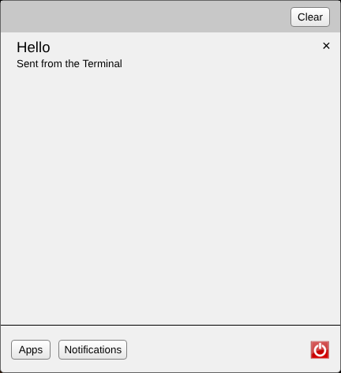
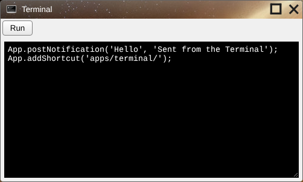
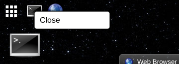
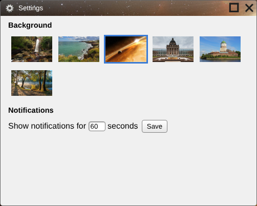
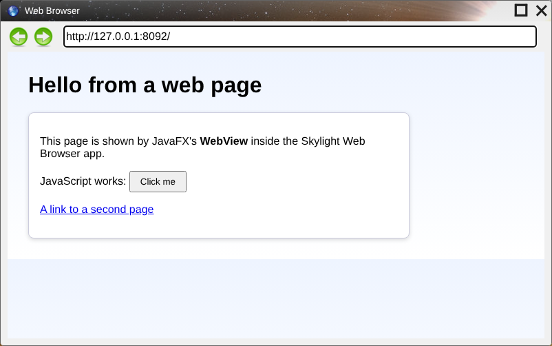

# User guide

## The desktop



| | |
| --- | --- |
| **Home button** (grid, top left) | Opens the home menu. Click it again, or anywhere else, to close it. |
| **Taskbar** (top, next to the home button) | An icon for each open window. |
| **Clock** (bottom right) | The time and the logged-in user. |
| **Shortcuts** | App icons on the desktop. Double-click to open; drag to move. They are saved with your settings. |
| **Toasts** (top right) | Notifications pop up here. |

### Home menu

* **Apps**: click an icon to open the app. Hover to see its name. The apps come from the `skylight` database, so everyone sees the same ones; a newly installed app appears after you log in again or reload the page.
* **Notifications**: everything you've been notified about since you logged in, newest first. Click **×** to remove one, or **Clear** to remove all.
* **Power button** (red): logs you out and returns to the login screen.



## Windows



* **Move** a window by dragging its title bar. Clicking anywhere in a window brings it to the front.
* **Maximize** with the square button; click it again to restore.
* **Close** with the × button. The app isn't asked first, so unsaved work is lost.
* **Minimize** by clicking the window's taskbar icon; click it again to bring the window back.
* **Right-click** a taskbar icon for a **Close** menu.



Windows can't be resized except by maximizing.

## Notifications

Apps send notifications to tell you something happened. Each one appears as a toast at the top right for a few seconds (you choose how long in Settings), and stays in the home menu's Notifications tab until you remove it, reload the page or log out. Click a toast's × to dismiss it early.


## Built-in apps

### Terminal

Runs JavaScript. Type code and click **Run**; every [App function](app-api.md) is available:

```
App.openWindow('apps/web-browser/');
App.openDialog('Are you sure?', function () { App.postNotification('OK', 'You clicked OK'); });
App.addShortcut('apps/settings/');
```

If the code fails, the error is added to the end of the text as a comment.

### Settings



* **Background**: click a picture. The desktop changes at once and remembers it.
* **Notifications**: how many seconds toasts stay on screen (1 to 60). Click **Save**.

### Web Browser



Type an address and press Enter (`http://` is added if you leave it out). Many websites refuse to load inside another page and show up blank. Back and forward only work for pages on the same site as Skylight OS; for others a notification explains why nothing happened.
