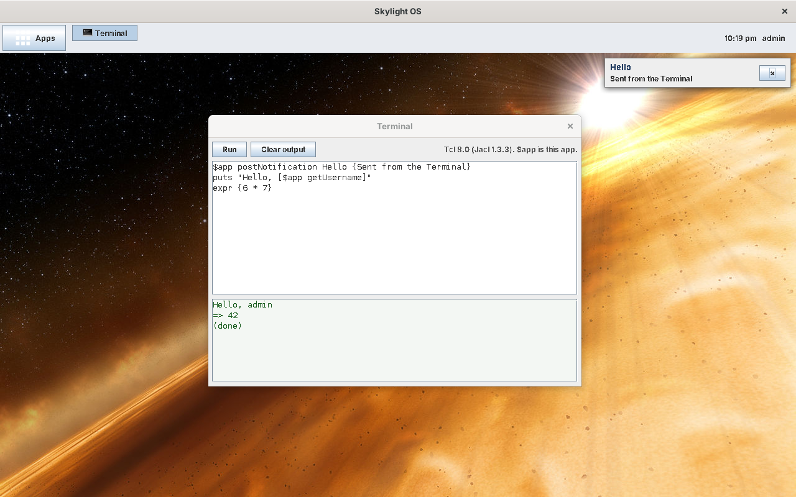

# Skylight OS with an improved Luxor XUL, and Tcl

This is the [Luxor XUL version](../wiki13luxor/README.md) of Skylight OS, taken further while staying on **Java 8**. The code is in [`../site15luxorplus`](../site15luxorplus).

* **Luxor, improved.** site13 used Luxor XUL 1.0 beta 8 as released, and worked around its limits. Here Luxor itself is changed, and rebuilt from its source: hex colours, padding, margin, spacing, any Java font, working tooltips, labels that grow with their text, `max-width` (which never worked, because of a bug), and every control findable by its `id`. See [Luxor, improved](luxor-improved.md).
* **Tcl instead of Python.** An app is an `app.xul` and an **`app.tcl`**, run by **Jacl 1.3.3**, a Tcl interpreter written in Java. Jacl 1.3.3 doesn't run on Java 8 as released; five small classes make it work. See the [Tcl primer](tcl-primer.md).

```xml
<vbox id="notes" spacing="4" style="padding: 6;">
	<hbox spacing="4">
		<button label="Save" command="save" tooltip="Save the note"/>
		...
	</hbox>
	<textarea id="note" rows="12" cols="40" flex="1" wrap="true"/>
</vbox>
```

```tcl
proc save {} {
    global app note
    set result [$app writeFile notes.txt [$note getText]]
    if {[java::field $result ok]} {
        $app postNotification Notes "Your note was saved."
    }
}
```



## Contents

**Using Skylight OS**

* [Getting started](getting-started.md): download and build Luxor and Jacl, build, add a user, run
* [User guide](user-guide.md): the desktop, windows, notifications and the built-in apps

**Building apps**

* [Building your first app](building-apps.md): the Notes tutorial, in XUL and Tcl
* [App manifest](app-manifest.md): the `app.properties` file
* [App API](app-api.md): what an app's script can call
* [Tcl primer](tcl-primer.md): Tcl, Jacl, and calling Java from Tcl
* [Luxor, improved](luxor-improved.md): what was changed in Luxor, and the bug it fixed

**How it works**

* [Architecture](architecture.md)
* [Desktop internals](desktop-internals.md)
* [Data and configuration](data-and-configuration.md)

**Background**

* [Compared with the other versions](comparison.md)
* [Security](security.md)
* [Limitations](limitations.md)

## At a glance

| | |
| --- | --- |
| Language | Java 8 for the desktop; XUL for windows; Tcl (Jacl 1.3.3) for apps |
| UI | Swing (Metal look), built by Luxor XUL 1.0 beta 8 with Skylight's changes |
| Runs on | Windows, Linux or macOS with a Java 8 JDK (no JavaFX needed) |
| Libraries | Luxor 1.0 b8 (GPL v2) and its libraries, and Jacl 1.3.3, downloaded and built by `tools/get-libs`; not in the repository |
| Changes to Luxor | 7 of its files, which grow by about 230 lines, in [`luxor/`](../site15luxorplus/luxor/README.md) |
| Data | `.properties` files in `data/`, as in the Java 8 versions |
| Tested | On Linux with OpenJDK 1.8.0 (see [Limitations](limitations.md#how-it-was-tested)) |
