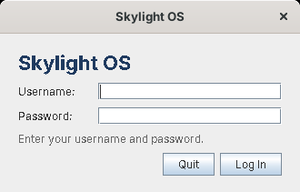

# Getting started

## Requirements

* **A Java 8 JDK** (`java`, `javac` and `jar` on your `PATH`). Any Java 8 works: this version needs only Swing, which every Java has. Check with `java -version` (it should say 1.8).
* **An internet connection once**, to download Luxor and Jacl from SourceForge. They aren't in the repository: they're other people's software, and Luxor is built from its source with Skylight's changes.

## 1. Download and build the libraries

From the `site15luxorplus` folder:

```
tools/get-libs.sh                                               (Linux, macOS: needs curl and unzip)
powershell -ExecutionPolicy Bypass -File tools\get-libs.ps1     (Windows)
```

This takes a few seconds, and:

1. downloads `luxor-libs-1.0-b8.zip` (Luxor's libraries), `luxor-1.0-b8.zip` (Luxor's source) and `jaclBinary133.zip` (Jacl 1.3.3);
2. copies Skylight's changed Luxor files from [`luxor/`](../site15luxorplus/luxor/README.md) over Luxor's source and compiles it into `lib/luxor-1.0-b8-skylight.jar`;
3. compiles the classes Jacl needs on Java 8, from [`compat/`](../site15luxorplus/compat/README.md), into `lib/jacl-java8.jar`.

## 2. Build

```
build.bat          (Windows)
./build.sh         (Linux, macOS)
```

This compiles `src/` into `skylight.jar`. Its manifest lists the jars in `lib/`, so `java -jar skylight.jar` finds them; keep `lib/` next to it.

## 3. Add a user

```
java -cp skylight.jar skylight.AddUser admin choose-a-password
```

Run it again to change a password. Usernames may use letters, digits, `-` and `_`.

## 4. Run

```
run.bat            (Windows: starts with javaw, no console window)
./run.sh           (Linux, macOS)
```

or `java -jar skylight.jar` from the `site15luxorplus` folder. Skylight looks for `apps/`, `images/`, `ui/` and `data/` in the current folder; to start it from elsewhere, add `-Dskylight.home=C:\path\to\site15luxorplus`.

## Log in



Type your username, press Enter, type your password and press Enter. **Quit** (or Escape) closes Skylight OS.

## Next steps

* Take the [user guide](user-guide.md) tour.
* Open the **Terminal** and run `$app postNotification Hello {It works}`.
* [Build your first app](building-apps.md).
* Run `tools/preview.sh` (or `tools\preview.bat`) to see every window's XUL layout in Luxilla.
