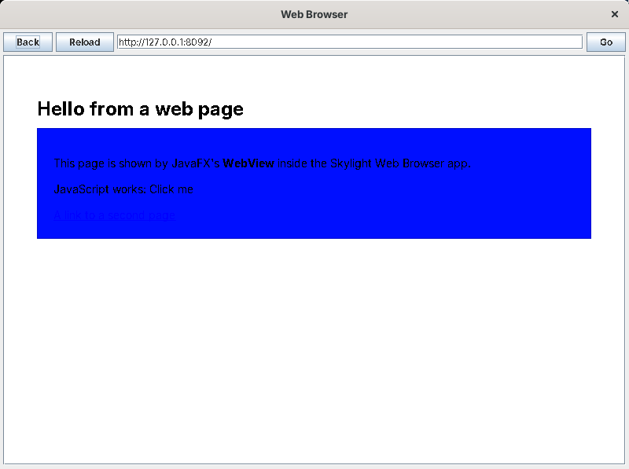

# Limitations

## Behaviour

* **Single user, single computer.** There's no server; each person runs their own copy.
* **Notifications** are kept only while Skylight is running.
* **Long-running code freezes the desktop.** Scripts, commands and events all run on Swing's event thread, so an endless loop in the Terminal freezes Skylight.
* **App windows have no minimize button.** They're dialogs owned by the desktop window, so the operating system doesn't give them taskbar buttons either; hide them with the window list instead.
* **The Web Browser** shows HTML 3.2 with a little CSS and no JavaScript. Modern pages look wrong: the test page's styled box below came out as a solid blue rectangle.

* **XUL files and scripts are read each time an app opens**, so edits show up at once. `app.properties` and `apps/apps.txt` are read at login.
* **Script mistakes appear at run time**: when the window opens (a "Cannot open app" notification) or when a button is clicked ("Error in ...").

## Luxor's remaining limits

The improvements are listed in [Luxor, improved](luxor-improved.md#whats-left), with what's still Luxor's own: one global table of definitions and actions, errors that are only logged, a fixed set of tags, inline styles only, and the HTML 3.2 viewer. Only the parts of Luxor that Skylight uses were tested, before and after the changes.

## Tied to Jacl 1.3.3, and to Java 8

* **Tcl at about the 8.0 level.** Jacl 1.3.3 reports Tcl 8.0, with some later additions. Missing: `eq` and `ne` (use `string equal`), `\d` in regular expressions (use `[0-9]`), `dict`, `lassign` and `{*}`. See the [Tcl primer](tcl-primer.md).
* **Jacl 1.3.3 needs Skylight's `sun.io` stand-ins on Java 8**, because Java 8 removed the classes it uses for text. They cover only what Jacl calls; anything else in Jacl that used `sun.io` would still fail, and none was found.
* **Java 8.** Everything was built and tested for Java 8. Jacl and Luxor are old enough that newer Javas may refuse parts of them; that wasn't tried.
* **Jacl is frozen.** Its last release was 1.4.1 in 2008, and this version uses 1.3.3 (2006); JTcl continued it later.

## How it was tested

Skylight was built and tested on Linux with:

* **OpenJDK 1.8.0** (Swing, Metal look);
* **Luxor 1.0 beta 8** built from its source with Skylight's changes, and **Jacl 1.3.3**, both made by `tools/get-libs.sh`. `tools/get-libs.ps1`, run with PowerShell 7, built the same jars: the downloaded libraries byte for byte, and Luxor and the Jacl fix with byte-identical classes;
* a virtual X display with **metacity** (GNOME's window manager).

**Jacl on Java 8** was tried first on its own: as released, creating an interpreter failed with `NoClassDefFoundError: sun/io/UnknownCharacterException`. With the stand-in classes it worked, including reading a file through Tcl's own `open` and `read`, which go through them. The rest of the prototype checked what apps need: Java objects as variables, calling procs from Java, `java::bind` running its Tcl straight away on the interpreter's thread, `java::field`, how a Java `null` string and an `Object` result come back, overloads, and error messages.

**Luxor's changes** were each checked directly, building a box from XUL and reading the Swing components' sizes, colours, fonts and insets: `#abc`, `rgb()`, a quoted font family, a size-only font, padding and margin around a border, `max-width` on a label and on a text box, and labels growing.

The final tests ran on a fresh copy of the `site15luxorplus` folder, with `tools/get-libs.sh` downloading and building everything again, and the Notes app copied out of [Building your first app](building-apps.md) by a script:

* **An automated driver** working the real Swing controls: logging in (a wrong password, then the right one); the home menu; the Terminal (output from `puts`, a command's result, errors, variables kept between runs, a Java call, files including an accented character, a refused file name, a missing file); dialogs with Cancel and OK, and a message-only one; a missing app, a XUL file with an XML mistake (reported with its line), a script with an error (reported with Tcl's message); `openWindow` with arguments, read back with `getArgs`; the Notes tutorial (save, the unsaved-changes question, reopening, Clear with OK, closing unchanged, and the window list afterwards); shortcuts, including a duplicate and a non-app; Settings (a background, 3 seconds, a refused 99, a non-number); the Web Browser (its start page, a test page, a second page, Back, Reload, following a link); the window list (hiding and showing); toasts showing their text, expiring after 3 seconds and closing with ×; logging out.
* **The improved Luxor in an app**: a label growing from 35 to 210 pixels without being cut off, a text box held to `max-width: 60` next to one that takes the rest, a button tooltip, a `#rrggbb` colour and a Java font name, a button without a label, a gadget filled with a `JTree`, a command with no proc, and a Tcl `error` inside a command.
* **Real mouse and keyboard**, through xdotool, three times: typing the login; the home menu opening and closing with a click outside; opening Notes from the menu, typing, clicking Save; Alt+F4 with unsaved changes (the question, then Enter for OK, then checking the window list); typing Tcl into the Terminal and clicking Run; dragging a shortcut (its new position saved) and double-clicking it; **Close** from the window list's right-click menu; closing the desktop window to log out; Escape to quit.
* **Luxilla**, through `tools/preview.sh`, showing every window's layout with the improved Luxor.

Testing found these problems, all fixed:

* in Luxor: `getMaxWidth()` returning the maximum height (so `max-width` never worked); a text field with `cols` ignoring the preferred size it was given; password fields and other controls without names;
* in the first version of the label fix: labels that started empty inside a vertical box stayed 0 pixels wide (the screenshots showed blank toasts), because the box around them kept its built size; the fix now sizes the enclosing boxes again too;
* in Jacl: the `sun.io` classes missing from Java 8;
* in Skylight: Luxor's private label class, which Jacl can't call methods through (Skylight now hands scripts the nearest public class); and a window closing itself from its own Tcl (`closeAnyway` in the Notes tutorial) whose interpreter was freed while still running, which left its button in the window list.

What wasn't tested:

* **Windows and macOS**, and the `.bat` scripts. **Windows PowerShell 5.1** for `get-libs.ps1`.
* **Java versions other than 8.**
* **Parts of Luxor that Skylight doesn't use** (menus, trees, tables, portals and the rest), with or without the changes.
* **Real websites** in the Web Browser, since the test machine couldn't reach the internet beyond SourceForge.
