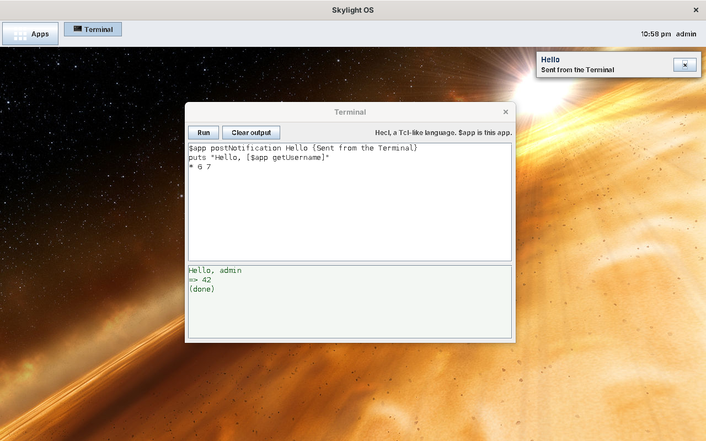

# Skylight OS with an improved Luxor XUL, and Hecl

This is the [improved Luxor version](../wiki15luxorplus/README.md) of Skylight OS with a different scripting language: apps are written in **Hecl** instead of Jacl's Tcl. Everything stays on **Java 8**. The code is in [`../site16luxorhecl`](../site16luxorhecl).

* **Hecl instead of Jacl.** An app is an `app.xul` and an **`app.hcl`**. [Hecl](https://github.com/davidw/hecl) is a small scripting language written in Java that reads like Tcl: commands and their words, `$variables`, `[commands]` and `{braces}`, `proc`, `foreach`, `global`. It isn't Tcl, though: maths, comparisons and string handling are all commands (`* 6 7`, `eq $a $b`, `strlen $s`), and an `if` condition is a command too. See the [Hecl primer](hecl-primer.md).
* **Included, not downloaded.** Hecl's source (46 files, Apache License 2.0) is in the repository, with Skylight's fixes to how Hecl calls Java, and is compiled into `skylight.jar`. Only Luxor is downloaded. Jacl, and the five stand-in classes it needed on Java 8, are gone.
* **The same improved Luxor** as site15: hex colours, padding, margin, spacing, any Java font, working tooltips, labels that grow with their text, `max-width`, and every control findable by its `id`. See [Luxor, improved](luxor-improved.md).

```xml
<vbox id="notes" spacing="4" style="padding: 6;">
	<hbox spacing="4">
		<button label="Save" command="save" tooltip="Save the note"/>
		...
	</hbox>
	<textarea id="note" rows="12" cols="40" flex="1" wrap="true"/>
</vbox>
```

```tcl
proc save {} {
    global app note
    set result [$app writeFile notes.txt [$note getText]]
    if {$result -field ok} {
        $app postNotification Notes "Your note was saved."
    }
}
```



## Contents

**Using Skylight OS**

* [Getting started](getting-started.md): download and build Luxor, build, add a user, run
* [User guide](user-guide.md): the desktop, windows, notifications and the built-in apps

**Building apps**

* [Building your first app](building-apps.md): the Notes tutorial, in XUL and Hecl
* [App manifest](app-manifest.md): the `app.properties` file
* [App API](app-api.md): what an app's script can call, and `bind` for Swing events
* [Hecl primer](hecl-primer.md): Hecl, how it differs from Tcl, and calling Java from Hecl
* [Luxor, improved](luxor-improved.md): what was changed in Luxor

**How it works**

* [Architecture](architecture.md)
* [Desktop internals](desktop-internals.md)
* [Data and configuration](data-and-configuration.md)

**Background**

* [Compared with the other versions](comparison.md), including Jacl against Hecl
* [Security](security.md)
* [Limitations](limitations.md), and how it was tested

## At a glance

| | |
| --- | --- |
| Language | Java 8 for the desktop; XUL for windows; Hecl for apps |
| UI | Swing (Metal look), built by Luxor XUL 1.0 beta 8 with Skylight's changes |
| Runs on | Windows, Linux or macOS with a Java 8 JDK (no JavaFX needed) |
| Libraries | Luxor 1.0 b8 (GPL v2) and its libraries, downloaded and built by `tools/get-libs`, not in the repository; Hecl (Apache 2.0), in the repository as source |
| Changes to Luxor | 7 of its files, as in site15, in [`luxor/`](../site16luxorhecl/luxor/README.md) |
| Changes to Hecl | 3 of its files, in [`hecl/`](../site16luxorhecl/hecl/README.md): mostly in how it calls Java methods |
| Data | `.properties` files in `data/`, as in the Java 8 versions |
| Tested | On Linux with OpenJDK 1.8.0 (see [Limitations](limitations.md#how-it-was-tested)) |
