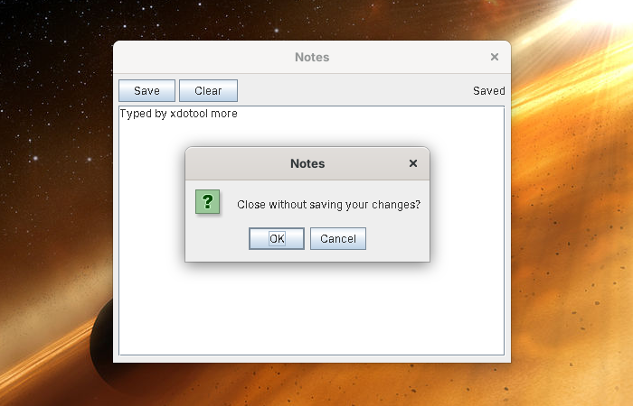

# Building your first app

This tutorial builds **Notes**, an app that keeps one note per user. Like the built-in apps, it's three plain files: XUL for the window, Hecl for what it does, and a manifest. There's no Java and nothing to compile. It covers the parts of the [App API](app-api.md) most apps need: reading and saving the user's files, notifications, a confirmation dialog, and stopping the window closing while there are unsaved changes. Every step was tested, with the code exactly as it is here.


You need Skylight OS built and running; see [Getting started](getting-started.md). New to Hecl? The [Hecl primer](hecl-primer.md) has what you need.

## 1. Create the folder

```
site16luxorhecl/apps/notes/
├── app.properties
├── app.xul
├── app.hcl
└── icons/16.png, 32.png, 48.png, 64.png
```

For the icons, copy the four PNGs from `apps/settings/icons/` for now.

## 2. Describe the app

`app.properties` (see [App manifest](app-manifest.md)):

```properties
title=Notes
xul=app.xul
script=app.hcl
width=440
height=320
icon.16=icons/16.png
icon.32=icons/32.png
icon.48=icons/48.png
icon.64=icons/64.png
```

## 3. Lay out the window

`app.xul`:

```xml
<?xml version="1.0" encoding="UTF-8"?>
<xul>
	<vbox id="notes" spacing="4" style="padding: 6;">
		<hbox spacing="4">
			<button label="Save" command="save" tooltip="Save the note"/>
			<button label="Clear" command="askToClear" tooltip="Empty the note"/>
			<spacer flex="1"/>
			<label id="status" value=""/>
		</hbox>
		<textarea id="note" rows="12" cols="40" flex="1" wrap="true"/>
	</vbox>
</xul>
```

* Everything is inside **`<xul>`**. The first box in it, `<vbox id="notes">`, becomes the window's contents.
* **Boxes** put their contents in a column (`<vbox>`) or a row (`<hbox>`). **`flex="1"`** gives a control the spare room: the spacer pushes the status label to the right, and the text area fills the window.
* **`spacing="4"`** leaves 4 pixels between a box's children, and **`style="padding: 6;"`** leaves 6 around them (both from Skylight's [improved Luxor](luxor-improved.md)).
* **`command="save"`** makes the button run the script's proc `save`. **`tooltip`** is shown when the mouse rests on it.
* **`id="note"`** makes the control a variable, `$note`, in the script.
* **`wrap="true"`** wraps long lines at word boundaries.

## 4. Write the script

`app.hcl`:

```tcl
# Notes: one note per user, kept in their files.
set changed 0

# 1. Show the saved note (an empty string if there isn't one yet), and watch for typing.
$note setText [$app readFile notes.txt]
$status setText "Hello, [$app getUsername]"
bind $note keyTyped {set changed 1}

# 2. Save. writeFile reports success, or an error to show the user.
proc save {} {
    global app note status changed
    set result [$app writeFile notes.txt [$note getText]]
    if {$result -field ok} {
        set changed 0
        $status setText Saved
        $app postNotification Notes "Your note was saved."
    } else {
        $app openDialog "Could not save: [$result -field error]"
    }
}

# 3. Ask before throwing work away. clearNote runs only if the user clicks OK.
proc clearNote {} {
    global note status
    $note setText ""
    $status setText "Cleared (not saved yet)"
}

proc askToClear {} {
    global app
    $app openDialog "Clear the note? This can't be undone." clearNote
}

# 4. Don't lose unsaved work when the window is closed.
proc closeAnyway {} {
    global app changed
    set changed 0
    $app closeWindow
}

proc canClose {} {
    global app changed
    if {= $changed 1} {
        $app openDialog "Close without saving your changes?" closeAnyway
        return 0
    }
    return 1
}

$app setCanClose canClose
```

How it works:

1. **The script runs once**, when the window is being built. Every `id` in `app.xul` is a variable holding its Swing control (`$note` is a `JTextArea`, `$status` a `JLabel`), and **`$app`** is the [App API](app-api.md). `$note setText ...` calls the text area's `setText` method.
2. **Procs** named in `command="..."` attributes run when their button is clicked. A proc sees top-level variables only after naming them with `global`, which is why each proc starts with one.
3. **Events:** `bind $note keyTyped {set changed 1}` runs that Hecl each time the note's key listener is told a key was typed. Bound Hecl runs at the top level, so it sets the top-level `changed` directly. (`bind` is Skylight's command; see the [App API](app-api.md#events-bind).)
4. **Files:** `$app readFile` and `$app writeFile` use the user's private storage, so each user has their own `notes.txt`. A missing file reads as an empty string. `writeFile` returns a Java object; `$result -field ok` reads its field `ok`, which is `1` or `0`.
5. **Conditions are commands.** In Hecl, `if` runs its condition as a command and tests the result, so `if {$result -field ok}` and `if {= $changed 1}` work, but `if {$changed}` doesn't: it would try to run a command called `1`. See the [Hecl primer](hecl-primer.md).
6. **Dialogs:** the Hecl given to `$app openDialog` (here the proc `clearNote`) runs only if the user clicks OK.
7. **Closing:** `$app setCanClose canClose` makes Skylight run `canClose` before the window closes. Returning `0` keeps it open; here it asks first, and closes the window itself if the user agrees.

## 5. Run it

Open the **Terminal** and run:

```tcl
$app openWindow apps/notes/
```

Type something, click **Save**, close the window and open it again: the note is still there. Type some more and close the window: you're asked first.



To change the app, edit `app.xul` or `app.hcl` and open the window again: both are read each time an app opens. (`app.properties` is read once per login.)

## 6. Add it to the home menu

Add the folder to `apps/apps.txt`:

```
apps/terminal/
apps/settings/
apps/web-browser/
apps/notes/
```

Log out and in again: Notes appears in the home menu. `$app addShortcut apps/notes/` in the Terminal puts it on the desktop.

## Seeing the layout without running it

`tools/preview.sh` (`tools\preview.bat` on Windows) shows every `.xul` file in Skylight in Luxilla, one tab each, including your new `notes` box. The buttons do nothing there, since Luxilla runs no scripts, but it's a quick way to check a layout.

## Going further

* **Commands with arguments**: `command="choose 3"` runs `choose 3`, as the Settings app does for its six pictures.
* **Any Swing component**: `<gadget id="chart"/>` in the XUL is an empty panel that the script fills:
  ```tcl
  java javax.swing.JTree JTree
  java javax.swing.JScrollPane JScrollPane
  $chart add [JScrollPane -new [list [JTree -new [list]]]]
  ```
* **Java classes from Hecl**: `java <class> <name>` makes a command for any class on the class path, for its constructors (`-new`), static methods and constants (see the [Hecl primer](hecl-primer.md#hecl-and-java)).
* **Several notes**: `$app listFiles` returns the names of the user's files, as a Hecl list: `foreach name [$app listFiles] { ... }`.
* **Settings**: `$app getSettings` and `$app saveSettings`, as in the Settings app (`apps/settings/app.hcl`).

## Troubleshooting

When an app can't open, the "Cannot open app" notification gives the file and the reason.

| Symptom | Likely cause |
| --- | --- |
| "Error on line 5: The element type ... must be terminated" | The XUL isn't well-formed XML: a tag isn't closed (`<button .../>` needs its `/`) |
| "syntax error: unsupported value ... for css property ..." | A `style` Luxor doesn't understand |
| "expected <xul> with a <vbox> or <hbox> inside it" | The file's root isn't `<xul>`, or the window's box is missing |
| `apps/notes/app.hcl: Command 'undefinedThing' does not exist (line 2)` | A mistake in the script, with the line it's on |
| "Error in Notes: ..." when a button is clicked | A mistake inside that proc; the notification gives Hecl's error and where it happened: `(line 1, in save at line 1)` |
| "Error in Notes: The script has no proc save." | A `command` in the XUL names a proc the script doesn't have |
| `Variable note does not exist` | A proc uses a top-level variable without `global note` |
| `Command '1' does not exist (line 1, in if at line ...)` | A variable used as a condition, `if {$changed}`; write `if {= $changed 1}` |
| `Exception of type class java.lang.NumberFormatException: For input string: "n"` | A number was expected: `incr n` instead of `incr $n`, or `=` (numbers only) instead of `eq` (text) |
| `Unbalanced []` or `Unbalanced {}` | A missing `]` or `}` |
| `Method settxt not found for class javax.swing.JTextArea` | A misspelt method (method names aren't case-sensitive in Hecl, so `settext` works) |
| `No method matched settext for class ...` | The method exists, but not with that number or kind of arguments |
| A list stays empty after `lappend l x` | `lappend` takes the list's value: `lappend $l x` |
