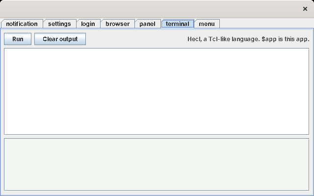

# Luxor, improved

site13luxor used Luxor XUL 1.0 beta 8 exactly as released, and worked around its limits in Skylight's own code. This version changes Luxor itself instead. What Luxor and Luxilla are, their tags and their history are in [site13's Luxor primer](../wiki13luxor/luxor-primer.md); this page is about what changed.

## How it's built

Luxor is GPL v2 software, and its full source is in `luxor-1.0-b8.zip` on SourceForge. `tools/get-libs`:

1. downloads Luxor's libraries and Luxor's source;
2. copies the seven changed files in [`site16luxorhecl/luxor/src/`](../site16luxorhecl/luxor/src/) over Luxor's source;
3. compiles it with Java 8 (all of it except the Jython console, which Skylight doesn't use) into `lib/luxor-1.0-b8-skylight.jar`.

The same changes are in [`luxor/skylight.patch`](../site16luxorhecl/luxor/skylight.patch), as a diff against Luxor's source, and every change in the code is marked `Skylight:`. The changed files stay under the GPL v2.

## What changed

### Styles

```xml
<vbox id="settings" spacing="6" style="padding: 12; background: #fafafa;">
	<label value="Background" style="font: 13 bold; color: #1f3a5f;"/>
	<textarea id="output" style="font: 13 monospaced; color: rgb(27, 94, 32);"/>
```

| | Luxor 1.0 b8 | Improved |
| --- | --- | --- |
| Colours | Names only (`gray`, `green`) | Also `#rgb`, `#rrggbb` and `rgb(r, g, b)` |
| Font families | `serif`, `sans-serif`, `monospace` | Also any Java font: `monospaced`, `Dialog`, `"DejaVu Sans"` |
| A font with no family (`font: 13 bold`) | An error | A sans-serif font |
| `padding` | Not available | 1 to 4 numbers, as in CSS (`padding: 4 8`), inside the element's border |
| `margin` | Not available | The same, outside the border |
| `max-width` | Ignored everywhere (a bug, below) | Works, also on flexible controls such as text boxes |

Padding and margin apply to boxes (`vbox`, `hbox`, `groupbox`), labels and images. Buttons and text boxes keep their own Swing borders. Skylight's windows now set their padding in XUL instead of in Java.

### Layout

* **Labels grow with their text.** Luxor set every control's preferred size once, when the box was built, so a label kept the width of its first text and cut longer ones off with "...". Now a box sizes a child again whenever its text, icon or font changes, and then each box around it, up to the window, because those were sized from their children as they were built too. site13 had to start labels with a long dummy text; this version starts them empty.
* **`spacing="6"`** on a box puts a 6-pixel gap between its children. Luxor had no gaps at all.
* **Sizes stay consistent.** A child's preferred size never exceeds its maximum. A text field with `cols="20"` and a `max-width` drops its column count, because Swing otherwise ignores the preferred size of a text field with columns.

### Controls

| | Luxor 1.0 b8 | Improved |
| --- | --- | --- |
| `tooltip` on `<button>` | Documented, but ignored | Works |
| A button without a `label` | Shows its `id` as its text | Has no text (for picture buttons) |
| `<textarea>` | No name, no line wrapping | Named; `wrap="true"` and `readonly="true"` |
| `<iframe>` | Not reachable from code; `src` required | Named, so a script can call `setPage`; `src` optional |
| Finding a control by `id` | Only some controls were named after their id | Every child of a box is |

### A bug

`AbstractComponent.getMaxWidth()` in Luxor 1.0 b8 returned the element's maximum *height*:

```java
public int getMaxWidth()
{
   return _def.getMaxHeight();   // now: _def.getMaxWidth()
}
```

So `max-width` never worked, in any Luxor app. site13 listed "`max-width` ignored on text boxes" as a limit; this is why.

## What's left

These are still Luxor's, unchanged:

* **One table of definitions and one table of actions** for the whole program. Skylight still loads each file just before building its window, and registers each window's actions just before building it.
* **Errors are logged, not thrown.** Skylight still reads each file with JDOM first, and listens to Luxor's messages while it loads, to report mistakes in a "Cannot open app" notification.
* **The tag set** is Luxor's own. For anything else there's `<gadget>`: an empty panel the script fills with any Swing component.
* **The page viewer** in `<iframe>` is still Swing's `JEditorPane`, with HTML 3.2.
* **Styles are inline.** Luxor has no stylesheet for Swing windows, so each element carries its own `style`.

## Luxilla

`tools/preview.sh` still shows every window's layout in Luxilla, now with the improved Luxor underneath, so padding, colours and spacing show up in the preview too.


