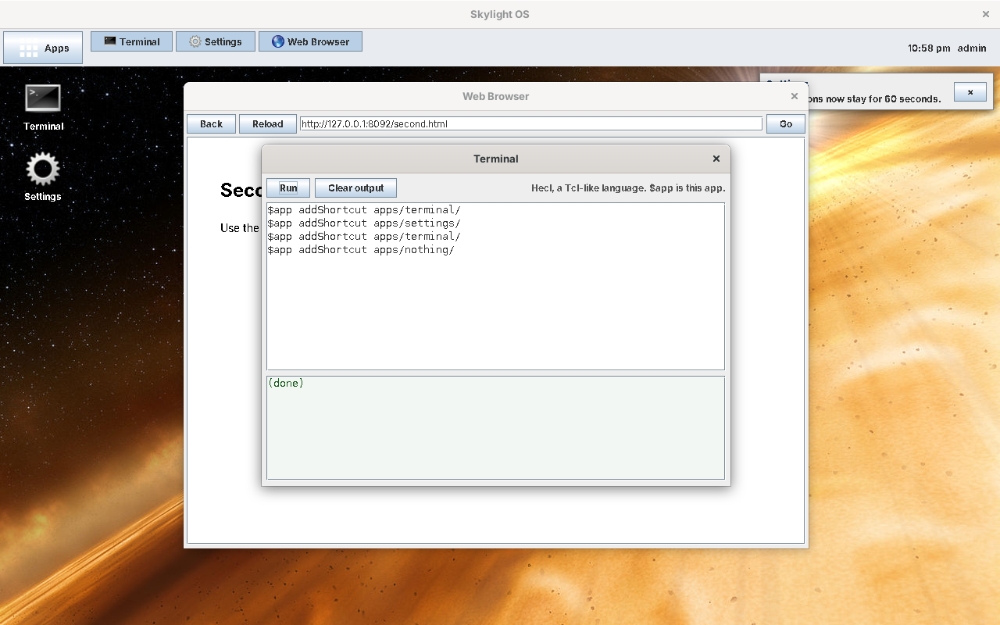
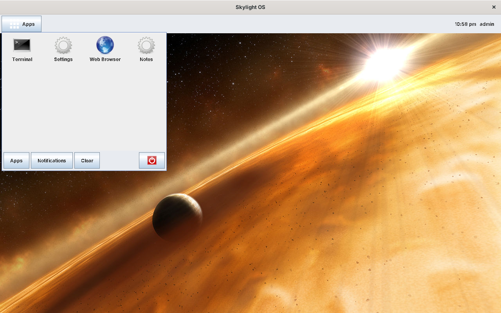
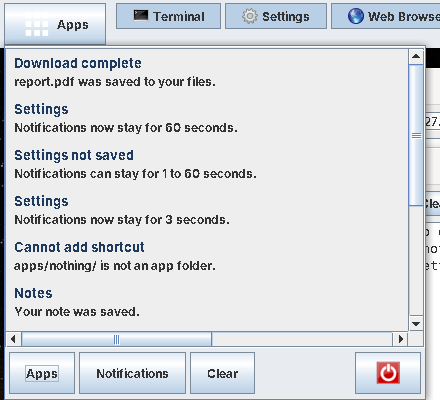
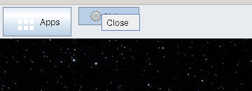
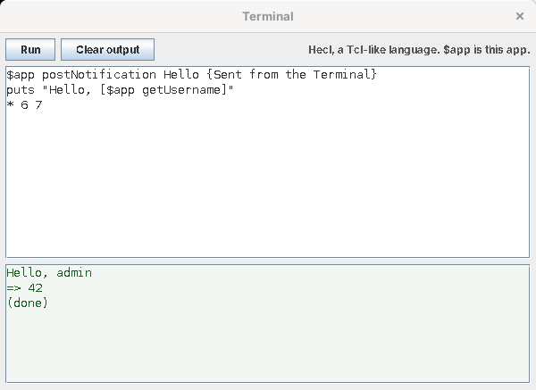
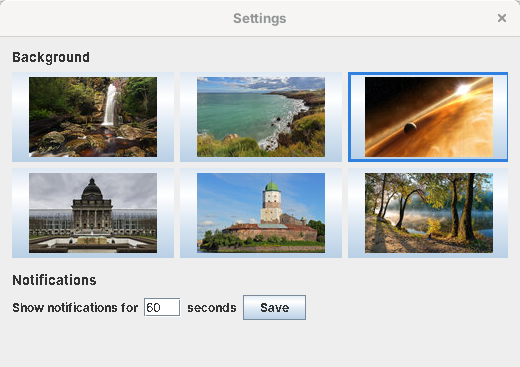
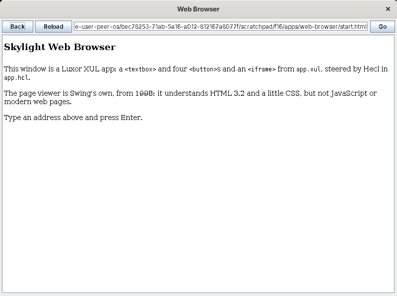

# User guide

## The desktop



| | |
| --- | --- |
| **Apps** (top left) | Opens the home menu. Click it again to close it. |
| **Window list** (next to Apps) | A button for each open app window |
| **Clock** (top right) | The time and your username |
| **Shortcuts** | App icons on the desktop. Double-click to open, drag to move, right-click to remove. They are saved with your settings. |
| **Closing the desktop window** | Logs you out |

### Home menu



* **Apps**: click an icon to open the app.
* **Notifications**: everything apps have posted since you logged in, newest first. **×** removes one; **Clear** removes them all.
* **The red button** logs you out: all windows close and the login window comes back.

A click outside the menu closes it.



### Windows

Each app opens in a real window of its own, which you move, resize and close as usual. App windows stay in front of the desktop and don't get buttons in your operating system's taskbar; Skylight's window list has them instead:

* click a window's button to bring it to the front, or, if it's already in front, to hide it; click again to show it;
* right-click it for **Close**.



### Notifications

Toasts appear at the top right and disappear after the time set in Settings (7 seconds unless you change it). **×** closes one early.

## The built-in apps

### Terminal



Type Hecl and click **Run**. `$app` is the Terminal's own [App API](app-api.md), so you can try any of it:

```tcl
$app postNotification Hello {From the Terminal}
$app openWindow apps/settings/
$app openDialog {Are you sure?} {$app postNotification {You clicked OK}}
puts [$app listFiles]
* 6 7
```

`puts` writes to the output box, the result of the last command is shown (`=> 42`), and errors are shown with their line, as `Error: Command 'nope' does not exist (line 1)`. Variables you set stay for later runs. Hecl can use any Java class: `java java.lang.System System` makes a command for the class, and then `puts [System getProperty java.version]`. See the [Hecl primer](hecl-primer.md).

### Settings



* **Background**: click a picture (hover to see its name). The desktop changes at once and remembers it; the one in use is outlined.
* **Notifications**: how many seconds toasts stay on screen (1 to 60). Click **Save**.

### Web Browser



Type an address and press Enter or click **Go** (`http://` is added if you leave it out); **Back** and **Reload** do what they say, and clicking a link follows it.

The page viewer is Swing's own `JEditorPane`, from the late 1990s: it understands HTML 3.2 and a little CSS, without JavaScript, so most of today's websites look wrong or don't load. The Web Browser is here to show a Luxor `<iframe>` steered from Hecl, not as a browser to use.
