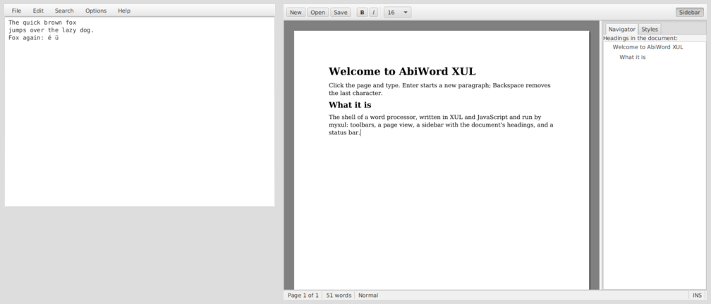

# myxul: XUL applications on Java 8, JavaFX and Nashorn

myxul is a XUL engine written from scratch for **Java 8**, built from the design spec in [`../myxul/designspec.txt`](../myxul/designspec.txt). The code is in [`../site17myxul`](../site17myxul).

* **Windows are XUL files.** An application's windows are Mozilla-style XUL: `<window>`, `<vbox>` and `<hbox>` with `flex`, `<button>`, `<textbox>`, `<menubar>`, `<tabbox>`, `<tree>`, `<splitter>` and the rest, with inline CSS styles.
* **JavaFX draws them.** Each XUL tag becomes a JavaFX control or pane, laid out by myxul's own box pane, which shares space by `flex` weights as XUL does.
* **Nashorn runs their JavaScript.** Event attributes (`oncommand`, `onclick`, `oninput`, ...) and `<script>` blocks are JavaScript, run by the engine built into Java 8. Scripts see XUL's `document`, `window`, `alert` and `confirm`, and elements behave like XUL elements (`el.value`, `el.setAttribute("disabled", true)`).
* **Nothing else to install.** myxul is about 3,000 lines of Java and JavaScript of its own, in a 73 KB jar, and needs only a Java 8 JDK that includes JavaFX.

```xml
<window title="Hello" xmlns="http://www.mozilla.org/keymaster/gatekeeper/there.is.only.xul">
    <script>
        function greet() {
            document.getElementById("greeting").value = "Hello, " + document.getElementById("name").value + "!";
        }
    </script>
    <hbox align="center" spacing="6" style="padding: 10px;">
        <textbox id="name" flex="1" oncommand="greet()"/>
        <button label="Greet" accesskey="G" oncommand="greet()"/>
    </hbox>
    <label id="greeting" value="" style="padding: 0 10px; font-weight: bold;"/>
</window>
```



## Contents

**Using myxul**

* [Getting started](getting-started.md): the Java 8 you need, building, running
* [User guide](user-guide.md): the launcher, Leafpad XUL, AbiWord XUL and the Gallery

**Building apps**

* [Building your first app](building-apps.md): the Notes tutorial
* [XUL reference](xul-reference.md): every element and attribute myxul knows, and the JavaFX class each becomes
* [Scripting](scripting.md): `document`, elements, `window`, events, commands and keys, services
* [Styles](styles.md): how web CSS in `style="..."` becomes JavaFX CSS

**How it works**

* [Architecture](architecture.md): the classes, and what happens when a window opens
* [Engine internals](engine-internals.md): the box layout, splitters, keys, menus, errors
* [From the design spec](design-spec.md): each part of the spec, and how it was built

**Background**

* [Testing against real-world XUL](real-world-xul.md)
* [Compared with FXML](comparison.md)
* [Security](security.md)
* [Limitations](limitations.md), and how it was tested

## At a glance

| | |
| --- | --- |
| Language | Java 8 for the engine; XUL, JavaScript (Nashorn, ECMAScript 5.1) and inline CSS for apps |
| UI | JavaFX 8 (Modena look) |
| Runs on | Windows, Linux or macOS with a Java 8 JDK that includes JavaFX; targeted at Lubuntu |
| Engine | 15 classes in `myxul` (12 of them the core), 3 in `myxul.service`, and `bootstrap.js`: about 3,000 non-blank lines |
| Libraries | None: only what Java 8 includes |
| Apps | Leafpad XUL, AbiWord XUL (a shell), the Gallery, the launcher |
| Tested | On Linux with OpenJDK 1.8.0 and OpenJFX 8 (see [Limitations](limitations.md#how-it-was-tested)) |
