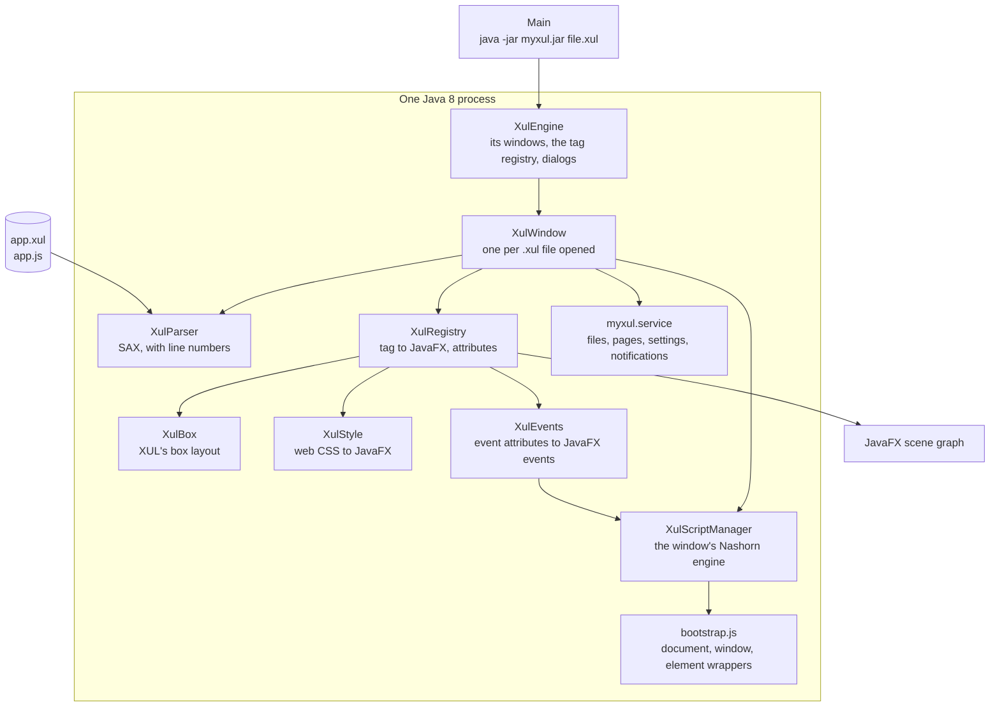

# Architecture

## One Java process: JavaFX, Nashorn and myxul

| Class | Job |
| --- | --- |
| [`Main`](../site17myxul/src/myxul/Main.java) | Starts JavaFX and opens the XUL file given, or the launcher |
| [`XulEngine`](../site17myxul/src/myxul/XulEngine.java) | Opens windows, keeps the list of open ones, reports errors and warnings, holds the dialogs (replaceable, for embedding or tests) |
| [`XulWindow`](../site17myxul/src/myxul/XulWindow.java) | One window: parses its file, sets up its scripts and services, builds it, binds its keys and commands, runs its scripts, shows it; it is also the script-side `window` |
| [`XulParser`](../site17myxul/src/myxul/XulParser.java) | Reads XML with SAX into `XulElement`s with line numbers; refuses DOCTYPEs and external entities |
| [`XulElement`](../site17myxul/src/myxul/XulElement.java) | One element: tag, attributes, children, line, and its JavaFX object; the XUL properties and methods scripts use |
| [`XulDocument`](../site17myxul/src/myxul/XulDocument.java) | The elements by id (checking ids are unique), for the script-side `document` |
| [`XulRegistry`](../site17myxul/src/myxul/XulRegistry.java) | The table of tags: a builder per tag that makes its JavaFX object, and how each attribute applies, at build time and on `setAttribute` |
| [`XulBox`](../site17myxul/src/myxul/XulBox.java) | XUL's box: a JavaFX `Pane` sharing space by flex weight, with `align`, `pack`, `spacing` and margins |
| [`XulStyle`](../site17myxul/src/myxul/XulStyle.java) | Translates inline web CSS to JavaFX CSS, sizes, margins and effects |
| [`XulEvents`](../site17myxul/src/myxul/XulEvents.java) | Connects `oncommand`, `onclick`, `oninput` and the rest to the control's JavaFX events |
| [`XulScriptManager`](../site17myxul/src/myxul/XulScriptManager.java) | The window's own Nashorn engine, with a class filter; runs scripts, compiles event attributes, turns script errors into messages |
| [`bootstrap.js`](../site17myxul/src/myxul/bootstrap.js) | Run first in each engine: `document`, `window`, `alert`, `confirm`, `prompt`, timers, and the element wrappers |
| [`XulCanvas`](../site17myxul/src/myxul/XulCanvas.java), [`XulEvent`](../site17myxul/src/myxul/XulEvent.java), [`XulDialogs`](../site17myxul/src/myxul/XulDialogs.java), [`XulException`](../site17myxul/src/myxul/XulException.java) | `<canvas>`; the event object for property-change events; alert, confirm, prompt and error dialogs; an error with its file and line |
| [`service/`](../site17myxul/src/myxul/service/) | `XulService`, and the services: `FileService` (NativeFileService), `PageView` (AbiCoreEngine), `SettingsService` (Settings) and `NotificationService` (Notifications) |

## Opening a window

`XulEngine.openWindow("apps/leafpad/leafpad.xul", arguments)`:

1. **Parse.** `XulParser` reads the file with SAX into a tree of `XulElement`s, each with its line. A mistake in the XML stops here, with its line. The root must be `<window>` or `<dialog>`.
2. **Index.** `XulDocument` records every `id` (two elements with one id is an error). The window finds the non-visual elements: `<command>`s, `<key>`s and `<script>`s.
3. **Scripts and services.** A new Nashorn engine is made for the window and runs `bootstrap.js`. Each `<?xul-service?>` makes its Java object a global. Each `<command>`'s `oncommand` is compiled.
4. **Build.** `XulRegistry` builds the tree from the root down. Each tag's builder makes its JavaFX object (containers build their children), then every element gets its common attributes (id, flex, style, sizes, disabled, hidden, tooltiptext, command) and its event attributes, each compiled into a JavaScript function.
5. **Keys.** Each `<key>` becomes an accelerator: on the menu item that names it, or for the whole window. Keys without Ctrl, Alt or Meta are also caught by an event filter, before the focused control.
6. **Run the scripts**, in document order.
7. **Show** the window, then run its `onload`.

If anything fails in steps 1 to 6, the window is never shown: the user gets the error with its file and line, and `openWindow` returns `null`.

## While it runs

JavaFX calls myxul's handlers on its application thread. A handler calls its compiled function with `this` as the element's wrapper and the event. The script reaches controls through the wrappers, which pass XUL properties to `XulElement` and anything else to the JavaFX object. A script error is caught, reported, and the window carries on.

Closing the window runs `onclose` first (if it returns `false`, the window stays), then `onunload`, then stops its timers and removes it from the engine. myxul exits when its last window closes.
