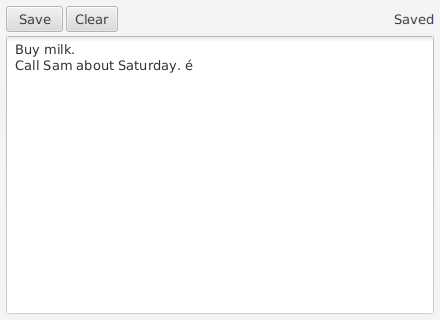
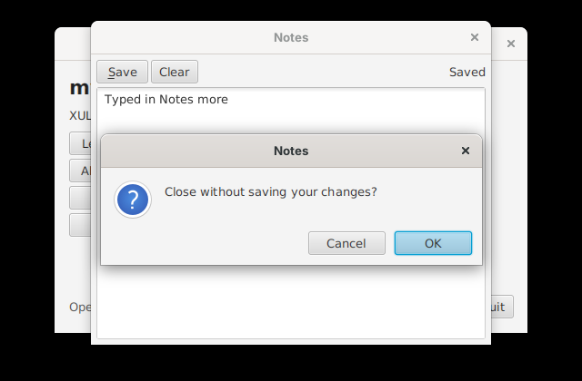

# Building your first app

This tutorial builds **Notes**, an app that keeps one note, saved between runs. Like the apps that come with myxul, it's two plain files: XUL for the window and JavaScript for what it does. There's no Java and nothing to compile. It covers what most apps need: controls and layout, event attributes, a Java service for files, a confirmation dialog, and stopping the window closing while there are unsaved changes. Every step was tested, with the code exactly as it is here.



You need myxul built; see [Getting started](getting-started.md).

## 1. Create the folder

```
site17myxul/apps/notes/
├── notes.xul
└── notes.js
```

## 2. Lay out the window

`notes.xul`:

```xml
<?xml version="1.0" encoding="UTF-8"?>
<?xul-service NativeFileService myxul.service.FileService?>
<window id="notes" title="Notes" width="440" height="320"
        onload="Notes.load()"
        onclose="return Notes.canClose()"
        xmlns="http://www.mozilla.org/keymaster/gatekeeper/there.is.only.xul">

    <script src="notes.js"/>

    <vbox flex="1" spacing="4" style="padding: 6px;">
        <hbox spacing="4" align="center">
            <button label="Save" accesskey="S" oncommand="Notes.save()" tooltiptext="Save the note"/>
            <button label="Clear" oncommand="Notes.askToClear()" tooltiptext="Empty the note"/>
            <spacer flex="1"/>
            <label id="status" value=""/>
        </hbox>
        <textbox id="note" multiline="true" flex="1" oninput="Notes.changed = true"/>
    </vbox>
</window>
```

* The root is **`<window>`**, in XUL's namespace. `title`, `width` and `height` set the window's title and size.
* **`<?xul-service NativeFileService myxul.service.FileService?>`** gives this window's scripts a Java object called `NativeFileService`, for files. Scripts can't reach Java's file classes themselves; see [Scripting](scripting.md#services).
* **`<script src="notes.js"/>`** loads the script. It runs once the window is built, so it can find every element.
* **Boxes** put their children in a column (`<vbox>`) or a row (`<hbox>`). **`flex="1"`** gives an element the spare room: the spacer pushes the status label to the right, and the text box fills the window. **`spacing`** leaves pixels between children; **`align="center"`** centres them across the box.
* **`style="padding: 6px;"`** is web CSS; myxul translates it to JavaFX's (see [Styles](styles.md)).
* **Event attributes** are JavaScript: **`oncommand`** runs when the button is pressed, **`oninput`** each time the text changes. **`accesskey="S"`** underlines the S and makes Alt+S press the button.
* **`onload`** runs once the window is showing, and **`onclose`** when the user closes it: returning `false` keeps it open.

## 3. Write the script

`notes.js`:

```javascript
// Notes: one note, kept in ~/.myxul/notes/notes.txt.
var Notes = {
    changed: false,
    file: NativeFileService.getDataFile("notes.txt"),

    // 1. Show the saved note, if there is one.
    load: function () {
        if (NativeFileService.exists(this.file)) {
            document.getElementById("note").value = NativeFileService.readFile(this.file);
        }
        this.changed = false;
        document.getElementById("status").value = "Ready";
    },

    // 2. Save. writeFile throws if the file can't be written, so catch it.
    save: function () {
        try {
            NativeFileService.writeFile(this.file, document.getElementById("note").value);
            this.changed = false;
            document.getElementById("status").value = "Saved";
        } catch (e) {
            alert("Could not save: " + e.message);
        }
    },

    // 3. Ask before throwing work away.
    askToClear: function () {
        if (confirm("Clear the note? This can't be undone.")) {
            document.getElementById("note").value = "";
            document.getElementById("status").value = "Cleared (not saved yet)";
        }
    },

    // 4. Don't lose unsaved work when the window is closed.
    canClose: function () {
        return !this.changed || confirm("Close without saving your changes?");
    }
};
```

How it works:

1. **`document.getElementById("note")`** gives the element. **`.value`** is XUL's property for a text box's text; myxul reads and sets it on the JavaFX `TextArea` underneath. Anything that isn't a XUL property or method goes to the JavaFX control, so `document.getElementById("note").selectAll()` works too. See [Scripting](scripting.md#elements).
2. **`NativeFileService.getDataFile("notes.txt")`** is a file of this app's own, in `~/.myxul/notes/` (the folder is named after the app's folder). `exists`, `readFile` and `writeFile` read and write it as UTF-8.
3. **Errors from Java** arrive as JavaScript exceptions: `e.message` says why, such as `the folder /x doesn't exist`.
4. **`confirm`** shows a question with OK and Cancel, and returns `true` for OK; **`alert`** shows a message.
5. **`oninput`** sets `changed` whenever the text changes, including when `load` puts the saved note in, which is why `load` sets it back to `false` afterwards.
6. **Closing:** `onclose="return Notes.canClose()"` asks only when there's something to lose.

## 4. Run it

```
./run.sh apps/notes/notes.xul
```

Type something, click **Save**, close the window and open it again: the note is still there. Type some more and close the window: you're asked first.



To change the app, edit `notes.xul` or `notes.js` and open it again. There's nothing to rebuild.

## 5. Add it to the launcher

The launcher is `ui/launcher.xul`, a XUL file like any other. Add a row to its grid:

```xml
<row align="center">
    <button id="open-notes" label="Notes" accesskey="N" oncommand="launch('../apps/notes/notes.xul')"/>
    <label value="One note, kept between runs"/>
</row>
```

## Going further

* **Menus and keyboard shortcuts:** `<menubar>`, `<menu>`, `<menuitem>`, with `<key>` elements for shortcuts and `<command>` elements to share one action between a menu item, a button and a key. Leafpad XUL (`apps/leafpad/`) uses all of them.
* **Lists and trees:** `<listbox>` and `<tree>`, filled from the XUL or from a script with `appendItem()`. See the Gallery (`apps/gallery/`).
* **Drawing:** `<canvas>` gives a JavaFX `Canvas` that resizes with the window, as in AbiWord XUL (`apps/abiword/`).
* **Your own Java:** a service is a Java class in `myxul.service` that implements `XulService`; see [Scripting](scripting.md#services).
* **The full list of elements and attributes:** [XUL reference](xul-reference.md).

## Troubleshooting

When a window can't open, or a script fails, myxul shows the file, the line and the reason, in a dialog and on the console.

| Message | Cause |
| --- | --- |
| `notes.xul:12: Not well-formed XML: The element type "button" must be terminated by the matching end-tag "</button>".` | A tag isn't closed: `<button .../>` needs its `/` |
| `notes.xul:9: Unknown tag <blink>. The tags myxul knows are: ...` | An element myxul doesn't have, or a misspelt one |
| `notes.xul:14: Script error in oncommand: Expected an operand but found )` | A JavaScript syntax error in an event attribute (found when the window opens) |
| `notes.js:7: Script error: ...` | A syntax error in a script file |
| `notes.xul:12: oncommand: ReferenceError: "Notes" is not defined` | A name the script doesn't define, found when the event happens; the window carries on |
| `notes.xul:3: <script src="notes.js">: there is no such file.` | The script's file name is wrong |
| `notes.xul:13: id="note" is used twice: also by <label> on line 11.` | Two elements with one id |
| `java.io.File isn't available to scripts: ...` | A script tried `Java.type` with a class outside JavaFX's UI packages; use a service |
| A style is ignored, with a warning `style "..." isn't supported` | A web CSS property JavaFX has no equivalent for; see [Styles](styles.md) |
