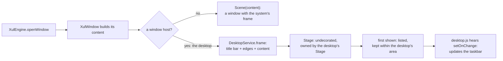

# Engine internals

For people changing myxul itself. The classes are described in [Architecture](architecture.md).

## The box layout

JavaFX's `HBox` and `VBox` can make children grow, but only equally: `Priority.ALWAYS` shares the spare room evenly among the children that have it. XUL shares it by **weight**, so `flex="1"` next to `flex="3"` gets a quarter and three quarters of the spare room. myxul's `XulBox` (a `Pane`) lays out its children the XUL way, in `layoutChildren()`:

1. **Across the box** (height in an `<hbox>`): with `align="stretch"` (XUL's default) each child gets the box's full size; with `start`, `center` or `end`, its preferred size, placed accordingly.
2. **Along the box**: every child starts at its preferred size. The spare room (the box's size, less the children's and the gaps) is handed out in proportion to `flex`. A child that reaches its maximum keeps it, and what it couldn't take is shared again among the rest. If there's too little room, flexing children shrink first, down to their minimum sizes, then the others do.
3. **Packing**: with room to spare and nothing flexing, `pack="center"` or `"end"` moves the children along.

`spacing` puts a gap between children, and a `margin` style (stored on the child) is kept around it.

**Maximum sizes.** A JavaFX `Button`'s maximum size is its preferred size, so a button would never flex or stretch. XUL buttons do. `XulBox` therefore ignores a control's own maximum unless the XUL set one, with `maxwidth`/`maxheight` or `max-width`/`max-height` in a style. Those hold even a flexing child, and clamp its preferred size too.

The box's own preferred and minimum sizes are the children's, added along the box and the largest across it, plus gaps and insets.

**Wrapped text.** A `<description>` (or a wrapping label or button) is taller when it's narrower. A box holding one says so to JavaFX (its *content bias* is horizontal), and works out heights from widths: a column measures its children at its own width, and a row first shares out the widths, then gives a wrapped child the height its text needs at that width. Without this, a description in a narrow column, or a long notification in the desktop's tray, was cut off after one line, which testing showed.

## Splitters

A box with `<splitter>` children isn't built as a `XulBox`: it becomes a JavaFX `SplitPane`, in the box's orientation. The children between splitters are its panes (several children between two splitters are wrapped in a box). The dividers start in proportion to each pane's `flex`, and a pane without flex doesn't grow when the window does.

A `SplitPane` can't hide a pane: it leaves an empty space and a divider. So when a pane is given `hidden` or `collapsed`, myxul takes it out of the split pane, remembering the dividers, and puts it back in its place when it's shown again. That's how AbiWord XUL's **Sidebar** button works.

## Commands

`<command>` elements are found before the window is built, so any element can refer to one. An element with `command="cmd-save"` runs the command's `oncommand` when used, unless it has an `oncommand` of its own. Setting `disabled` on the command (in the XUL, or with `setAttribute`) sets it on every element that uses it.

## Keys

Each `<key>` becomes a JavaFX `KeyCombination`: `key="S"` or `keycode="VK_F3"` (`VK_RETURN` and `VK_BACK` are translated to JavaFX's names), and the `modifiers` (`accel` is JavaFX's Shortcut: Ctrl, or Cmd on macOS).

* A menu item with `key="..."` gets it as its **accelerator**, shown in the menu. Pressing it runs the menu item's command, or the key's own if the item has none.
* Other keys go into the window's **scene accelerators**.
* **Keys without Ctrl, Alt or Meta** (F3, Shift+F3) are also caught by an event filter on the scene, before the focused control sees them. A JavaFX `TextArea` uses up key presses without modifiers, so without the filter F3 never reached the accelerators while typing in Leafpad XUL, which testing showed. A menu item's filter fires the item, so it doesn't run twice.

## Menus and access keys

`accesskey="N"` becomes a JavaFX mnemonic: myxul puts `_` before the letter in the label (and doubles any `_` already there). JavaFX then underlines it and handles Alt+N for buttons, labels and the menu bar's menus.

JavaFX 8 doesn't handle access keys for the items of an open menu: pressing the letter did nothing in the menu, and typed into the text box behind it. So myxul adds them. An event filter watches for a letter while one of the window's menus is open, and chooses the item with that access key (toggling a checkbox item first, as a click would). Submenus are checked before their parents. A letter that matches nothing in the open menu is swallowed, and so is the typed character that follows the key press.

## Stacks

A `<stack>` is `XulBox.Stack`, a `Pane`: a child with `left` or `top` is resized to its preferred size and placed there; the others are stretched over the whole stack. Its preferred size is enough to hold them all. `setAttribute("left", ...)` stores the position on the child's JavaFX node and asks the stack to lay out again, which is how the desktop moves a shortcut while it's dragged.

## Popups and context menus

A `<panel>` is a JavaFX `Popup` holding a vertical `XulBox`. A `Popup` doesn't size its content, so `showPopup` gives the box the window's style sheets, shows the popup, then sizes the box to its preferred size and the popup to the box. `openPopup(anchor, position)` shows it first, so its size is known, then moves it beside the anchor.

A `<menupopup>` in a `<popupset>` is a `ContextMenu`, built with the same code as a menu's items. `context="id"` adds a handler for JavaFX's context-menu event (a right-click, or the menu key) that looks the id up each time, sets `document.popupNode`, and shows the menu at the pointer. Access keys in an open context menu work as in a menu bar's menus (see below).

## Elements made by scripts

`document.createElement` makes a `XulElement` with no JavaFX object. `insertBefore` puts it in the parent's children; if the parent is in the window, it is indexed (its id, and its children's), built by the registry as if it had been in the file, and its JavaFX object is inserted among the parent's, counting only the siblings that have one. `removeChild` does the reverse, and keeps the element's JavaFX object, so it can be appended again. Where a child's object goes depends on the parent's: a `Pane`'s children, a `ToolBar`'s items, a `ScrollPane`'s content, a `Popup`'s box, or a `ContextMenu`'s or `Menu`'s items.

`addEventListener` uses `XulEvents.listen`, which adds a JavaFX event handler (not `setOnAction` and the like, which event attributes use), so listeners and attributes don't replace each other, and `removeEventListener` can take it away again. The newer event attributes (`onmousedown`, `onmousemove`, `onmouseup`, `oncontextmenu`, `onpopupshown`, `onpopuphidden`) go through `listen` too.

## The desktop

While `ui/desktop.xul` is open, its `DesktopService` is the engine's **window host** (`XulEngine.setWindowHost`). Every `XulWindow` made from then on hands its content to the host before its `Scene` is made, and shows what the host gives back: a `Frame`.

* **Each app window is still a `Stage` of its own**, `StageStyle.UNDECORATED` (no system frame) and owned by the desktop's `Stage` (so it stays in front of it). Windows drawn inside the desktop's own scene, as Skylight's web version draws them, would share one scene: their menu accelerators, mnemonics and scene-wide key filters would clash (two Leafpads both want Ctrl+S). As separate stages, every window keeps its keys, menus and dialogs exactly as it has them anywhere else, and needs nothing changed.
* **The frame** is a `BorderPane`: the title bar on top (the app's icon, the title, bound to the stage's, and minimize, maximize and close buttons), the app's content in the middle, and 4-pixel edges whose mouse handlers resize the stage. Dragging the title bar moves the stage, keeping the bar on the desktop. The `:active` and `:maximized` pseudo-classes, styled in `myxul.css`, darken the frame of the window being worked in and drop the edges of a maximized one.
* **Minimize** is `XulWindow.setMinimized(true)`: the stage is hidden, and the window ignores the hiding (it would otherwise count as closed). **Close** is `XulWindow.requestClose()`, which runs `onclose` as the system's close button would.
* **The active window** is the one whose stage last had the keyboard, unless it was minimized since. Clicking the desktop's taskbar gives the desktop's stage the keyboard, so the taskbar shows the window that had it before, which is the one a click on its button should minimize.
* **The desktop's area** (the `<stack>` below the panel, given with `setArea`) is measured on screen when needed: windows open in a cascade inside it, are made smaller if they don't fit, and maximize to it; `NotificationService` puts its notifications at its top right.
* A window is listed (and the script told) when it is first shown, so a window whose XUL has a mistake, which is never shown, never appears. When the desktop closes, it stops being the host, and windows are plain again. If the desktop's own XUL has a mistake, it never shows, and the next window opened finds that and clears the host.

## Scripts

Each window's `XulScriptManager` makes a Nashorn engine with `NashornScriptEngineFactory.getScriptEngine(args, loader, classFilter)` (available since Java 8u40), with `--language=es5`. The class filter lets `Java.type` see only JavaFX's UI packages, and with a class filter present Nashorn also refuses Java reflection.

**Event attributes** are compiled once each, when the window is built, by evaluating `(function (event) {\n` + code + `\n})` with the file name set to `leafpad.xul (oncommand on line 23)`. The design spec's first idea was to evaluate the code with fresh `Bindings` holding `event`. That runs against a new, empty set of globals, so the window's own functions aren't defined; the spec's review found this, and testing confirmed it. Errors in the compiled code report their line within the attribute, which myxul adds to the element's line.

**Inline `<script>` text** is padded with blank lines so that error line numbers are the .xul file's.

**Element wrappers** are Nashorn `JSAdapter` objects (made in `bootstrap.js`): `__get__`, `__put__` and `__call__` hooks that send XUL property and method names to the `XulElement` and other names to its JavaFX object. Each element keeps its wrapper, so `===` works. Calls to Java methods go through a small switch on the number of arguments, since Java methods in Nashorn have no `apply`.

## Errors

Everything that can go wrong in a XUL file is a `XulException` with the file and line: XML errors (from SAX's line), unknown tags and bad attributes (from the element's line), script syntax errors (from Nashorn's line within the script or attribute). `XulEngine.report` puts it in its error list, prints it as `myxul: file:line: message`, and shows it in a dialog. Warnings (styles that were ignored, a missing XUL namespace) are printed and listed, but don't stop anything.

Nashorn's messages are tidied: the location it appends (`in file at line number n`) and the source line and caret of syntax errors are dropped, since myxul gives the file and line itself. A Java exception from a service keeps its class name (`NoSuchFileException: ...`) unless the service gave it a readable message.

## Extending myxul

* **A new tag:** add a builder in `XulRegistry`'s constructor (`builders.put("mytag", (e, w) -> ...)`) returning the JavaFX object; attributes every element shares are applied for you. If the tag has attributes scripts should be able to change, handle them in `applyAttribute`.
* **A new event attribute:** wire it in `XulEvents.wire`, calling the compiled handler with the element and an event.
* **A new service:** a class in `myxul.service` implementing `XulService`, with a public constructor taking the `XulWindow`; its public methods are what scripts can call.
