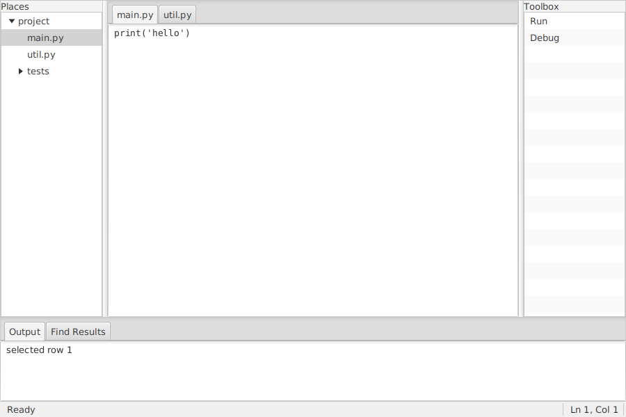

# Testing against real-world XUL

The design spec suggests testing myxul against the XUL of established applications, SeaMonkey Composer and Komodo Edit, in three stages: core layout, then Mozilla's own mechanisms stripped out, then events and scripts.

## What was tested

No files from SeaMonkey or Komodo were used. Instead, `site17myxul/tests/xul/` has two test files **written for myxul in the style of those applications**: their element structure, ids and patterns, not their actual files.

| File | In the style of | What it exercises |
| --- | --- | --- |
| `composer-toolbar.xul` | SeaMonkey Composer's editor chrome | Stage 1: a `<toolbox>` and `<toolbar>` holding an `<hbox align="center" flex="1">` of `<toolbarbutton>`s with `tooltiptext`, and a `<vbox flex="2">` with a label and a `<menulist>` (the spec's own snippet, filled in). Stage 2: `command="cmd_bold"` hooks, which in Mozilla went to XPCOM, here to `<command>` elements running JavaScript; a disabled command disabling its button. Stage 3: `oncommand="window.close();"` |
| `komodo-workbench.xul` | Komodo Edit's `komodo.xul` workbench | Two `<splitter>`s between a file tree, an editor area and a toolbox (three resizable panes, dividers at flex 1 : 4 : 1); a `<tabbox>` of editors (`wrap="off"`, monospace); a nested `<tree>` whose `onselect` writes to a read-only output box in a bottom `<tabbox>`; a `<statusbar>` |

Both open without changes and behave as described; the automated tests check each point (see [Limitations](limitations.md#how-it-was-tested)).

## Real XUL files

Taking XUL from a real Mozilla application, the stages the spec describes still apply:

1. **Core layout first.** Copy a structural piece (toolbars, boxes, a dialog's controls) into a `<window>` and open it. Elements myxul doesn't know are reported with their line; the error lists the elements it does know.
2. **Strip Mozilla's mechanisms.** myxul has no overlays, so a file whose root is `<overlay>` is refused (`A XUL file's root must be <window> or <dialog>, not <overlay>`): merge overlays into one file by hand. Entities from DTDs (`&editor.bold.label;`) need replacing with text, since myxul refuses DOCTYPEs. `command="cmd_..."` attributes need a `<command>` with that id, written in JavaScript. `chrome://` URLs, XBL bindings (`-moz-binding`), `<stringbundle>` lookups and XPCOM calls (`Components.classes[...]`) have no equivalent.
3. **Then the events and scripts**, which will mostly need rewriting: Mozilla's scripts use XPCOM and the DOM far more than myxul offers.

## Other XUL applications worth trying

The spec lists more applications with distinctive layouts: Songbird and Nightingale (media library grids, sliders), Zotero's older XUL releases (a three-pane collection tree, item list and detail pane), Google AdWords Editor (dense data forms), BlueGriffon and KompoZer (many dialogs and pickers), and Celtx. None of them was tried.
