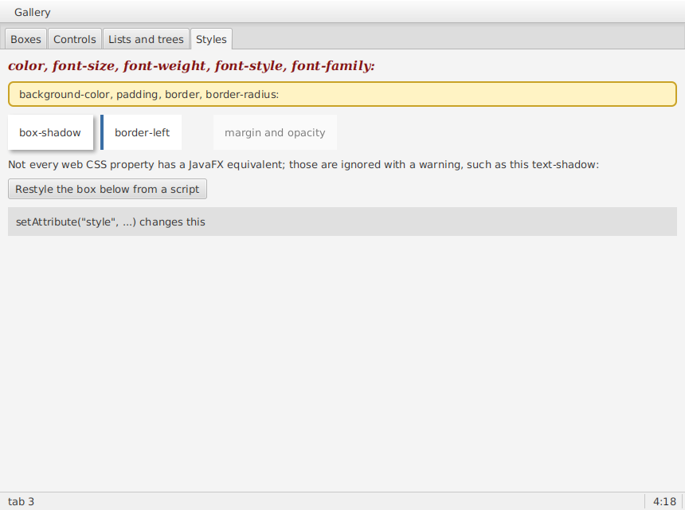

# Styles

XUL elements carry inline web CSS: `style="font-family: monospace; padding: 6px;"`. JavaFX also styles with CSS, but its own: its properties start with `-fx-` and some work differently, so myxul translates each declaration. A declaration it can't translate is ignored, with a warning naming the file, line and property.



## What's translated

| Web CSS | JavaFX | Applies to |
| --- | --- | --- |
| `color` | `-fx-text-fill` | Labels, buttons, text boxes |
| `background`, `background-color` | `-fx-background-color` | Boxes and controls (any Region) |
| `font-family` | `-fx-font-family`; `monospace` becomes JavaFX's `monospaced`, other names are quoted | Everything with text |
| `font-size` | `-fx-font-size` (`14px`, `10pt`; a bare number is pixels) | |
| `font-weight`, `font-style` | `-fx-font-weight`, `-fx-font-style` | |
| `padding` | `-fx-padding` (1 to 4 values, as in CSS) | Regions |
| `border`, `border-top`, `-right`, `-bottom`, `-left` | `-fx-border-color`, `-fx-border-width`, `-fx-border-style`: `1px solid #ccc` | Regions |
| `border-radius` | `-fx-border-radius` and `-fx-background-radius` | Regions |
| `opacity` | `-fx-opacity` | |
| `margin` | A margin in the box (1 to 4 values) | Children of boxes |
| `width`, `height`, `min-width`, `min-height`, `max-width`, `max-height` | Preferred, minimum and maximum sizes | Regions |
| `box-shadow: 2px 2px 5px rgba(0,0,0,0.3)` | A `DropShadow` effect: x and y offset, blur, colour | |

Colours are passed through as they are: JavaFX understands `#rgb`, `#rrggbb`, `rgb()`, `rgba()` and colour names.

## What isn't

Everything else: `text-shadow`, `text-align`, `display`, `position`, `float`, `line-height`, `-moz-` properties and so on. Some have no JavaFX equivalent; others work differently in a box layout. myxul warns rather than failing:

```
myxul warning: gallery.xul:198: style "text-shadow: 1px 1px 2px gray" isn't supported on Label, so it was ignored.
```

A declaration that JavaFX can't use on that kind of node, such as `padding` on an image or `color` on a box, is ignored with the same warning.

## Changing styles from a script

```javascript
document.getElementById("restyled").setAttribute("style", "background-color: #d7e6ff; padding: 16px;");
```

replaces the element's whole style (and its shadow, if it had one) with the new one.

## Stylesheets

myxul has no stylesheet support for XUL files: no `<?xml-stylesheet?>`, so each element carries its own `style`. Its own default look for status bars and toolbar buttons is `myxul.css`, inside `myxul.jar`, and `class="..."` adds JavaFX style classes that a stylesheet could use.
