# User guide

## The launcher

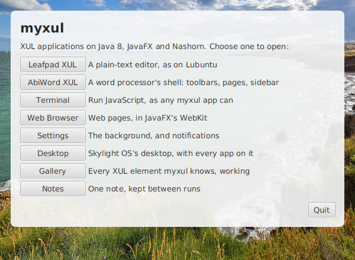

`./run.sh` opens the launcher. Its buttons open **Leafpad XUL**, **AbiWord XUL**, the **Terminal**, the **Web Browser**, **Settings** and the **Gallery**, each in a window of its own, and the **Desktop**; Alt with the underlined letter does the same. Behind it is the background chosen in Settings, which changes as soon as a new one is chosen. **Quit** closes the launcher. myxul exits when its last window closes, so the apps you opened stay open until you close them too.

The launcher is `ui/launcher.xul`, a XUL file like the apps; add your own apps to it (see [Building your first app](building-apps.md#5-add-it-to-the-launcher)).

## The desktop

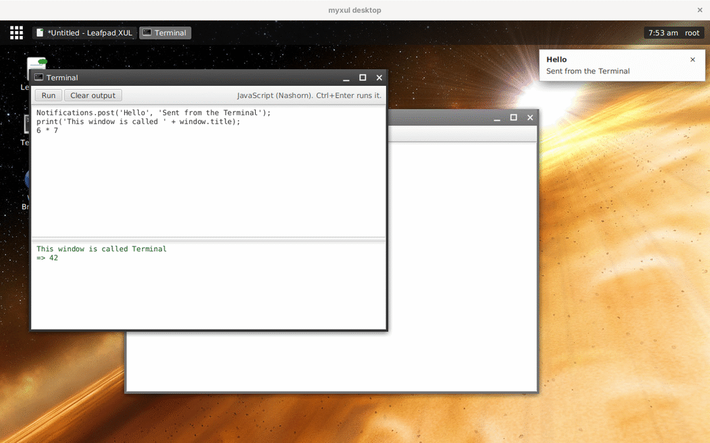

`./run.sh ui/desktop.xul` (or the launcher's **Desktop** button) opens Skylight OS's desktop, filling the screen. There's no login and no logout: myxul runs as you, so the desktop is yours as soon as it opens, and the clock shows your user name.

| Part | Where | What it does |
| --- | --- | --- |
| Background | the whole desktop | The picture chosen in Settings; a new one shows at once |
| Home button | top left (the grid) | Opens and closes the home menu; Alt+H does the same |
| Taskbar | along the top, after the home button | A button for each open window, with its icon and title. The window you're working in has its button pressed. Click a button to bring its window to the front; click the front window's button to minimize it, and again to bring it back. Right-click for **Close** |
| Clock | top right | The time, then your user name |
| Shortcuts | top left of the background | Double-click to open the app. Drag one to move it (it stays there next time); right-click for **Open** and **Remove from desktop** |
| Notifications | top right, below the panel | Notifications appear here, and go into the tray |

### The home menu

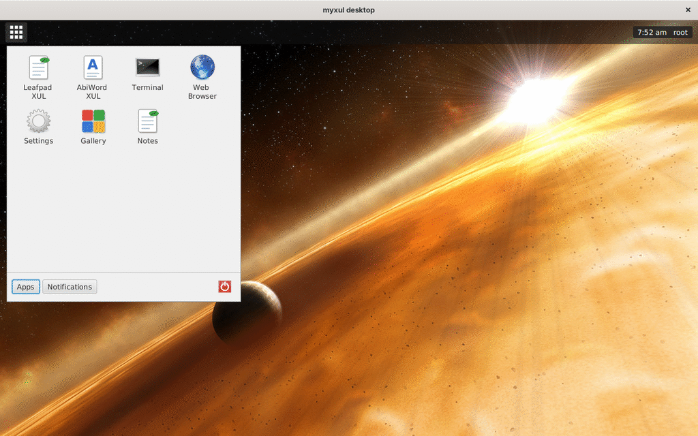

* **Apps** shows every app in `apps/apps.txt`, four to a row, with its icon; hover for what it does, click to open it. Right-click an app for **Open** and **Add to desktop**, which gives it a shortcut.
* **Notifications** is the notification tray: every notification since the desktop opened, newest first. The **×** beside one removes it; **Clear** removes them all. The button counts them: **Notifications (2)**.
* The red **power button** closes every window and then the desktop. A window with unsaved changes asks first, as its close button would; if you say **Cancel**, that window comes to the front and the desktop stays.

Clicking anywhere outside the menu, or Escape, closes it.

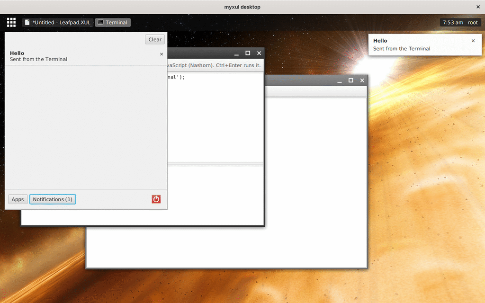

### Windows on the desktop

Every app opened on the desktop, from the home menu, a shortcut, or another app (`window.open`), gets Skylight's window frame:

* **The title bar** shows the app's icon and the window's title (with Leafpad's `*` for unsaved changes). Drag it to move the window; double-click it to maximize. The window you're working in has a darker frame.
* **Minimize** hides the window; its taskbar button brings it back. **Maximize** fills the desktop below the panel; click again to put it back. **Close** closes it as the system's close button would, so Leafpad still asks about unsaved changes.
* **The edges** resize the window: drag the left, right or bottom edge, or a bottom corner.
* Windows stay on the desktop: they open in a cascade from the top left, no bigger than the desktop, and can't be dragged above the panel.

Keys, menus and dialogs work as they do in a window of its own: each app's window is still a window, drawn without the system's frame. See [Engine internals](engine-internals.md#the-desktop) for how.

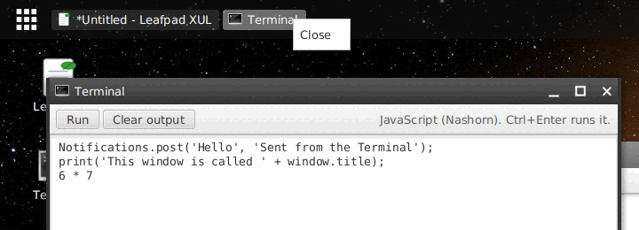

Settings and shortcuts are kept in `~/.myxul/settings.properties`, with the other settings. To put your own app on the desktop, see [Building your first app](building-apps.md#6-put-it-on-the-desktop).

## Leafpad XUL

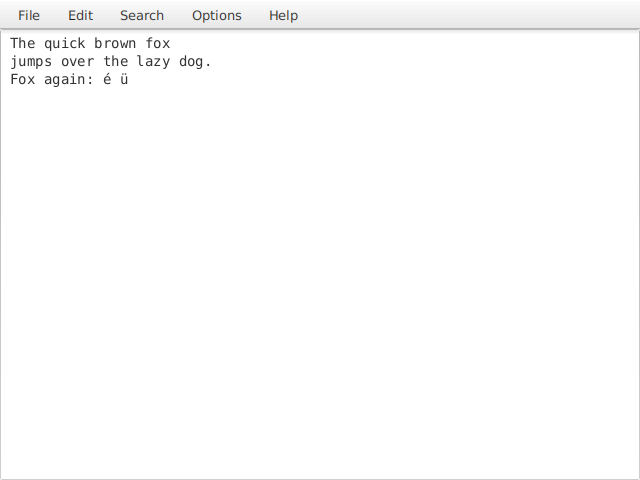

A plain-text editor in the spirit of Lubuntu's Leafpad. The title shows the file's name, with a `*` when it has unsaved changes.

| Menu | Item | Key |
| --- | --- | --- |
| File | New, Open..., Save, Save As..., Quit | Ctrl+N, Ctrl+O, Ctrl+S, Ctrl+Shift+S, Ctrl+Q |
| Edit | Undo, Redo, Cut, Copy, Paste, Delete, Select All | The text box's own keys work too, such as Ctrl+Z, Ctrl+X, Ctrl+C, Ctrl+V and Ctrl+A |
| Search | Find..., Find Next, Jump To... | Ctrl+F, F3 |
| Options | Word Wrap, Monospace Font | |
| Help | About | |

* **Open** and **Save As** use the system's file dialogs (on Linux, GTK's). Files are read and written as UTF-8.
* **New**, **Open**, **Quit** and the window's close button ask before throwing away unsaved changes.
* **Find** asks for the text and selects the next match after the cursor, going back to the top when it reaches the end; **Find Next** (F3) looks for the same text again. Matches are case-sensitive.
* **Jump To** moves the cursor to the start of a line.
* `./run.sh apps/leafpad/leafpad.xul notes.txt` opens `notes.txt`, or starts a new file of that name, which **Save** writes without asking.
* With a menu open, the underlined letter chooses an item, and the arrow keys and Enter work as usual.

## AbiWord XUL

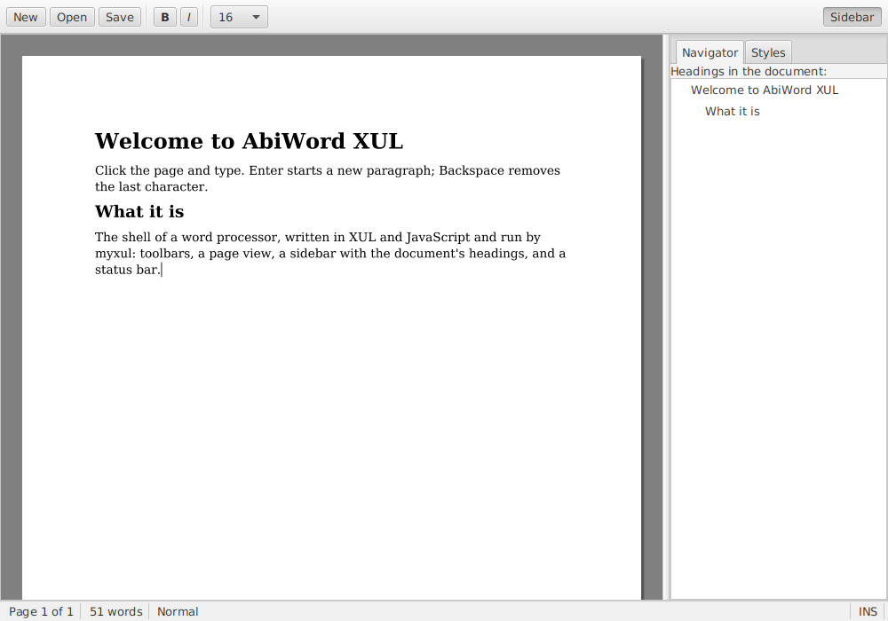

The shell of a word processor: the layout of a real one, around a simple document engine.

* **Click the page and type.** Enter starts a new paragraph; Backspace removes the last character. Typing always goes to the end of the document: there's no cursor to move and no selection.
* **B** and **I** (or Ctrl+B and Ctrl+I) make the whole document bold or italic; the size list sets its size.
* **Styles** (in the sidebar) sets the style of the paragraph you're typing: Normal, Heading 1 or Heading 2. **Navigator** lists the document's headings.
* **Sidebar** hides and shows the sidebar; the splitter between the page and the sidebar can be dragged.
* The **status bar** shows the number of pages, words, and the current paragraph's style.
* **New**, **Open** and **Save** (or Ctrl+N, Ctrl+O, Ctrl+S) work with text files: each paragraph a line, headings starting with `# ` or `## `, so a saved document opens with its headings again.

## Terminal

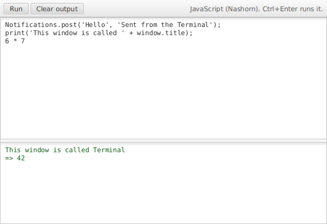

Ported from Skylight OS. Type JavaScript and click **Run** (or press Ctrl+Enter). The code runs in the Terminal window's own Nashorn engine, the same as any myxul app's scripts, so it can try anything an app can:

```javascript
Notifications.post('Hello', 'Sent from the Terminal');
print('This window is called ' + window.title);
6 * 7
```

`print` writes to the output box, the result of the last line is shown (`=> 42`), and errors are shown as `Error: ReferenceError: "nope" is not defined`. Variables you set stay for later runs. The Terminal has the `Notifications`, `Settings` and `NativeFileService` services, and `document` and `window` are its own. **Clear output** (Ctrl+L) empties the output box; the splitter between the boxes can be dragged.

## Settings

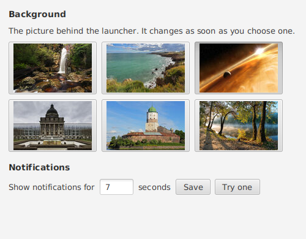

Ported from Skylight OS.

* **Background**: click a picture (hover to see its name). The launcher's and the desktop's background changes at once, and is remembered; the picture in use stays pressed.
* **Notifications**: how many seconds notifications stay on screen (1 to 60). Click **Save**, or press Enter; **Try one** shows one.

Settings are kept in `~/.myxul/settings.properties`, for every app.

### Notifications

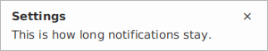

Apps can post notifications (the Terminal's sample does, and so does Settings when it saves). Each appears at the top right of the screen (on the desktop, of the desktop, below its panel) with a header and a body, and closes itself after the time set in Settings, or when its **×** is clicked. Several stack downwards. On the desktop they're also kept in the home menu's notification tray.

## Web Browser

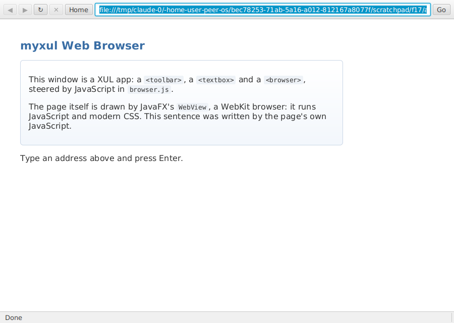

Ported from Skylight OS. Type an address and press Enter or click **Go** (`http://` is added if you leave it out). **◀** and **▶** (Alt+Left and Alt+Right) go back and forward, **↻** (F5) reloads, **✕** stops a page loading, **Home** goes back to the start page, and Ctrl+L puts the cursor in the address bar. The status bar says when a page is loading, done, or couldn't be loaded, and the title is the page's.

Pages are drawn by JavaFX's `WebView`, a WebKit browser that runs JavaScript and CSS. It is JavaFX 8's WebKit (its user agent says `AppleWebKit/604.1`, the WebKit of Safari 11, from 2017), so some current websites may not work fully.

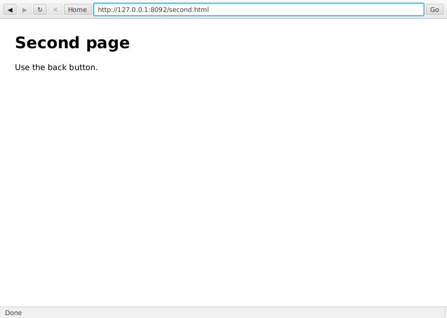

## Gallery

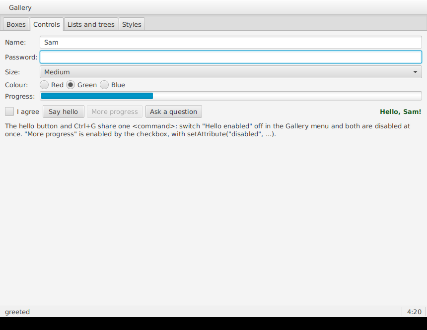

Every XUL element myxul knows, each doing something, on four tabs: **Boxes** (flex weights, `pack`, `align`, `maxwidth`, a splitter), **Controls** (text boxes, a password box, a drop-down list, radio buttons, a progress meter, a checkbox, buttons sharing a command with Ctrl+G, dialogs), **Lists and trees**, and **Styles** (web CSS translated to JavaFX). What happens is shown in the status bar, with a clock that a script updates.

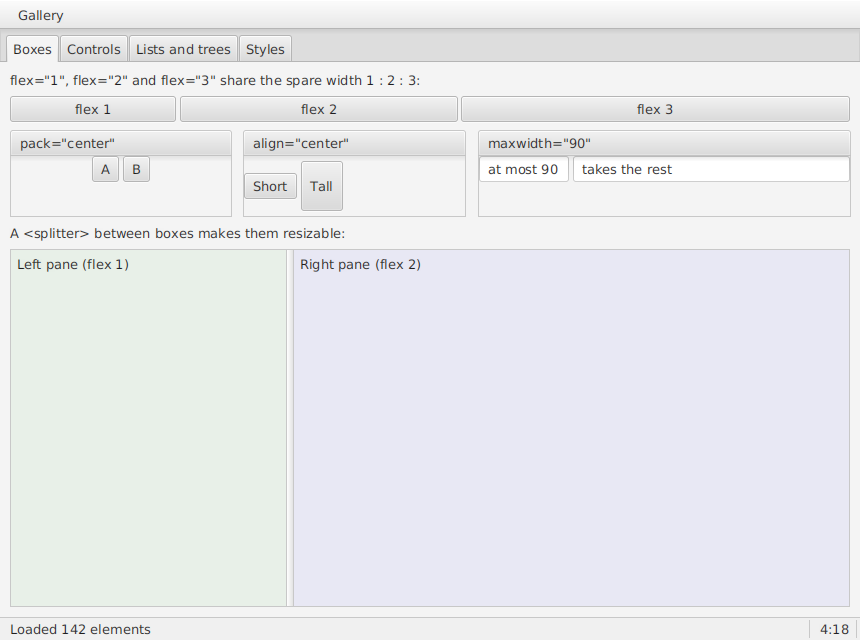
