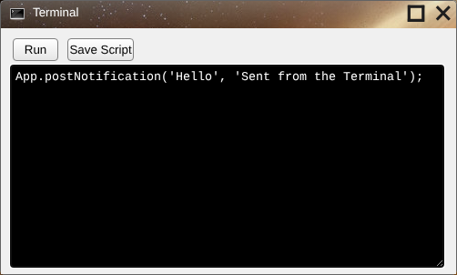
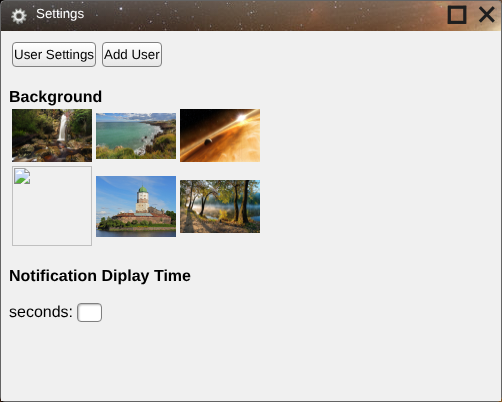
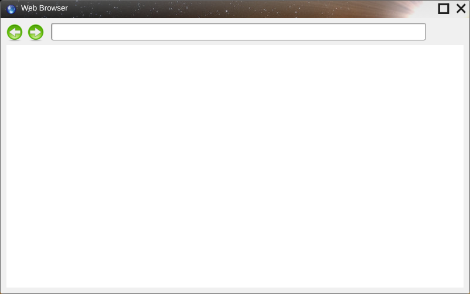

# Built-in Apps

These apps ship in `siteroot` and appear in the home menu (see [Configuration Files](Configuration-Files.md)). Their source is a good place to learn how apps are written.

## Terminal

[`apps/default/terminal/`](../siteroot/apps/default/terminal/)

A JavaScript console. Type code in the black box and click **Run**; it runs inside the Terminal's window, so the whole [App Object](App-Object.md) is available. If the code throws an error, the error is added to the end of the text as a comment. It is the easiest way to try App functions, for example `App.openWindow('apps/default/web browser/');`.

* **Save Script** does nothing (the button's id is misspelled, so no handler is attached).
* Running the text `qwerty` shows an easter egg dialog.
* The folder contains its own `js/app.js`, which isn't used.

## Settings

[`apps/default/settings/`](../siteroot/apps/default/settings/)

* **Background:** click a picture to make it the desktop background. The choice is applied immediately with [App.setBackground](App.setBackground.md) and saved in the user's settings file through `saveFile.php`. If the save is refused (see [Known Issues](Known-Issues.md#server)), the app doesn't say so and the old background returns at the next login. The fourth picture is missing on servers with case-sensitive file names, because the file is `desktop_4.JPG`.
* **Notification Display Time:** not implemented; typing a value has no effect.
* **Add User:** opens a form for a username and password, but **Save** does nothing. Switching to this page loses the window's AppID and username (it uses `location.assign` instead of [App.gotoLocation](App.gotoLocation.md)).

## Web Browser

[`apps/default/web browser/`](../siteroot/apps/default/web%20browser/)

Type a full address (including `https://`) and press Enter to load it in the frame below. The arrows go back and forward. Limitations come from the browser it runs in:

* Many sites refuse to be shown inside a frame and load as a blank page.
* Back and forward only work for pages on the same site as Skylight OS; for other sites the browser blocks them.
* The address box doesn't update as you follow links.

## Dialog

[`system/components/dialog/`](../siteroot/system/components/dialog/). The window behind [App.openDialog](App.openDialog.md). See [Dialogs](Dialogs.md).

## Save File

[`system/components/save dialog/`](../siteroot/system/components/save%20dialog/). An unfinished file browser. See [Save File Dialog](Save-File-Dialog.md).

---

_New page, written from the `siteroot` code. Not on the SourceForge wiki._

_Updated after the `system/server` scripts were added to `siteroot`._
