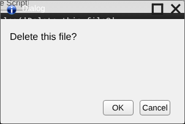

## Buttons

Default button: 


Regular Button: 


A regular button is made simply by creating any default HTML element such as

```
<input type="submit"/>
<input type="reset"/>
<button></button>
```

A default button is made by adding the class "default":

```
<input type="submit" class="default"/>
<input type="reset" class="default"/>
<button class="default"></button>
```

If you want to imply urgency, you can make the button hop up and down by adding the class "pulse".  You should only use the pulse class in conjunction with the default class.

```
<input type="submit" class="default pulse"/>
<input type="reset" class="default pulse"/>
<button class="default pulse"></button>
```

> **In `siteroot`:** only regular buttons exist. [`ui.css`](../siteroot/system/css/ui.css) styles `<button>` and `<input>` elements of type `button`, `submit` and `reset` with a white-to-grey gradient, rounded corners and a grey border, and reverses the gradient while the button is pressed. It has **no `default` or `pulse` classes**: adding them changes nothing. (The Dialog's OK button carries the `default` class but looks the same as Cancel.) The screenshots above are from a later release.
>
> 

---

_Source: [Buttons](https://sourceforge.net/p/skylightos/wiki/Buttons/) on the SourceForge wiki · Labels: button, UI · Last modified 2014-01-21_

_Updated after reviewing the `siteroot` code._
